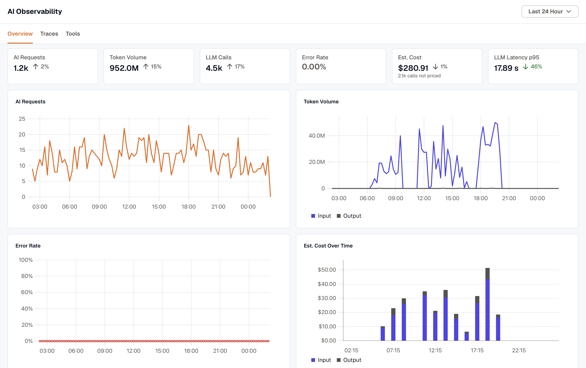
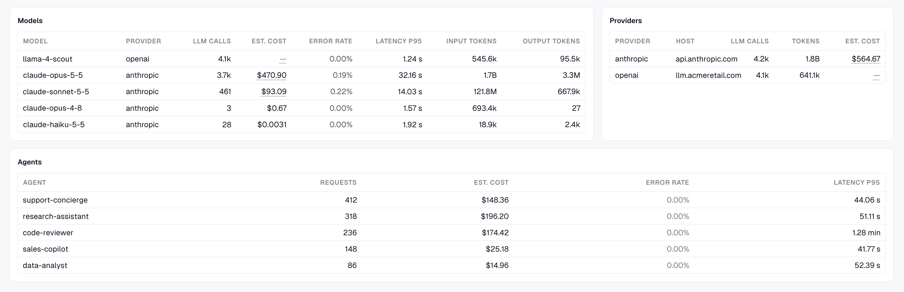
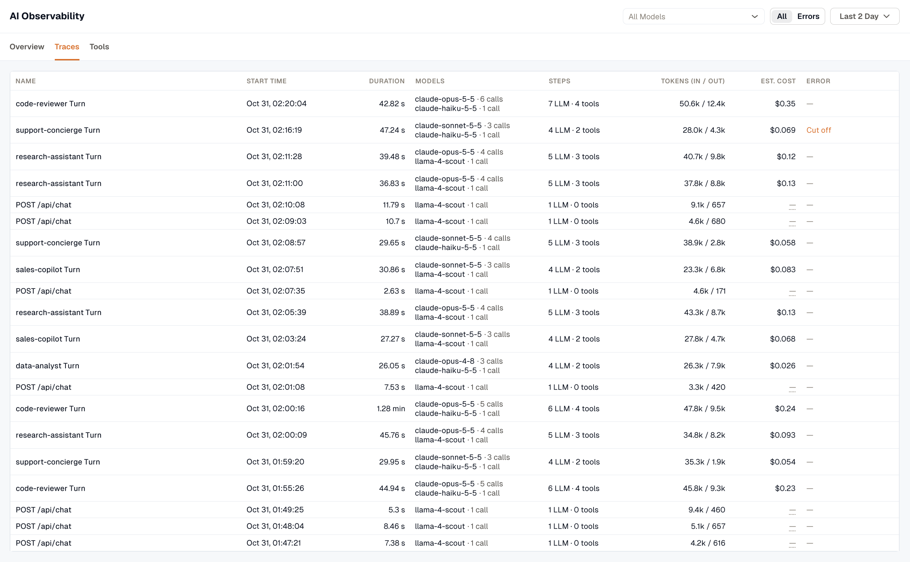
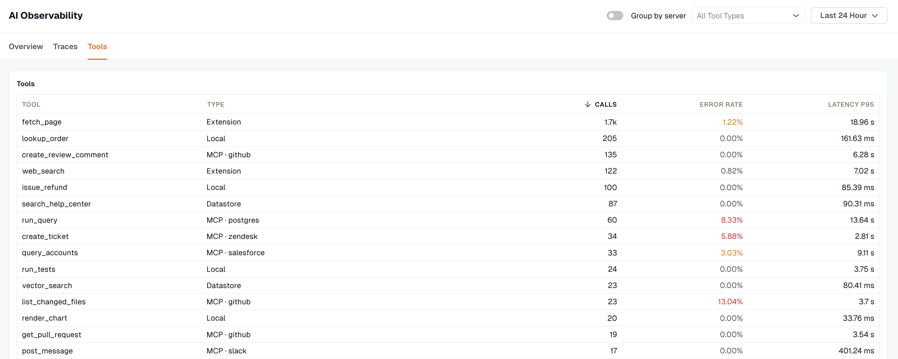
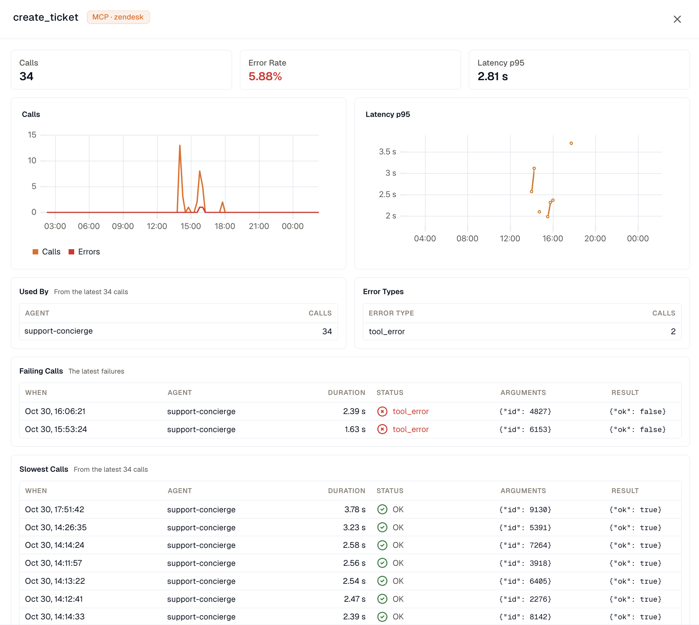

Use **Overview** for trends and breakdowns, **Traces** for individual runs, and **Tools** for tool calls. All tabs share one time range, which defaults to the last 24 hours.

## Overview

**Overview** shows how much work your AI apps did in the selected range, what it cost, and how much of it failed. Each tile compares against the previous period of the same length.

| Tile | What it counts |
| --- | --- |
| **AI Requests** | Runs your AI apps handled from start to finish. See [How runs are built](#how-runs-are-built). |
| **Token Volume** | Input plus output tokens across all LLM calls. |
| **LLM Calls** | Individual requests to a model. One AI request can make many LLM calls. |
| **Error Rate** | Failed runs as a share of all runs. A step the agent recovered from, such as a tool that failed once and succeeded on retry, doesn't count as a failure. |
| **Est. Cost** | The estimated price of every LLM call in the range. See [How cost is estimated](#how-cost-is-estimated). |
| **LLM Latency p95** | The time 95% of individual LLM calls finish within, from the request to the last token. Long answers take longer, so this tracks output length as well as model speed. |

**N LLM calls cut off** counts model calls that hit their max-token limit, so their answers may be incomplete. **N calls not priced** counts calls whose model or provider has no known price.

When 1,000 or more traces in the range contain failures, the error rate is calculated from the 1,000 with the most failures and shown with a `≥` prefix, meaning the real rate is at least that high.

### Trend charts

- **AI Requests** and **Token Volume** (input and output).
- **Error Rate**. A failed run counts in the interval it started in.
- **Est. Cost Over Time**, stacked into input, output, and any other cost such as a per-request fee.
- **LLM Latency per Call** at p50 and p95.
- **Cache Hit Rate**, the share of input tokens read from the provider's prompt cache. A falling cache hit rate usually means a prompt prefix changed and the cache stopped matching.

A run that spans several intervals counts in each of them, so the bars on the **AI Requests** chart can add up to more than the tile.

### Models, Providers, and Agents

- **Models** lists the 10 models with the most calls, with each model's provider, LLM calls, estimated cost, error rate, p95 latency, and input and output tokens. Models that report reasoning tokens also get a **Reasoning** column. The same model served by two providers, for example `gpt-4o-mini` through OpenAI and through OpenRouter, appears as two rows.
- **Providers** groups LLM calls by provider and API host. The host tells you when calls go through a gateway: a call with provider `openai` and host `openrouter.ai` was sent to OpenRouter with an OpenAI model.
- **Agents** lists the 10 busiest agents with their requests, estimated cost, error rate, and p95 latency. It appears only when your agent spans carry `gen_ai.agent.name`. An agent's cost shows a dash when its LLM calls don't carry the agent's name.

## Traces

**Traces** lists the runs in the selected range, newest first. Filter the list by model with **All Models**, or select **Errors** to show only runs with a failed span.

| Column | Shows |
| --- | --- |
| **Name** | The run name. See the naming rules below. |
| **Start time** | When the run started. |
| **Duration** | How long the run took, with its status if it hasn't finished. See [Run status](#run-status). |
| **Models** | The models the run called and how many times, for example `claude-opus-5-5 · 8 calls`. |
| **Steps** | The number of LLM calls and tool calls, for example `8 LLM · 14 tools`. |
| **Tokens (In / Out)** | Input and output tokens across the run's LLM calls. |
| **Est. Cost** | The estimated cost of the run's LLM calls. |
| **Error** | The error type when the run failed. **Cut off** means the run's last LLM call hit its max-token limit, so the final answer may be partial. |

Select a run to open its trace. For a turn, that's the trace with the agent span; otherwise it's the run's busiest trace. [Agent Traces](../agent-traces/) covers the AI views in trace detail.

### How runs are built

A run is one request your AI app handled, which can span more than one trace:

- A trace that contains an agent span (`invoke_agent`) is a **turn**, and starts a run.
- A trace without an agent span joins the nearest earlier turn with the same `gen_ai.conversation.id`, or the next one if none came before. If the conversation has no turns at all, its traces form one run.
- A trace without a conversation ID is a run of its own.

Runs are named, in order of preference, after the agent (**Claude Code Turn**, or **Agent Turn** when the agent has no name), the workflow name, the root span of your application, the most-called model (**Chat · gpt-4o-mini**), or the tool (**Tool · lookup_order**).

### Run status

A run that hasn't finished shows its status under **Duration**. For a relative time range, open runs update every 15 seconds.

| Status | Meaning |
| --- | --- |
| **Running** | The run had activity in the last 2 minutes. |
| **Waiting** | The run hasn't finished and has been quiet for 2 to 10 minutes. It's usually waiting on a slow tool or on input from a person. |
| **Incomplete** | The run's outer span never arrived: the run started before the range, or it has been quiet for more than 10 minutes. It may still be sending, or it stopped without finishing. Totals cover only the part inside the range. |

**Incomplete** isn't an error. If a run you expect to see is incomplete, widen the time range so it covers the start of the run.

## Tools

**Tools** lists the tools your agents called in the range, with each tool's type, call count, error rate, and p95 latency. Filter by type with **All Tool Types**.

| Type | Meaning |
| --- | --- |
| **Local** | A function that runs in your application's own code. |
| **MCP** | A tool called through an MCP server. The server name appears after the type when the instrumentation sends it, for example **MCP · github**. |
| **Extension** | A tool that calls an external API directly, without MCP. |
| **Datastore** | A tool that queries a data store, for example a search or RAG lookup. |

When your MCP tool calls carry a server name, turn on **Group by server** to add a subtotal row for each MCP server and compare their error rates and call counts.

The same tool name can appear on more than one row. For example, a `get_weather` function your app runs locally and a `get_weather` tool on an MCP server are counted separately.

### Tool detail

Select a tool to see its calls and errors over time, along with:

- **Used By**, the agents that called the tool, from the latest 100 calls.
- **Error Types**, the failed calls grouped by `error.type`.
- **Failing Calls** (the latest 10) and **Slowest Calls** (from the latest 100 calls), each with the agent, duration, status, arguments, and result. Arguments and results appear only when your instrumentation captures tool content.

Select a call to open its trace at the tool span.

## How cost is estimated

KloudMate prices each LLM call when its span arrives, from the call's token counts and the provider's public list price. Prices come from the open-source [genai-prices](https://github.com/pydantic/genai-prices) dataset, which prices more than 1,200 models.

- The provider is taken from the API host first, so a call sent through OpenRouter is priced at OpenRouter's rate.
- The model is the one the provider reports in its response, or the requested model when the response doesn't name one.
- Cached input tokens are priced at the provider's cache rates, and reasoning tokens are priced as output.
- If your framework already reports a cost on the span, as Pydantic AI does, KloudMate keeps that value.

Costs are estimates and won't match your invoice exactly. They don't include negotiated discounts, committed-use pricing, or batch discounts. Calls to self-hosted models, private gateways, and models the dataset doesn't list count as **calls not priced**.

## Related resources

- [AI Observability overview](../)
- [Send GenAI traces](../send-genai-traces/)
- [Agent Traces](../agent-traces/)
