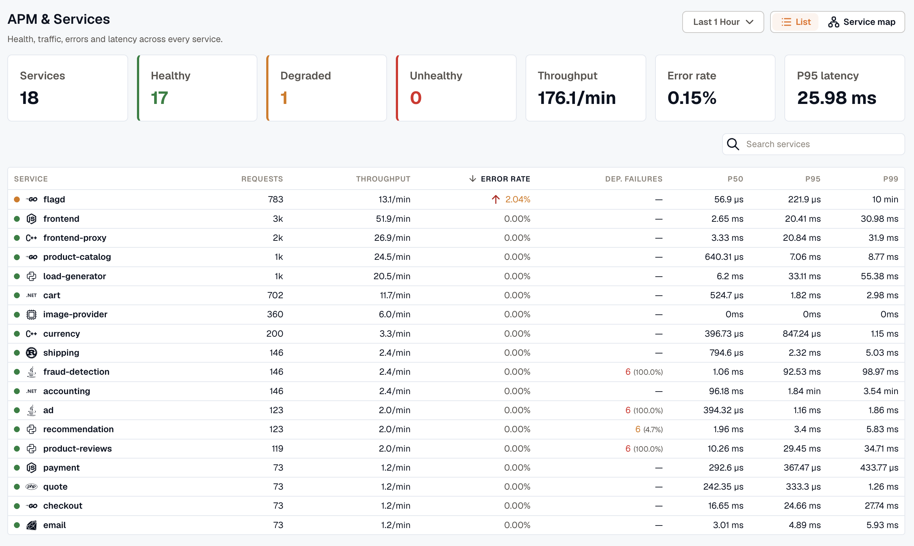
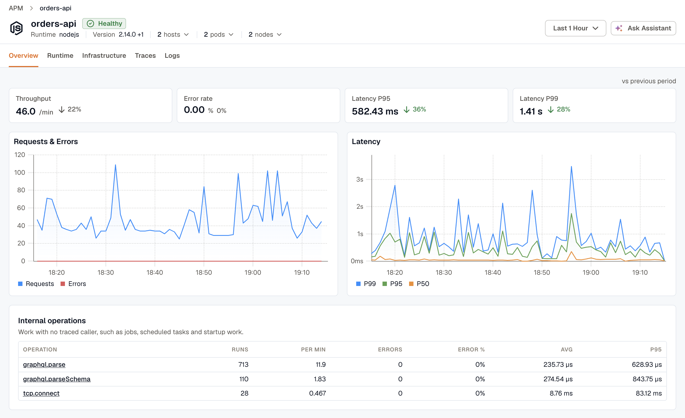
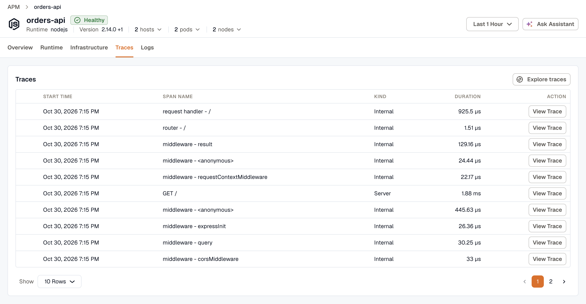
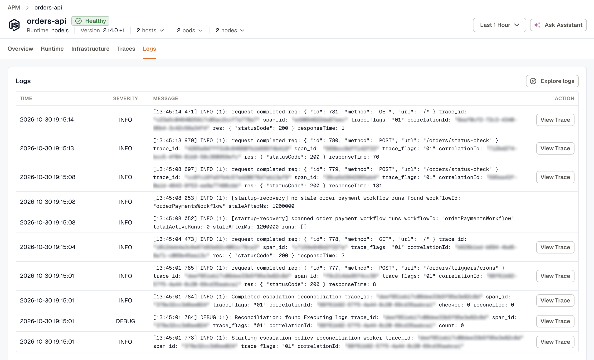

Open **APM & Services** to compare application and service performance at a glance. It opens in the **List** view. Select the **Service map** view to see how your services connect, as described in [Service Map](../service-map/).

## Services Overview

The **List** view shows all instrumented applications and services in a table, so you can compare their health across the selected time range.

Each row represents one service and includes:

- **Service:** the application or service name
- **Requests:** total requests handled during the selected time range
- **Throughput:** request rate, such as requests per minute
- **P99, P95, and P50 latency:** percentile-based latency views for worst-case, upper-percentile, and median performance
- **Error rate:** percentage of failed requests
- **Dep. failures:** outbound calls this service made that failed, with their share of all its outbound calls. These failures don't count toward **Error rate**.

## Service APM Dashboard

Clicking any service in the **List** view opens its APM dashboard, which is a preconfigured view focused on that specific service. The dashboard has tabs for **Overview**, [Runtime](../runtime/), [Infrastructure](../infrastructure/), **Traces**, and **Logs**.

The **Overview** tab includes:

- **Requests, errors, and latency over time:** timeline charts that help identify traffic spikes, error bursts, and latency regressions
- **Service dependencies:** tables of downstream dependencies, outbound calls, and upstream callers, including request rate, error percentage, and latency
- **Internal operations:** work with no traced caller, such as jobs, scheduled tasks, and startup work, with its runs, errors, and latency
- **Related issues, alerts, and dashboards:** links to broader operational context for that service

## Traces and Logs

Use the **Traces** and **Logs** tabs to inspect the traces and logs for a selected service.

The **Traces** tab shows recent traces with details such as start time, span name, kind, and duration. Click **View Trace** to open the full trace for end-to-end request analysis, or **Explore traces** to search across them.

The **Logs** tab lists recent logs with time, severity, and message. Click **View Trace** on a log line to open the trace it belongs to, or **Explore logs** to investigate further.

