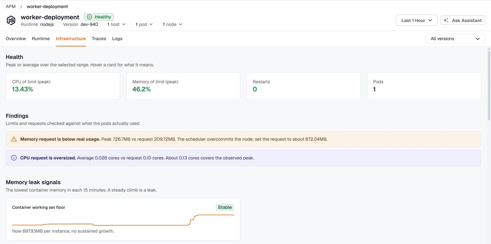
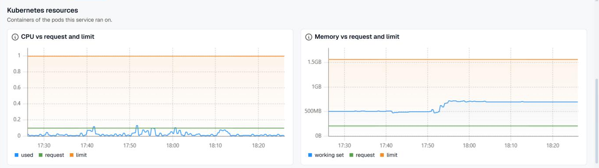
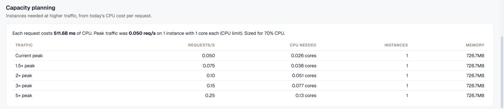

The **Infrastructure** tab on a service's APM page shows the Kubernetes pods and containers the service runs in. It answers questions the traces can't: is the pod near its memory limit, is it being throttled, are its requests sized right, and how many instances it needs at higher traffic.

Open **APM & Services**, click a service, then select **Infrastructure**. The tab follows the page's time range.

The tab needs the service to run on Kubernetes with the [KloudMate Agent for Kubernetes](../../../kloudmate-agent/installation/kubernetes-agent/) collecting container metrics. KloudMate matches the service to its pods through the traces, so the tab is empty for a range in which no pods ran the service.

## Filters

When the service runs in more than one pod, a **Pod** filter appears next to the tabs. When it reports `service.version`, a **Version** filter appears too. Both narrow every section of the tab. These filters are shared with the [Runtime](../runtime/) tab, so switching tabs keeps them.

## Health

The health cards show the pods' key values over the selected range:

- **CPU of limit (peak):** the busiest pod against its CPU limit. At the limit, the kernel throttles the pod and latency rises.
- **Memory of limit (peak):** the busiest pod's working set against its memory limit. The working set is what the OOM killer measures, so at 100% the pod is killed.
- **Restarts:** container restarts in the range.
- **Pods:** pods that reported in the range.

Green, amber, and red mark healthy, warning, and critical values.

## Findings

**Findings** checks the pods' limits and requests against what they actually used. Each finding names what to change:

- **Containers were OOMKilled:** a container hit its memory limit and was killed. Raise the limit, or find what grows under **Memory leak signals**.
- **Container restarts:** each restart drops in-flight requests and resets runtime caches and JIT warm-up.
- **No memory limit:** one leaking pod can starve every other pod on the node.
- **Peak memory near the limit:** at 80% or more of the limit, a traffic spike or a slow leak will OOMKill the pod.
- **Memory request below real usage:** the scheduler overcommits the node. The finding suggests a request about 20% above the peak.
- **Memory or CPU request oversized:** the request is far above what the pods used. The finding suggests a smaller request that still covers the peak, which frees capacity on every node.
- **No CPU limit:** fine for latency-sensitive services, but **Capacity planning** then sizes from observed CPU.
- **CPU peaks near the limit:** at 90% or more of the limit, the kernel throttles the pod, which shows up as tail latency.

## Memory leak signals

The **Container working set floor** card tracks the lowest container memory in each 15 minutes, with a sparkline over the range. A steady climb is a leak. The card is marked **Growing** or **Stable**, shows the current value and how fast it's rising per hour, and estimates when it reaches the memory limit if it keeps growing.

## Kubernetes resources

These charts cover the containers of the pods the service ran on.

- **CPU vs request and limit**
- **Memory vs request and limit**, using the working set
- **Memory by pod**, one line per pod, so an outlier stands out
- **Restarts and terminations**, per pod, with containers currently waiting or terminated and the reason
- **Major page faults**, pages read back from disk. Sustained faults mean memory pressure.

## Capacity planning

**Capacity planning** estimates how many instances the service needs at higher traffic. It starts from what a request costs in CPU today, then sizes each traffic level so that every instance runs at 70% CPU.

The summary line gives the CPU per request, the peak request rate, the instance count, and the cores per instance. Cores come from the CPU limit, or the CPU request when there's no limit. The table then shows the current peak and 1.5×, 2×, 3×, and 5× that peak, each with the requests per second, the CPU needed, the instances needed, and the memory those instances use. An instance count above today's is highlighted with how many more you need.

The estimate assumes CPU grows in line with traffic. It needs request metrics and CPU usage for the service, and traffic in the selected range.

## Related

- [Runtime](../runtime/) for the language runtime inside these containers
- [Services](../apm-and-services/) for the service list and its APM dashboard
- [Kubernetes](../../../infrastructure/) for cluster-wide views
