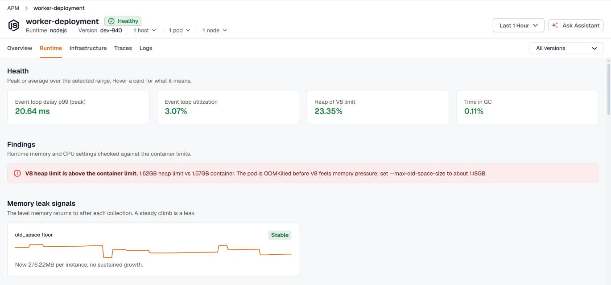
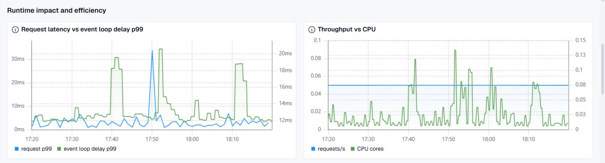

The **Runtime** tab on a service's APM page shows how the service's language runtime behaves: memory, garbage collection (GC), threads, and the event loop or scheduler. Use it when a service is slow or restarting and the traces don't explain why, to tell whether the runtime is the cause and not the code or a dependency.

Open **APM & Services**, click a service, then select **Runtime**. The tab follows the page's time range.

## Supported runtimes

The tab reads the runtime metrics that the OpenTelemetry SDK reports.

| Runtime | How to get the metrics |
| --- | --- |
| Java (JVM) | The OpenTelemetry Java agent reports them by default. For heap buffers and CPU load, add `-Dotel.instrumentation.runtime-telemetry.emit-experimental-metrics=true`. |
| Go | Call `runtime.Start()` from `go.opentelemetry.io/contrib/instrumentation/runtime`. Scheduler latency also needs `runtime.NewProducer()` on the metric reader. |
| Node.js | `@opentelemetry/auto-instrumentations-node` includes them by default. With a manual setup, register `@opentelemetry/instrumentation-runtime-node`. |
| .NET | On .NET 9 and later, add the built-in meter with `AddMeter("System.Runtime")`. On .NET 6 to 8, add `OpenTelemetry.Instrumentation.Runtime` with `AddRuntimeInstrumentation()`. |
| Python | Install `opentelemetry-instrumentation-system-metrics`. The OpenTelemetry Operator's Python image and `opentelemetry-bootstrap` include it. |

Services that the [KloudMate Agent instruments with the SDK](../../auto-instrumentation/) report these metrics with no extra setup. A service traced with eBPF only doesn't report runtime metrics. If it runs on Kubernetes, its container metrics are still on the [Infrastructure](../infrastructure/) tab.

## Filters

When the service reports `service.version`, a **Version** filter appears next to the tabs. When it runs in more than one pod, a **Pod** filter appears too. Both narrow every section of the tab. Picking a version limits the **Pod** list to the pods that ran that version.

## Health

The health cards show the runtime's key values over the selected range, as a peak or an average. Green, amber, and red mark healthy, warning, and critical values.

| Runtime | Cards |
| --- | --- |
| Java | Heap after GC (of max), Time in GC, GC pause p99, Blocked threads (peak) |
| Go | Goroutines (peak / instance), Heap of GOMEMLIMIT, Allocation rate, Scheduler latency p99 |
| Node.js | Event loop delay p99 (peak), Event loop utilization, Heap of V8 limit, Time in GC |
| .NET | GC pause time, Gen2 collections, Thread pool queue (peak), Exceptions |
| Python | RSS (peak / instance), CPU, Gen2 collections, Uncollectable objects |

## Findings

**Findings** checks the runtime's memory and CPU settings against the container's limits, for services that run on Kubernetes. Each finding names the setting to change. For example:

- **Java:** the max heap is above 80% of the container's memory limit. Metaspace, thread stacks, and direct buffers live outside the heap, so the pod is OOMKilled before the JVM throws `OutOfMemoryError`. Keep `-Xmx` or `MaxRAMPercentage` at 75% or less.
- **Go:** `GOMEMLIMIT` isn't set, so the GC doesn't know about the container's limit. Or `GOMAXPROCS` is above the CPU limit, so the pod gets throttled.
- **Node.js:** the V8 heap limit is above the container's limit, or so far below it that Node runs out of heap while the container still has room. Set `--max-old-space-size` to about 75% of the container's limit.

## Memory leak signals

Each card tracks the level memory returns to after each collection, such as the Java heap live set or the Node.js old space floor, with a sparkline over the range. A steady climb is a leak. The card is marked **Growing** or **Stable**, shows the current value and how fast it's rising per hour, and estimates when it reaches the limit if it keeps growing.

## Runtime impact and efficiency

These charts compare the runtime with the service's traffic.

- **Request latency vs** the runtime's pause signal (GC pause p99 for Java, event loop delay p99 for Node.js, scheduler latency p99 for Go). Spikes that line up mean the runtime is slowing requests.
- **Throughput vs CPU.** CPU should track traffic. CPU rising while traffic is flat means each request costs more work.
- **CPU time per request.** The unit cost of a request. Compare it before and after a release to catch efficiency regressions.

## Runtime charts

The section named after the runtime, such as **JVM** or **Node.js runtime**, charts memory by pool or generation, GC rate and pauses, threads, CPU, and runtime-specific signals such as goroutines, the event loop, the .NET thread pool, or Python's uncollectable objects. Each chart's description says what to look for.

## Version comparison

**Version comparison** shows whether a release changed what an instance costs to run. Pick a **Baseline** and a **Compared** version to see memory, CPU, and GC per instance side by side, with the change between them. A rise is the regression, since every row is a cost. Both versions must have run in the selected range, so widen the range to compare a release with the one before it.

**Deployments in range** lists each version with when it was first and last seen and its peak instance count. The service needs to report `service.version` for this section.

## Instances

The table lists each instance (pod, host, or service instance) with its memory, CPU, a key runtime value, and restarts. A cell well above the fleet median is highlighted, as is any restart. Use it to find the one pod that behaves differently from the rest.

## Related

- [Infrastructure](../infrastructure/) for the pods and containers the service runs in
- [Services](../apm-and-services/) for the service list and its APM dashboard
- [Auto-Instrumentation](../../auto-instrumentation/) to add the SDK with no code change
