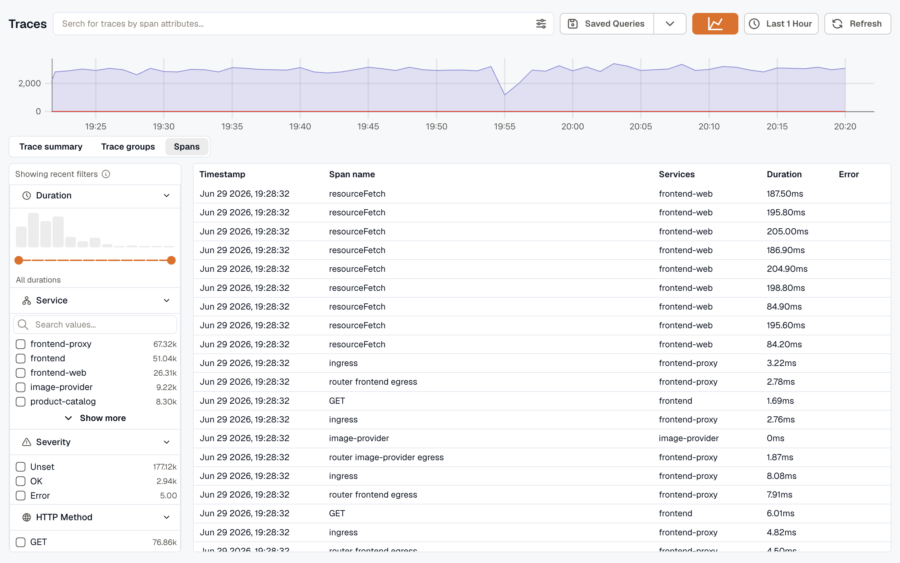
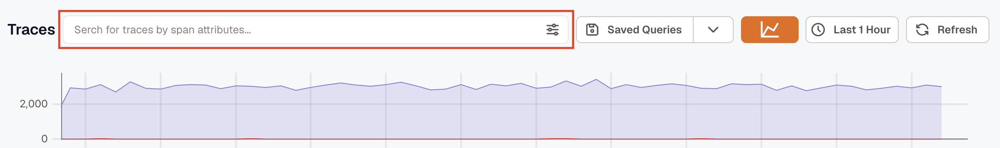
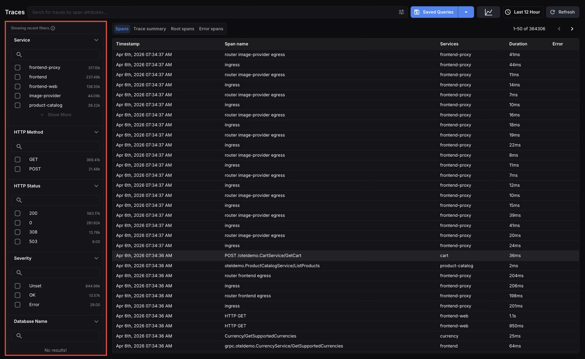
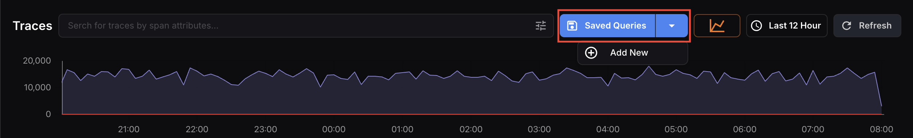
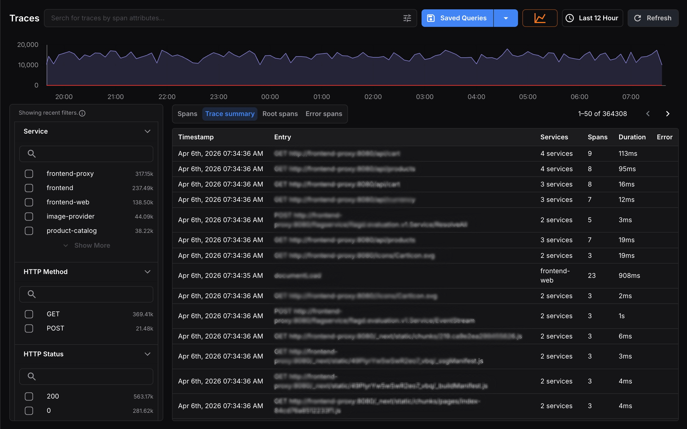
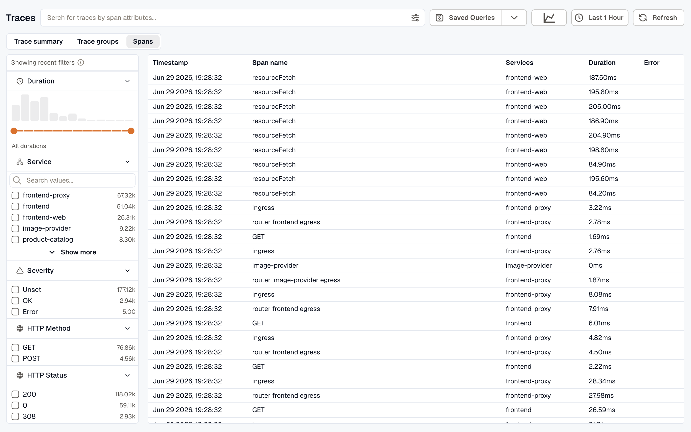
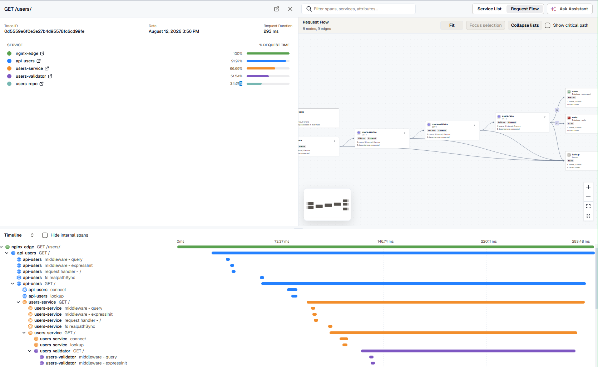

Click **Traces** in the left navigation menu to open the section. It opens on the **Trace Summary** view by default.

To see trace activity over the selected time range, click the chart icon next to the time picker. The **Span count** chart stacks spans with errors and all other spans in each interval.

:::note
  See [Sending Data to KloudMate](../../getting-started/sending-data-to-kloudmate/) for onboarding and ingestion options.
:::

## Searching and Filtering

### Search Bar

Search across traces using span attributes. Click the search bar or start typing, pick an attribute, then an operator and a value. If the attribute or value you want isn't listed, type it. Each condition appears as a chip in the bar, and a trace must match every chip. To remove a condition, click the **×** on its chip.

The operators are the ones [KMQL](../../visualize-data/kmql/) uses. The `in` and `not in` operators take several values, which you can type separated by commas. On string attributes, `matches` and `not matches` compare the value against a regular expression that must match the whole value.

### Sidebar Filters

Use the left sidebar to filter results by:

- Service
- Severity
- HTTP Method
- HTTP Status
- Database Name
- Duration (a latency histogram with a range slider)

Each filter section includes a search box for quick lookup. When filters are active, a recent-filters notice appears at the top of the sidebar.

## Saved Queries

Open the **Saved** menu next to the search bar. Select **Save this query** to save the current search, pick a query under **Recent** to run it, or select **All saved queries** to browse every saved query.

## Traces Result Views

Switch between views using the toggle above the results. They all read the same trace data, subject to the active time range and filters — each gives you a different level of detail.

### Trace Summary

**Trace Summary** is the default view. It groups spans into complete traces, giving you a higher-level view of end-to-end request journeys. Each row represents a single trace, showing its entry point, number of services, spans involved, total duration, and any errors.

### Trace Groups

**Trace Groups** rolls traces up by **entry point** — one row per `(service, root operation)` — so you can see which endpoints drive your traffic, latency, and errors at a glance. Each row shows:

- **Entry point** — the root service and operation
- **Traces** — number of traces for that entry point
- **Spans (avg)** — average spans per trace
- **Entities (avg)** — average number of services involved per trace (hover for the per-service breakdown)
- **p95** — 95th-percentile trace duration
- **Errors** — number of traces with errors
- **Trend** — a sparkline of trace volume over the window (hover for per-bucket counts)

Filter the groups from the left panel by **entry operation**, **service**, and **duration**.

#### Drilling into a group

Click a group row to open its **drill-down drawer**. The drawer shows the group's metrics across the top, then the list of traces that belong to it. From here you can:

- **Filter the group's traces** by span attributes using the drawer's search bar, which works the same way as the [search bar](#search-bar) on the main page.
- **Scroll the list** — it pages automatically as you reach the bottom.
- **Open any trace** — click a row to open its full [Trace Detail](../trace-detail/) stacked on top of the drawer. Closing it returns you to the group; closing the group returns you to the list.

### Spans

The **Spans** view lists every individual span captured within the selected time range and active filters. Each row displays `Timestamp`, `Span Name`, `Services`, `Duration`, and `Error`.

This view is best when you need the most granular look at tracing activity. To isolate errors, add a **Severity → Error** filter from the sidebar.

## Open a Trace

Select a trace or span from any result view to open it in [Trace Detail](../trace-detail/), where you inspect the timeline waterfall, per-span attributes, and the Service List, Request Flow, and AI Flow views.

## Related Paths

- [Trace Detail](../trace-detail/)
- [APM Views](../apm-views/)
- [Explore](../../visualize-data/explore/)
