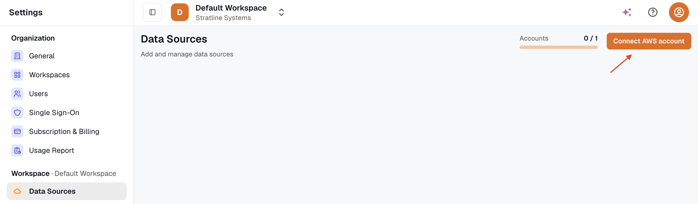
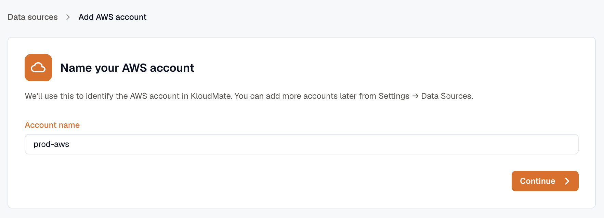
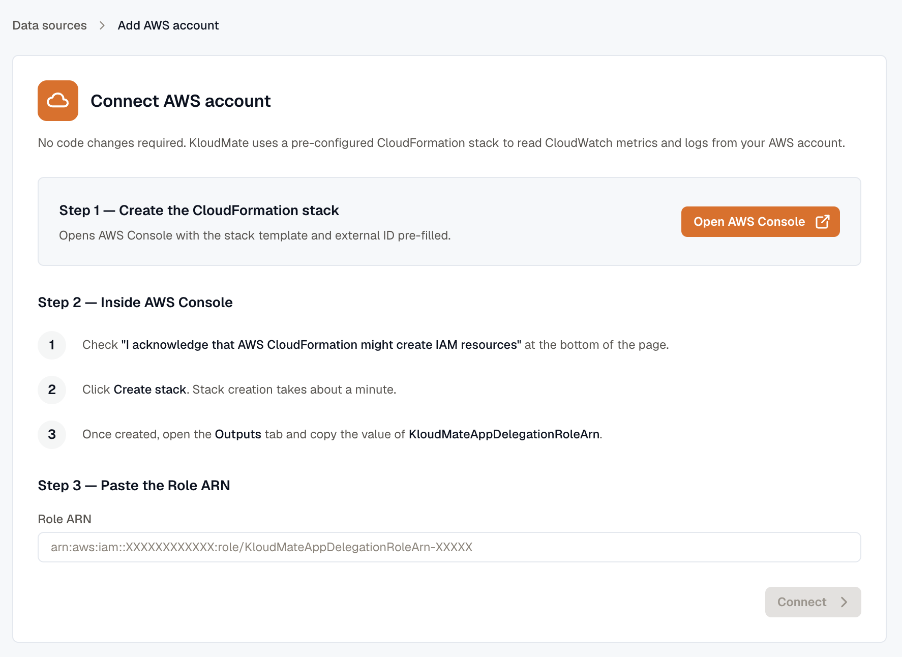
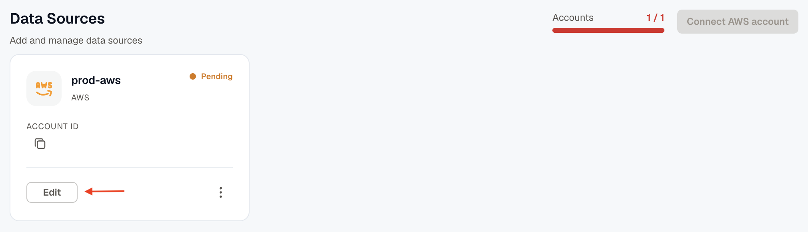
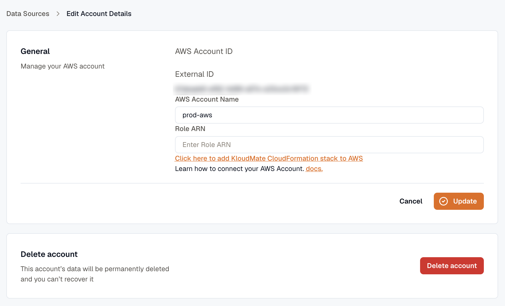

Connect an AWS account to KloudMate so it can read CloudWatch metrics and logs from that account, with no code changes. KloudMate gives you a pre-configured CloudFormation stack that creates a delegation role in your account, and you paste the role's ARN back into KloudMate.

## Connect Your AWS Account

1. Go to **Settings → Data Sources** and click **Connect AWS account**. The **Accounts** counter beside it shows how many accounts you've connected out of the number your plan allows.

2. Enter an **Account name** and click **Continue**. The name identifies the account in KloudMate, so use one you'll recognize, such as `prod-aws`.

3. Click **Open AWS Console**. It opens CloudFormation with the stack template and external ID already filled in. Sign in to AWS with an administrator account if you're asked to.

4. In AWS, check **I acknowledge that AWS CloudFormation might create IAM resources** at the bottom of the **Quick create stack** page, and click **Create stack**.
5. Wait for the stack to be created. This takes about a minute.
6. Open the stack's **Outputs** tab and copy the value of **KloudMateAppDelegationRoleArn**.
7. Back in KloudMate, paste the ARN into the **Role ARN** field and click **Connect**.

The account appears on the **Data Sources** page. To add another account, repeat these steps.

## Edit or Delete an Account

Each account on the **Data Sources** page has an **Edit** button. An account you named but haven't finished connecting shows **Pending**, with no account ID. When you reach your plan's account limit, **Connect AWS account** is turned off.

Click **Edit** to open **Edit Account Details**. It shows the account's AWS account ID and external ID.

- To rename the account or finish connecting it, change the **AWS Account Name** or paste the **Role ARN**, then click **Update**. If you don't have a role yet, **Click here to add KloudMate CloudFormation stack to AWS** opens the stack in AWS.
- To remove the account, click **Delete account**. You need the **Owner** role, and the account's data is deleted permanently. See [Remove an AWS Account](../../platform/settings/deleting-your-aws-account-from-kloudmate/) to also remove the stack from AWS.

## Related Resources

- [AWS Integration](../)
- [Data Sources](../../platform/settings/data-sources/)
- [CloudWatch Logs](../cloudwatch-logs/)
- [AWS Lambda Monitoring](../lambda-monitoring/)
- [Troubleshoot AWS sync](../../platform/settings/troubleshoot-aws-sync/)
- [Sending Data to KloudMate](../../getting-started/sending-data-to-kloudmate/)
