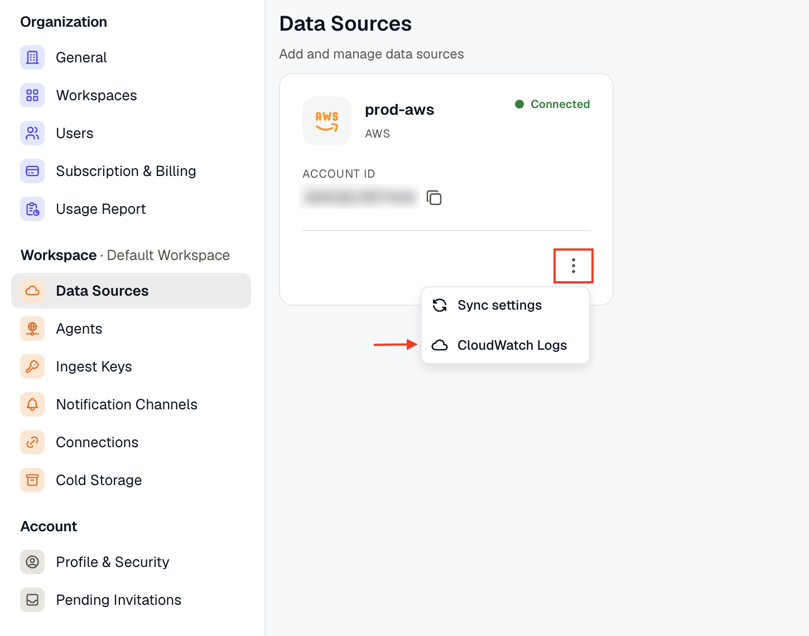
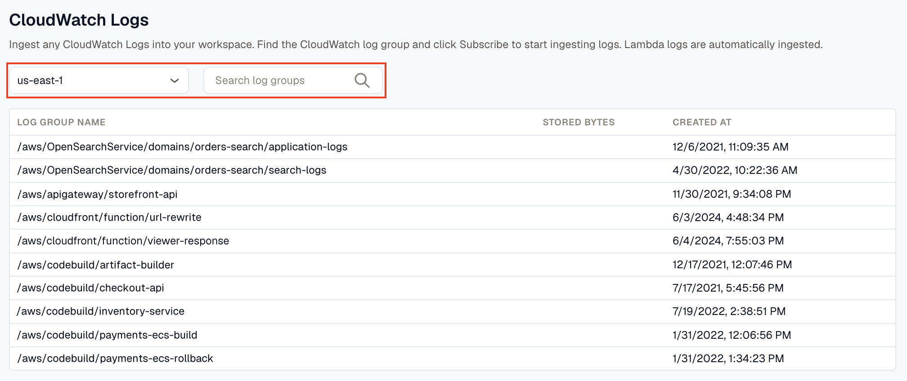

Use this workflow after you have connected your AWS account to KloudMate. You can subscribe CloudWatch log groups by region and make those logs searchable in Log Explorer.

:::info
Lambda logs from the connected AWS account are ingested automatically.
:::

## Before You Start

- Complete [AWS Account Setup](../account-setup/)
- Confirm that the target log groups exist in CloudWatch

## Subscribe a CloudWatch Log Group

1. Go to **Settings → Data Sources**.
2. On the card of the AWS account you want to ingest logs from, open the menu (⋮) and select **CloudWatch Logs**.

3. Pick the AWS region, or search for a log group by name. The list shows each log group's name, stored bytes, and creation time.

4. Click **Subscribe** for each log group that you want KloudMate to ingest.

## CloudWatch Subscription Filter Limit

:::note
AWS allows only two subscription filters per log group.
:::

If a log group already has two active subscription filters, KloudMate cannot add another one until an existing filter is removed.

## Remove an Existing Subscription Filter

To free a subscription slot:

1. Open the AWS console.
2. Go to **CloudWatch → Log groups**.
3. Select the relevant log group.
4. Open **Actions**.
5. Click **Remove Subscription Filter**.

:::tip
After subscription is enabled, you can search and analyze the ingested logs in [Log Explorer](../../logs/log-explorer/).
:::

## Related Resources

- [Lambda Log Attributes](./cloudwatch-logs-attributes/)
- [AWS Account Setup](../account-setup/)
- [Log Explorer](../../logs/log-explorer/)
