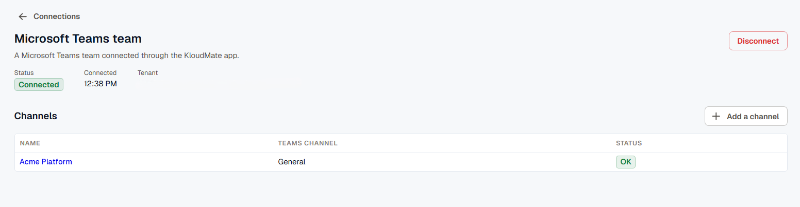

Connect a Microsoft Teams team to your KloudMate workspace to send incident alerts to its channels. Responders acknowledge, resolve, add responders, and start a war room from the alert card in Teams. War rooms open as channels in the same team.

You'll need a Teams admin to upload the app, a team owner to add it to a team, and a KloudMate workspace admin to confirm the connection. One person can do all three if they hold all three roles.

## Before you start

- Download the KloudMate app package, [`kloudmate-teams-app.zip`](https://api.kloudmate.com/integrations/msteams/app-package.zip). It's also in KloudMate: go to **Settings** > **Connections**, click **Connect**, and select **Microsoft Teams**.
- KloudMate sends alerts to **General** and standard channels. You can add the app to a private or shared channel, but KloudMate doesn't send alerts there, and adding or removing it there doesn't change the team's connection.

## Upload the app to your organization

A Teams admin does this once for the whole organization.

1. In the [Teams admin center](https://admin.teams.microsoft.com/), go to **Teams apps** > **Manage apps**.
2. Select **Upload new app** (in some layouts, **Actions** > **Upload new app**) and upload `kloudmate-teams-app.zip`.
3. Check that the app's status is **Allowed**, and that your app permission policies let your team owners use it.

The app can take a few hours to show up in Teams under **Built for your org**. When KloudMate ships a new version of the app, upload the new zip with **Upload file** on the app's page.

## Allow the app's team permissions

The app asks for permissions on each team it's added to, never on your whole organization. The team owner who adds the app grants them for that team.

| Permission | What KloudMate uses it for |
| --- | --- |
| `TeamMember.Read.Group` | Checks that the person who clicks **Connect** or **Disconnect** in Teams owns the team. |
| `ChannelMessage.Read.Group` | Reads the messages in a war room channel to write the incident summary. Teams sends KloudMate every message in the team's standard channels; KloudMate drops the ones that don't mention it without storing them. |
| `Channel.Create.Group` | Creates a channel for each war room. |
| `ChannelSettings.ReadWrite.Group` | Renames a war room's channel when the room closes. |
| `Channel.Delete.Group` | Deletes a closed war room's channel 7 days after it closes. |

Whether team owners can grant these depends on your tenant's team resource-specific consent (RSC) setting. The default, `ManagedByMicrosoft`, allows it, so most organizations have nothing to change.

To check the setting, run this in [Microsoft Graph PowerShell](https://learn.microsoft.com/en-us/powershell/microsoftgraph/get-started). Connecting Graph PowerShell to your organization for the first time needs a Global Administrator.

```powershell
Install-Module Microsoft.Graph.Beta.Teams
Connect-MgGraph -Scopes @('TeamworkAppSettings.ReadWrite.All', 'Policy.ReadWrite.Authorization', 'AppCatalog.Read.All', 'Policy.ReadWrite.PermissionGrant', 'InformationProtectionPolicy.Read', 'Application.ReadWrite.All')
Get-MgBetaTeamRscConfiguration
```

What to do depends on the **State** it returns:

- `ManagedByMicrosoft` or `EnabledForAllApps`: nothing.
- `EnabledForPreApprovedAppsOnly`: preapprove KloudMate's permissions, as shown below.
- `DisabledForAllApps`: team owners can't add any app that needs team permissions, KloudMate included. Change the state, or preapproval won't help.

To preapprove KloudMate, replace `YOUR_KLOUDMATE_APP_ID` with the **App ID** on the KloudMate app's page in the Teams admin center:

```powershell
New-MgBetaTeamAppPreapproval -TeamsAppId YOUR_KLOUDMATE_APP_ID -ResourceSpecificApplicationPermissionsAllowedForTeams @('TeamMember.Read.Group', 'ChannelMessage.Read.Group', 'Channel.Create.Group', 'ChannelSettings.ReadWrite.Group', 'Channel.Delete.Group') -TeamLevelSensitivityLabelCondition AnySensitivityLabel
```

Microsoft's preapproval cmdlets are in preview. See [Preapproval of RSC permissions](https://learn.microsoft.com/en-us/microsoftteams/platform/graph-api/rsc/preapproval-instruction-docs) for the full options.

## Add the app to a team and connect it

A team owner starts the connection in Teams, and a KloudMate workspace admin finishes it.

1. In Teams, open **Apps**, find **KloudMate** under **Built for your org**, and add it to the team that should get alerts. Pick the channel for KloudMate's first card, and approve the app's team permissions when Teams asks.
2. KloudMate posts a card with a **Connect** button in that channel, or in **General** if it can't post there. Click **Connect**.
3. KloudMate checks that you own the team, then gives you a link to KloudMate. Open it and sign in. The link works once, for 10 minutes.
4. If you're a workspace admin, pick the workspace and click **Connect team**. If you aren't, click **Copy link for a workspace admin** and send the link to one. They open it, pick the workspace, and click **Connect team**.

A team connects to one KloudMate workspace at a time. To move it to another workspace, disconnect it first.

The team then shows under **Settings** > **Connections**. Open it with **Manage** to see its status and the channels that get alerts.



## Choose the channels that get alerts

Connecting a team doesn't send anything yet. A workspace admin picks the channels:

1. Go to **Settings** > **Connections**, open the team's **Actions** menu, click **Manage**, and click **Add a channel**. Or go to **Settings** > **Notification Channels**, click **Create**, and select **MS Teams**.
2. Pick the **Team** and the **Channel**. You can also give the channel a different name in KloudMate.
3. Click **Add channel**.

Use the channel like any other notification channel: in [routing rules](../routing-rules/), in [escalation policy](../escalation-policy/) steps, and as the channel for war rooms. If someone deletes the channel in Teams, it's marked **Error** in KloudMate. Pick another channel wherever you used it.

## Link your Teams account

Buttons on an alert card act as the KloudMate user who clicks them, so KloudMate needs to know who you are in Teams. You must be a member of the KloudMate workspace the team is connected to.

- **If your Microsoft sign-in name is your KloudMate email address,** you don't need to do anything. KloudMate recognizes you the first time you click a button and remembers the link.
- **Otherwise,** for example if you sign in to Microsoft with a different address or you're a guest in the tenant, your first click shows you a **Link my account** button. Click it, open the link, and click **Link account** in KloudMate. Then go back to Teams and click the alert button again.

A link covers one team. To see or remove your links, go to **Incidents** > **Settings** and find the **Microsoft Teams** section.

## Disconnect a team

A workspace admin can disconnect a team in KloudMate: go to **Settings** > **Connections**, open the team's **Actions** menu, and click **Disconnect**. A team owner can also use **Disconnect** on the card KloudMate posted in **General** when the team connected. You can't disconnect from KloudMate while a war room is open in the team.

After a disconnect, the team's channels stop getting alerts and show an error until you delete them. To connect the team again, a team owner clicks **Connect** in Teams.

If someone removes the app from the team instead, alerts stop and the team shows **App removed** in KloudMate. Add the app back to the team to resume.

## Troubleshoot the connection

- **No Connect card after you add the app:** check **General**. If it isn't there either, remove the app from the team, wait two minutes, and add it again from Teams. Adding the app to a team from the Teams admin center doesn't post the card.
- **Connect can't check the team's owners:** the team didn't grant the app its permissions. Check your tenant's RSC setting in [Allow the app's team permissions](#allow-the-apps-team-permissions).
- **Connect asks you to try again in a minute:** Microsoft takes a short while to give a newly added app access to a team. Wait a minute and click **Connect** again.
- **Only team owners can connect:** ask an owner of the team to click **Connect**.
- **A link from Teams no longer works:** links work once and expire after 10 minutes. Click **Connect**, or the alert button, in Teams again for a new one.
- **The team is already connected:** if it's connected to another workspace, disconnect it there first. If it's this workspace, there's nothing to do.

If someone opens a one-on-one chat with KloudMate, the app replies that it works in team channels.

## Related

- [Slack Integration](../slack-integration/): the same alerts and actions in Slack.
- [Notification Channels](../../platform/settings/notification-channels/): every channel type KloudMate can send to.
