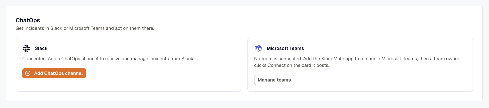
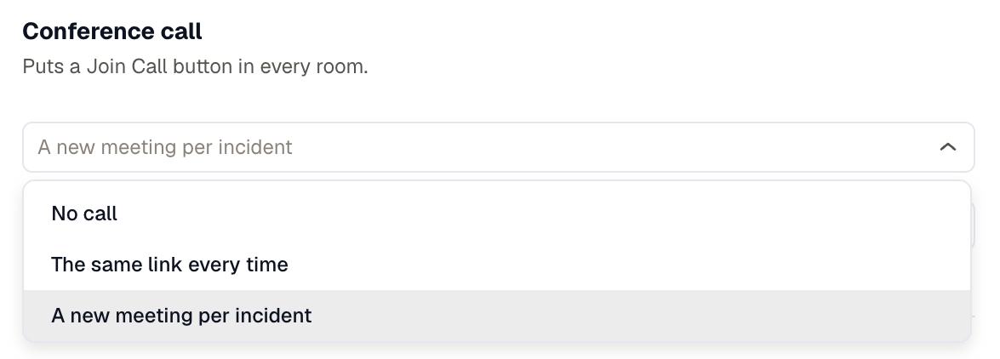
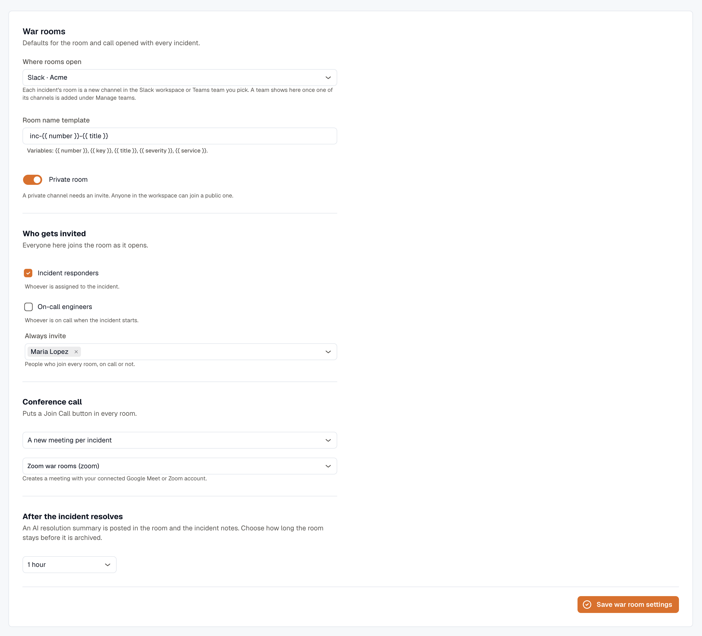

import { Steps } from '@astrojs/starlight/components';

War rooms run on the chat connection you already use for incident notifications. Point them at a Slack or Microsoft Teams channel, decide who gets invited, and optionally let KloudMate create a conference call for each incident.

The settings live on **Incidents → Settings**, under **War rooms**, below the **ChatOps** card where Slack and Microsoft Teams are connected. You need the **Developer** role to change them. Everyone else sees them read-only.

**Where rooms open** lists every connected Slack workspace and every Teams team channel, each named with its app, such as **Slack · Acme**. A room opens in the app of the one you pick.

## Before you start

- Your plan includes Incident Management.
- Your workspace has a Slack channel, or a Microsoft Teams channel in a team connected through the KloudMate app. See [Slack Integration](../../slack-integration/) and [Microsoft Teams Integration](../../microsoft-teams-integration/).
- For a conference call that's created per incident, you've connected Google Meet or Zoom under **Settings → Connections**.

## Connect ChatOps

The **ChatOps** card on **Incidents → Settings** connects Slack and Microsoft Teams to Incident Management, so responders can act on incidents from chat. War rooms open in the workspaces and channels connected here, so set this up first.

- **Slack:** Click **Connect** on the **Slack** panel. If Slack is already installed for notifications, click **Add ChatOps channel** instead. See [Slack Integration](../../slack-integration/).
- **Microsoft Teams:** Add the KloudMate app to a team in Teams, and have a team owner click **Connect** on the card it posts. Then add one of the team's channels under **Manage teams**. See [Microsoft Teams Integration](../../microsoft-teams-integration/).

## Set up Slack rooms

Slack needs more permissions to open a war room than it does to post a notification. Creating a channel, reading a member's email address, and inviting people all sit behind permissions that a notifications-only install was never granted.

<Steps>
1. Open **Settings → Connections** and find your Slack connection.

2. Click **Edit**, add **Workflows** under **Can be used for**, and save. Those are the permissions a war room needs.

3. Click **Reconnect** beside the connection and approve the Slack install again. Approving again only adds permissions, so you don't lose what Slack already had.

4. Open **Incidents → Settings** and pick your Slack workspace under **Where rooms open**.
</Steps>

KloudMate checks the channel's permissions as soon as you pick it. If anything is missing, a **Reconnect Slack to open war rooms** banner lists the exact scopes, and **Start war room** stays disabled until you fix it. These are the ones it checks:

| Scope | Why it's needed |
|---|---|
| `chat:write` | Post and update the incident card. |
| `users:read` and `users:read.email` | Match a KloudMate user to their Slack account by email address. |
| `groups:write` | Create a private channel and invite people to it. |
| `channels:manage` | The same, for public channels. |

## Set up Microsoft Teams rooms

A Teams room is a new standard channel in a team connected through the KloudMate app. The app creates, renames, and deletes these channels with the team permissions a team owner approved when they added it, so there's no separate account to sign in with.

<Steps>
1. Connect the team and add one of its channels in KloudMate. See [Microsoft Teams Integration](../../microsoft-teams-integration/).

2. Open **Incidents → Settings** and pick that channel under **Where rooms open**. Rooms open as new channels in its team.

3. Set **After the incident resolves** to a delay. Teams rooms can't use **Keep the room open**.
</Steps>

The channel you pick also keeps each room's record. When a room closes, KloudMate posts the closing note and the AI resolution summary in the incident's alert thread there, because the room's own channel is deleted 7 days after it closes.

Every room takes one of the team's 1,000 channel slots, and Teams keeps counting a deleted channel for 30 days. KloudMate won't open a room when the team is within 100 channels of that limit, so point war rooms at a team that doesn't already hold hundreds of channels.

## Add a conference call

**Conference call** decides where the **Join Call** button points:

| Option | What happens |
|---|---|
| **No call** | No call link, unless whoever opens the room pastes one. |
| **The same link every time** | KloudMate uses your **Call link**, rendered per incident, plus an optional **Dial-in**. Use a standing bridge, or a link with the incident key in it, such as `https://meet.google.com/lookup/inc-{{ key }}`. |
| **A new meeting per incident** | KloudMate creates a fresh meeting on the connection you pick. |

For a new meeting per incident, connect one of these under **Settings → Connections** and select it in the war room settings. The picker lists connections granted for **Meetings**, so a Slack or AWS connection never shows up there.

Teams rooms use the same options. KloudMate doesn't create Teams meetings, so for a Teams call, put a standing Teams meeting link under **The same link every time**.

### Google Meet

Connect **Google Workspace** and sign in as the Google Workspace account that should own the meeting spaces. The consent screen asks to create meeting spaces, plus your name and email address to label the connection. The meeting permission reaches only the spaces KloudMate creates itself, not the rest of your Workspace. Google Meet returns no dial-in number, so rooms show the **Join Call** button on its own.

### Zoom

Connect **Zoom** and install the KloudMate app. Every war room meeting is created as the account that installs it, so install it from a Licensed Zoom account: meetings hosted by a Basic account cut out after 40 minutes, which is not what you want halfway through an incident. Zoom rooms don't show a dial-in number.

Removing the KloudMate app from Zoom revokes the connection. KloudMate erases the stored credential, marks the connection **Revoked**, and switches it off, so rooms open without a call link until the app is installed again. **Reconnect** beside the connection re-runs the install and switches the connection back on, with the same connection id, so the war room settings keep pointing at it. See [Zoom](/platform/settings/connections/zoom/) for the full install and removal steps.

:::caution
Account-level Zoom settings override what KloudMate asks for. If responders land in a waiting room or get turned away, check the account's join-before-host and authentication settings.
:::

## Set the defaults for every room

| Setting | What it controls |
|---|---|
| **Room name template** | The channel name. Use `{{ number }}`, `{{ key }}`, `{{ title }}`, `{{ severity }}`, and `{{ service }}`. The default is `inc-{{ number }}-{{ title }}`. Slack names are lowercased and stripped to letters, numbers, hyphens, and underscores, up to 80 characters. Teams names can run to 50 characters, without the characters Teams doesn't allow in a channel name, such as `#`, `/`, and `?`. |
| **Private room** | Opens Slack rooms as private channels, which people have to be invited to. Turn it off to open public channels anyone in the Slack workspace can join. Teams rooms are always standard channels, visible to everyone in the team. |
| **Incident responders** | Invites whoever is assigned to the incident. |
| **On-call engineers** | Invites whoever is on call. Leave the schedule picker empty to follow the incident's escalation policy, or name specific [schedules](../../oncall/) to use those instead. |
| **Always invite** | People who join every room, on call or not. An incident commander, for example. |
| **After the incident resolves** | How long a resolved room stays open before KloudMate closes it. **Keep the room open** turns the automatic archive off for Slack rooms. Teams rooms need a delay. |

Click **Save war room settings** to apply your changes.

If a name is already taken by another incident's channel, KloudMate adds a short suffix and uses that. A name you type yourself is never changed for you, so you're told it's taken instead.

Anyone KloudMate can't match to a chat account is listed on the card, under **Could not add** in Slack, or under **Not in this team** or **Not linked to Teams** in Teams. They're tagged **Unmapped** on the incident panel. The room still opens, and everyone else is still invited.

## Open a room automatically

Opening a room by hand is fine for the first few. After that, let the rule that creates the incident do it.

**From a routing rule.** Add the **Start War Room** action to the rule. Every incident that rule creates opens with a room. The rule uses the workspace roster unless you turn on **Customize member roster for this rule**, which replaces it for incidents this rule creates. See [Routing Rules](../../routing-rules/).

**From an escalation step.** Check **Start War Room on this step** in the step editor. The room opens when the incident reaches that step, and only on the policy's first pass, so a policy that repeats won't open a second room. See [Escalation Policies](../../escalation-policy/).

Both paths are worth scoping tightly. A rule that matches everything opens a channel for every incident. Archived channels still count towards your Slack workspace limits, and a Teams room holds a channel slot in its team until 30 days after it's deleted.

## Related

- [War rooms overview](../): what responders see once a room is open.
- [Troubleshooting](../troubleshooting/): scope banners, connection states, and missing call links.
- [Connections](/platform/settings/connections/): where the Slack, Google Meet, and Zoom credentials live, and your connected Teams teams.
