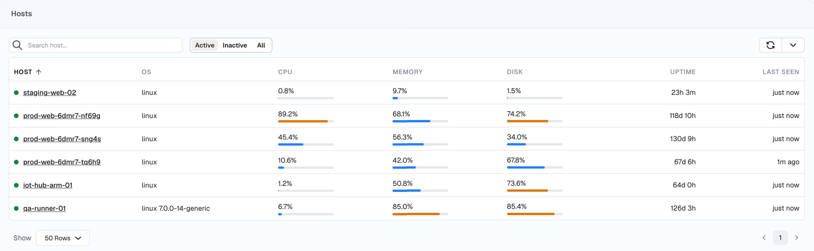
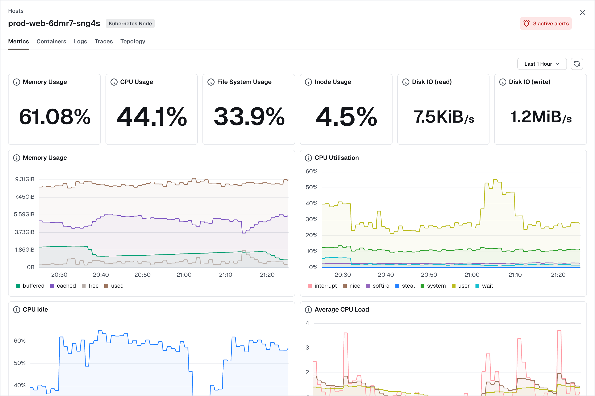
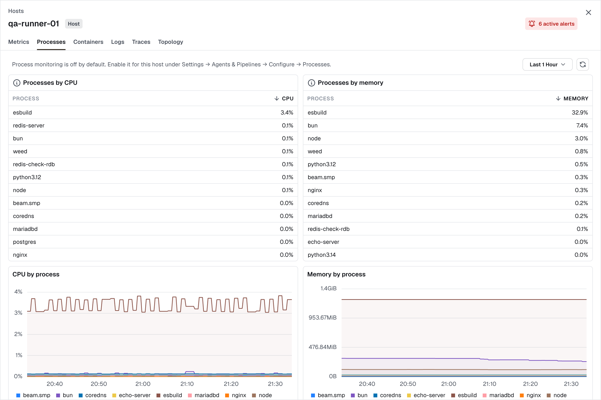
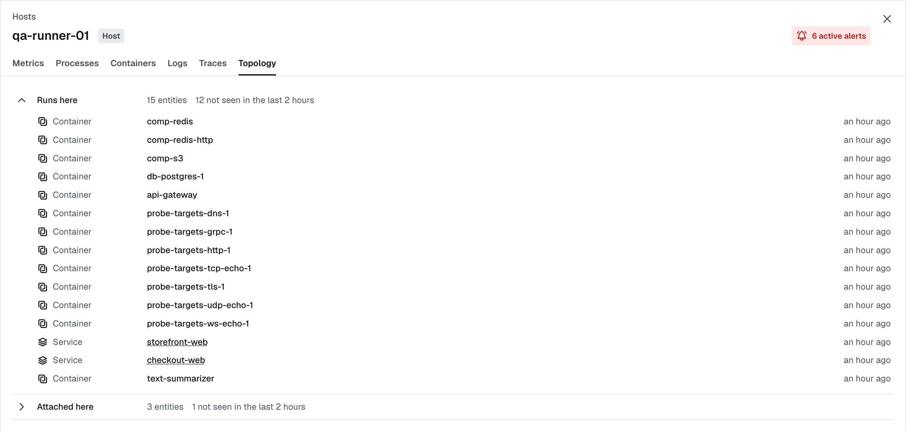

The **Hosts** module provides a centralized view for monitoring the health, performance, and resource utilization of your infrastructure. This view automatically populates with data once the KloudMate Agent is installed on your Linux or Windows servers.

From this view, you can move from a fleet-wide overview down to the metrics, processes, containers, and logs of an individual host.

## The host list

Open **Hosts** to see every physical or virtual machine running the KloudMate Agent. Each host shows:

- **Host:** the detected name of the machine, with a green dot while it's reporting.
- **OS:** the operating system type and version, for example `linux` or `windows`.
- **CPU**, **Memory**, and **Disk:** the percentage in use, with a bar that turns orange as usage climbs.
- **Uptime:** how long the host has been running continuously.
- **Last seen:** when the host last sent data.

### Search and filter hosts

- **Search:** type part of a host name to narrow the list.
- **Active**, **Inactive**, or **All:** **Active** (the default) lists hosts that are reporting now. **Inactive** lists hosts that have stopped reporting, with a gray dot and dashes in place of their metrics.
- **Auto-refresh:** click the refresh button to reload the list, or pick an interval from the menu beside it, from **5s** to **30m**. **Off** turns auto-refresh off.

## Drill-down View

Click a host to open its details in a drawer. The drawer header shows the number of active alerts for the host. A host that is also a Kubernetes node is labeled **Kubernetes Node**.

### Metrics Tab
Displays interactive time-series charts for the resource.
- **Hosts:** View detailed charts for CPU, Memory, Disk I/O, Network traffic, and System Load.
- **Containers:** View container-specific CPU and Memory utilization charts.

### Processes Tab (Hosts Only)
Lists the processes that use the most CPU and memory on the host, with **CPU by process** and **Memory by process** charts over the selected time range.

Process monitoring is off by default. To turn it on for a host, go to **Settings** > **Agents & Pipelines**, click **Configure** for the host's agent, and open **Processes**.

### Containers Tab (Hosts Only)
When inspecting a Host, this tab lists all the active containers running on that specific machine, displaying their individual CPU, Memory, Image, and Runtime metrics. Clicking a container in this list updates the drawer to show the details for that container.

### Logs Tab
Provides immediate access to the logs generated by the selected resource. 
- You can search, filter, and analyze logs specific to that host or container directly within the drawer.

### Topology Tab (Hosts Only)
The last tab in the host drawer lists the containers, services, and databases that run on the host, what it talks with, and the EC2 instance it runs on. When the host runs on an EC2 instance, the tab also lists that instance's security groups, subnet, volumes, and target groups.

Each group shows how many of its resources are alerting. Hover over a resource's **firing** count to see its alerts, and click an alert to open its rule in a new tab.

Linking a host to its EC2 instance needs KloudMate agent 2.2.0 or later. If an AWS account is connected and the host runs an older agent, the tab asks you to [upgrade the agent](../../kloudmate-agent/upgrade/).

## Getting Started

Host metrics are collected **automatically**, with no configuration, once you deploy the agent.

1. Install the [KloudMate Agent](../../kloudmate-agent/) on your servers.
2. The agent forwards core metrics (CPU, Memory, Filesystem, Uptime) and system logs to KloudMate.
3. Your servers appear in the Hosts view within a few minutes.

For instructions on adding custom cloud metadata (like AWS EC2 or Azure tags) or capturing advanced process-level metrics, see the [Advanced Host Metrics Collection](../server-metrics-to-kloudmate/) guide.
