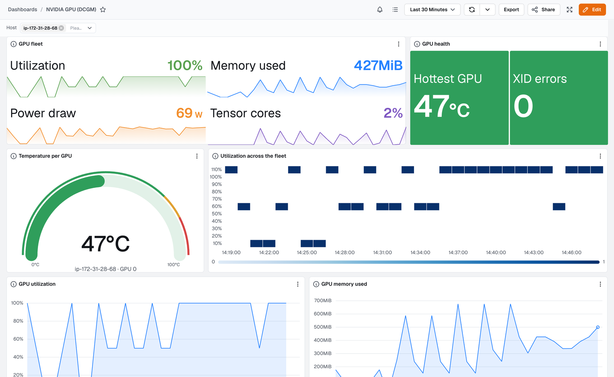
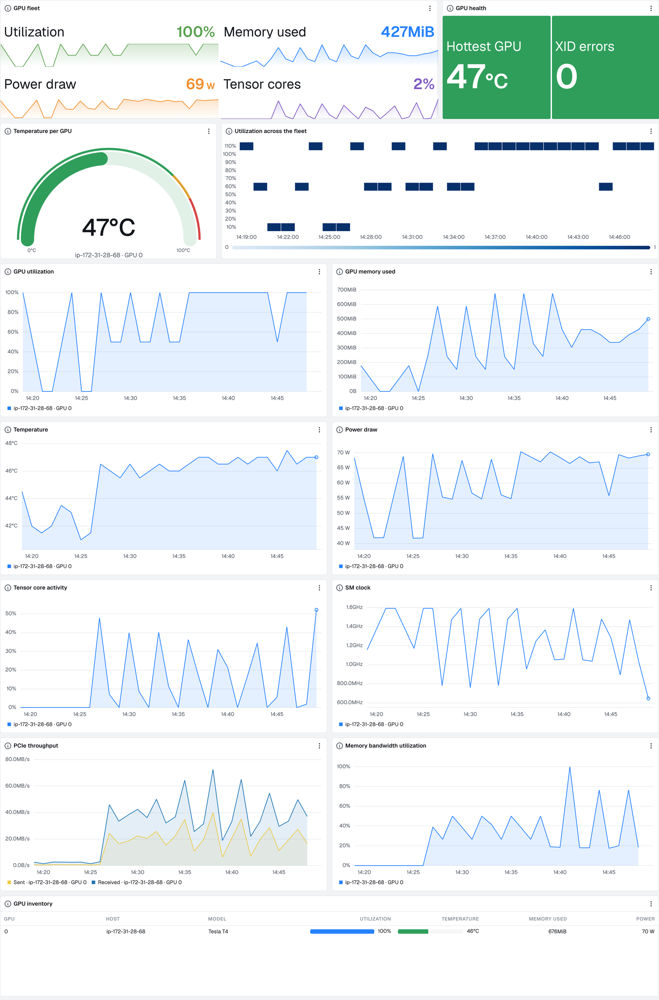

Track the utilization, memory, temperature, power draw, and health of every NVIDIA GPU on a Linux host. NVIDIA's [dcgm-exporter](https://github.com/NVIDIA/dcgm-exporter) reads each GPU through the Data Center GPU Manager (DCGM) and serves the readings as Prometheus metrics. The KloudMate Agent on the same host scrapes them and sends them to KloudMate, where the **NVIDIA GPU (DCGM)** dashboard shows them per host and per GPU.



## Before you start

- A Linux host with an NVIDIA GPU and the NVIDIA driver installed. `nvidia-smi` should list the GPU.
- Docker with the [NVIDIA Container Toolkit](https://docs.nvidia.com/datacenter/cloud-native/container-toolkit/latest/install-guide.html), so containers can reach the GPU.
- The [KloudMate Agent](../../../kloudmate-agent/installation/linux-agent/) installed on the same host.

## Step 1: Run dcgm-exporter

Start dcgm-exporter as a container on the GPU host:

```bash
docker run -d --name dcgm-exporter \
  --hostname "$(hostname)" \
  --gpus all --cap-add SYS_ADMIN \
  --restart unless-stopped \
  -p 9400:9400 \
  nvcr.io/nvidia/k8s/dcgm-exporter:4.5.2-4.8.1-ubuntu22.04
```

`--hostname` sets the exporter's `Hostname` label to the host's name. Without it, the label carries the container ID.

Check that the exporter serves metrics:

```bash
curl -s localhost:9400/metrics | grep DCGM_FI_DEV_GPU_UTIL
```

Each GPU returns one line, labeled with its index, UUID, and model, for example `DCGM_FI_DEV_GPU_UTIL{gpu="0",UUID="GPU-451f…",modelName="Tesla T4",…} 87`.

## Step 2: Add the scrape to the agent

1. Go to **Settings → Agents & Pipelines** and open the agent on the GPU host.
2. Open the **Collector Config** tab.
3. In **Custom config override**, add the following and click **Save override**:

```yaml
receivers:
  prometheus/dcgm:
    config:
      scrape_configs:
        - job_name: dcgm
          scrape_interval: 15s
          static_configs:
            - targets: ["localhost:9400"]
service:
  pipelines:
    metrics:
      receivers: [prometheus/dcgm]
```

This adds the receiver to the agent's existing `metrics` pipeline, so every GPU metric carries the same `host_name` and cloud attributes as the host's own metrics. The agent picks up the change on its next check-in, usually within a minute. If the agent runs in manual mode, add the same receiver to the collector configuration directly. See [Custom config override](../../../kloudmate-agent/custom-config-override/) for how the override merges.

## Step 3: Check the data in Explore

Open [Explore](../../../visualize-data/explore/), choose the metrics dataset, and query `DCGM_FI_DEV_GPU_UTIL` grouped by `host_name` and `gpu`. Metric names keep dcgm-exporter's upper case, so search for `DCGM_FI`, not `dcgm_fi`.

## Install the dashboard

Install the **NVIDIA GPU (DCGM)** dashboard from the [gallery](../../../platform/gallery/): click **Import** on the **Dashboards** list and paste the ID `nvidia-gpu-dcgm`. After installing, pick the hosts to show in **Host**. It lists every host that reports DCGM metrics.



| Panel | Metric | What to look for |
|---|---|---|
| GPU fleet | `DCGM_FI_DEV_GPU_UTIL`, `DCGM_FI_DEV_FB_USED`, `DCGM_FI_DEV_POWER_USAGE`, `DCGM_FI_PROF_PIPE_TENSOR_ACTIVE` | Average utilization, total memory used, total power draw, and average tensor core activity across the selected GPUs, each with a sparkline. |
| GPU health | `DCGM_FI_DEV_GPU_TEMP`, `DCGM_FI_DEV_XID_ERRORS` | The hottest GPU turns amber at 75 °C and red at 85 °C. XID errors turns red when any GPU reports one. |
| Temperature per GPU | `DCGM_FI_DEV_GPU_TEMP` | A gauge per GPU. Above the card's slowdown threshold, the GPU lowers its clocks. |
| Utilization across the fleet | `DCGM_FI_DEV_GPU_UTIL` | How many GPUs ran at each utilization level over time. A dark band at the bottom is idle capacity. |
| GPU utilization | `DCGM_FI_DEV_GPU_UTIL` | Share of time a kernel was running. A GPU stuck at 0% while a job is scheduled on it points to a stalled job or a data loading bottleneck. |
| GPU memory used | `DCGM_FI_DEV_FB_USED` | Framebuffer memory in use, in MiB. A job that runs out of GPU memory fails, so watch the headroom against the card's total. |
| Temperature | `DCGM_FI_DEV_GPU_TEMP` | Core temperature in °C. The dashed line marks 85 °C. |
| Power draw | `DCGM_FI_DEV_POWER_USAGE` | Watts drawn per GPU, for rack power planning. |
| Tensor core activity | `DCGM_FI_PROF_PIPE_TENSOR_ACTIVE` | Share of cycles the tensor cores were busy. Mixed-precision training and inference run on them. |
| SM clock | `DCGM_FI_DEV_SM_CLOCK` | A clock that drops while utilization stays high means the GPU is throttling for power or heat. |
| PCIe throughput | `DCGM_FI_PROF_PCIE_TX_BYTES`, `DCGM_FI_PROF_PCIE_RX_BYTES` | Bytes per second between the host and each GPU. |
| Memory bandwidth utilization | `DCGM_FI_DEV_MEM_COPY_UTIL` | Share of time GPU memory was being read or written. High bandwidth with low utilization means the job is memory bound. |
| GPU inventory | | Every GPU reporting, with its host, model, and current utilization, temperature, memory, and power. |

dcgm-exporter only sends `DCGM_FI_DEV_XID_ERRORS` after a GPU has reported an XID error, so the **XID errors** tile reads **0** on a healthy host. To find the code a GPU reported, query `DCGM_FI_DEV_XID_ERRORS` in Explore grouped by `host_name` and `gpu`, and look it up in [NVIDIA's XID catalog](https://docs.nvidia.com/deploy/xid-errors/).

The `DCGM_FI_PROF_*` profiling metrics need a GPU that supports DCGM profiling, such as the data center T4, A100, and H100. On a GPU without profiling support, the tensor core and PCIe panels stay empty.

## Alert on GPU problems

Useful [alerts](../../../alerts/create-alerts/) to start with:

- **XID error reported:** `DCGM_FI_DEV_XID_ERRORS` above 0 for any `host_name` and `gpu`. Most XID errors need a driver reset or a hardware check.
- **GPU running hot:** `DCGM_FI_DEV_GPU_TEMP` above the slowdown temperature that `nvidia-smi -q -d TEMPERATURE` reports for the card.
- **GPU memory almost full:** `DCGM_FI_DEV_FB_USED` above 90% of the card's memory.
- **GPU host stopped reporting:** turn on [absence detection](../../../alerts/instance-absence-detection/) for `DCGM_FI_DEV_GPU_TEMP`, grouped by `host_name`, to catch an exporter or host that goes silent.

## Troubleshooting

**`curl localhost:9400/metrics` returns nothing.** Check the exporter's logs with `docker logs dcgm-exporter`. If the container can't find a GPU, the NVIDIA Container Toolkit isn't installed or Docker wasn't restarted after installing it. Run `docker run --rm --gpus all ubuntu nvidia-smi` to test GPU access from a container.

**The exporter works but no `DCGM_FI` metrics appear in KloudMate.** Confirm the override was saved on the agent running on the GPU host, then check the agent's logs with `journalctl -u kmagent` for errors mentioning `prometheus/dcgm`. The scrape target is `localhost`, so the agent and the exporter must run on the same host.

## Related

- [Prometheus Integration](../prometheus-integration/): the general pattern for scraping any Prometheus endpoint.
- [Custom config override](../../../kloudmate-agent/custom-config-override/): how overrides merge into a managed agent's configuration.
- [AI Observability](../../../ai-observability/): requests, tokens, cost, and errors for the LLM applications running on these GPUs.
