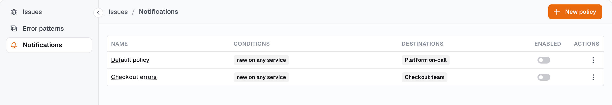

Configure where issue notifications land: by service, by occurrence type (new vs. regression), and across the channels you've set up.

## Where to find it

In **Issues**, click **Notifications** in the Issues panel. The page lists your issue notification policies with their conditions and destinations, and whether each one is enabled.

The notification settings have these URLs:

- `<workspace>/issues/notifications`: the list of all issue notification policies.
- `<workspace>/issues/notifications/create`: create a new policy.
- `<workspace>/issues/notifications/<id>`: edit a policy.

## Anatomy of a policy

Each policy is workspace-scoped (not per-issue) and has three fields:

| Field | What it does |
|---|---|
| **Name** | How the policy shows up in the list. |
| **Conditions** | One or more rows. Each picks an **Issue type** (`New issues` or `New and regression`) and one or more **Target services**. |
| **Notification channels** | One or more channels that receive the notification. |

A **Disabled** toggle lets you save the policy without activating it.

## Create an issue notification policy

1. Open **Issues → Notifications** and click **New policy**.
2. Name the policy.
3. Add one or more conditions. Select the **Issue type** (`New issues` or `New and regression`) and one or more **Target services** from the autocomplete (suggestions come from services emitting telemetry).
4. Select one or more **Notification channels** from the multi-select.
5. Click **Save**.

## Forward-looking note

This page is a dedicated settings surface for issues because the grouping engine and Routing Rules currently handle alert signals only. Issues may converge onto the routing-rules engine in a future release; if that happens, existing issue notification policies will migrate automatically, so you won't need to recreate them.

## Related

- [Issues](../): the error-tracking page these notifications come from.
- [Routing Rules](../../alerts/routing-rules/): notification routing for alerts.
- [Notification Channels](../../platform/settings/notification-channels/): set up where notifications are sent.
