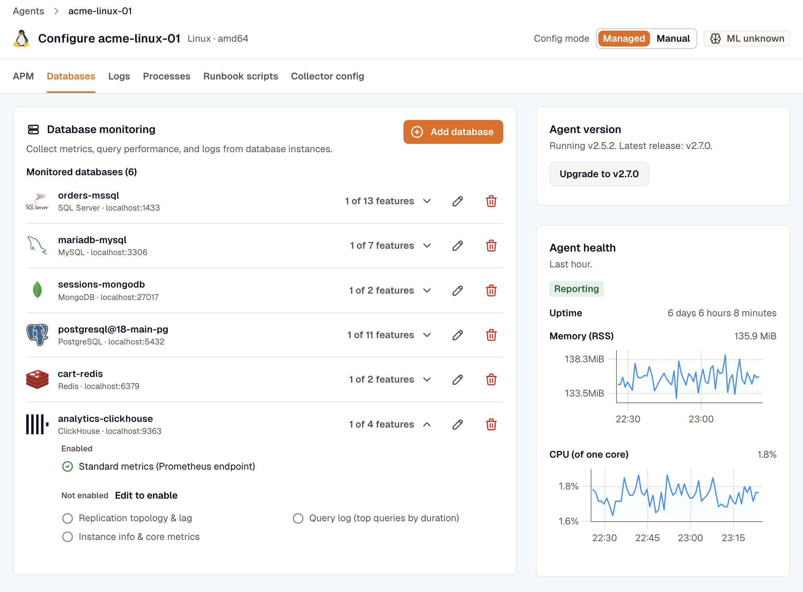

import { LinkCard, CardGrid } from '@astrojs/starlight/components';

Database monitoring connects the KloudMate agent to your databases with a monitoring user, and collects their health metrics, query performance, sessions, schema, topology, and logs. You set it up per database through a wizard, and the agent generates the collector configuration for you. The results appear in the [Databases module](../../../database-monitoring/).

## Two views of your databases

The agent sees your databases in two ways that work together:

- **From your applications, with no credentials.** eBPF and application traces capture the queries your services run against a database, with their timing. These appear in distributed traces, the service map, and the **Calling services** tab of the Databases module. See [eBPF observability](../../ebpf-observability/).
- **From the database itself, when you opt in.** Database monitoring reads the database's own statistics: connections, cache hit ratio, replication lag, top queries, active sessions, and more. This needs a monitoring user.

Both views share a database identity, so a slow query in a trace lines up with the server metrics for the same database. See [Telemetry identity](../../reference/telemetry-identity/).

## Before you start

- **The agent must be in managed config mode.** Database monitoring is generated into the managed collector configuration, on every platform. If the agent is in manual mode, the **Databases** tab offers to switch it. Switching regenerates the configuration from the agent's integrations and replaces manual edits. See the [configuration model](../../concepts/config-model/).
- **The agent must reach the database.** For a self-hosted database, install the agent on the same machine. For a managed database such as Amazon RDS, Cloud SQL, or MongoDB Atlas, install it on a host that can reach the database over the network.
- **The engines and coverages you're offered come from the agent itself**, so they depend on the agent version. Upgrade the agent to get newer coverages.

## Where to set it up

You can open the wizard from two places:

- **Databases → Monitor a database.** Choose the agent, then the engine. This is the quickest path when you're adding a database for the first time.
- **Settings → Agents & Pipelines.** Open the agent and go to its **Databases** tab. It lists the databases the agent discovered and not yet monitored, with a **Monitor** button on each, and the databases already monitored, with **Edit** and **Remove**. Use **Add database** for a database that wasn't discovered.

Once you add one database of an engine on a host, the other discovered databases of that engine drop off the **Discovered on this host** list. Add further databases of the same engine with **Add database**.

## Coverages

You choose what to collect for a database as a set of **coverages**. **Standard metrics** is always on. Every other coverage, such as **Query performance**, **Schema catalog**, or **Replication topology & lag**, is off until you turn it on.

Under **Standard metrics**, check **Collect all optional metrics** to collect the receiver's full metric set instead of the basic one. You get more detail, at a higher series count. Several panels in the Databases module need it.

See [Engines and coverages](../engines-and-coverages/) for every coverage by engine.

## The wizard

The wizard is one form, top to bottom:

1. **Database engine.** Skipped when you started from a discovered database or from the Databases module, since the engine is already chosen.
2. **What to collect.** Turn coverages on and off.
3. **Setup required.** The grants, extensions, and database settings the selected coverages need, ready to copy. Run them on the database before you save.
4. **Connection.** The fields your coverages need: endpoint, monitoring user, password, and coverage-specific settings such as scan intervals or schemas to scan. **Instance name** is optional, but set it when you monitor more than one database of the same engine on one endpoint, such as an Oracle CDB root and its PDBs. It keeps their data apart.
5. **Advanced.** An optional YAML fragment per coverage, merged into that coverage's generated receiver configuration. Use it for settings the form doesn't expose, such as TLS options. It isn't validated against a schema, and a password typed here is stored in plain text.

Click **Save and apply**. The change reaches the agent within a minute.


## What's checked when you save

The wizard checks that required fields are filled in and that any **Advanced** override is a YAML mapping. It doesn't connect to the database, so it can't test your password or grants.

- **A wrong password or a missing grant** shows up as errors in the agent log, and as empty tabs in the Databases module. If a tab stays empty, run the setup steps again and check the agent log.
- **A database the agent can't generate** is skipped on its own. The other databases and the rest of your telemetry keep working. Skipped integrations and the reason are listed on the agent's **Collector config** tab.

## Edit or remove a database

Monitored databases are edited from the agent that monitors them, not from the Databases module. Go to **Settings → Agents & Pipelines**, open the agent, and go to its **Databases** tab.



Click **Edit** on a monitored database to change its coverages, connection, or overrides. Stored passwords stay in place unless you replace them. To turn on a coverage you haven't enabled yet, expand the database's feature list and follow **Edit to enable**.

Click **Remove** to stop monitoring a database. The change applies within a minute.

## Reduce query performance volume

The **Query performance** coverage sends two kinds of log events. **Query samples** (`db.server.query_sample`) are snapshots of the sessions on the database at each collection. **Top queries** (`db.server.top_query`) are the most expensive statements since the previous collection. On a busy database, these can add up to thousands of events an hour.

To send fewer, edit the database, expand **Advanced**, choose the **Query performance** coverage, and set these keys:

| Engine | Top queries per collection | Top query interval | Sessions per sample |
|---|---|---|---|
| PostgreSQL | `top_query_collection.top_n_query` (200) | `top_query_collection.collection_interval` (1m) | `query_sample_collection.max_rows_per_query` (1000) |
| MySQL and MariaDB | `top_query_collection.top_query_count` (200) | `top_query_collection.collection_interval` (1m) | `query_sample_collection.max_rows_per_query` (100) |
| SQL Server | `top_query_collection.top_query_count` (250) | `top_query_collection.collection_interval` (1m) | `query_sample_collection.max_rows_per_query` (100) |
| Oracle | `top_query_collection.top_query_count` (200) | `top_query_collection.collection_interval` (1m) | `query_sample_collection.max_rows_per_query` (100) |

Defaults are in parentheses. For example, this sends the top 50 PostgreSQL statements every 5 minutes instead of the top 200 every minute, and samples at most 200 sessions:

```yaml
top_query_collection:
  top_n_query: 50
  collection_interval: 5m
query_sample_collection:
  max_rows_per_query: 200
```


- **Query samples follow the standard metrics interval.** The receivers don't support a separate interval for samples. Don't set a top-level `collection_interval` in this override: query performance shares a receiver with standard metrics, so it would slow those down too.
- **Connection poolers produce many idle samples.** An idle session is sampled once after each query it finishes, which is how short queries are captured at all. Behind a pooler such as PgBouncer, most connections are idle at any moment, so most samples are idle sessions. Samples can't be filtered by session state, so lower `max_rows_per_query` to send fewer of them.
- **The sample row limit isn't a ranking.** When there are more sessions than `max_rows_per_query`, the sessions that get sampled aren't chosen by activity or duration.

## PII detection

Database query logs and database spans pass through the agent's PII detection before they leave the host. Records that contain personal data are tagged with `km.pii.detected`, `km.pii.critical`, and `km.pii.categories`. The matched values themselves aren't copied into these attributes.

The agent's configuration page shows the status of the on-host machine learning classifier: **ML active** when it's running, **ML not responding** when it stopped reporting, **ML not installed**, or **PII detection off**.

:::note
Query samples and top queries carry normalized statements with literal values replaced. The coverages that can carry raw SQL are the query log coverages for Oracle, SQL Server, and ClickHouse, Snowflake top queries, and database log file coverages such as the MySQL slow query log.
:::

## Where to run it

<CardGrid>
  <LinkCard title="On a VM" href="../on-vm/" description="Monitor databases on or reachable from a Linux or Windows host." />
  <LinkCard title="On Kubernetes" href="../on-kubernetes/" description="Monitor in-cluster databases from the cluster collector." />
  <LinkCard title="Engines and coverages" href="../engines-and-coverages/" description="Every coverage, by engine." />
  <LinkCard title="Credentials" href="../credentials/" description="Provide the monitoring user's password safely." />
</CardGrid>
