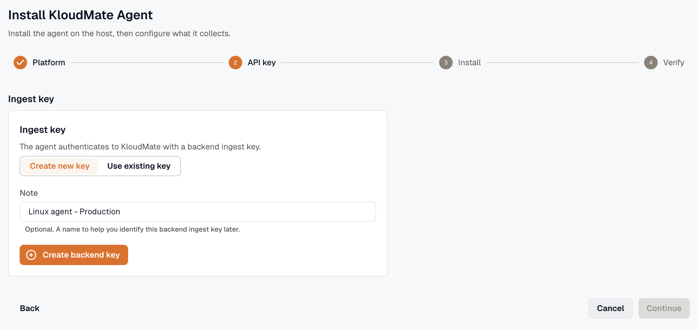
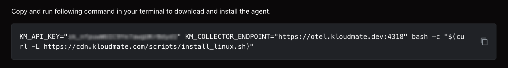
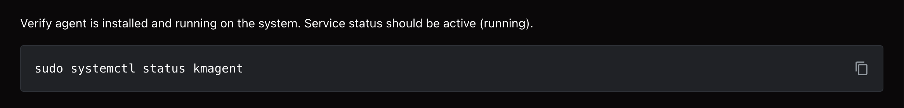
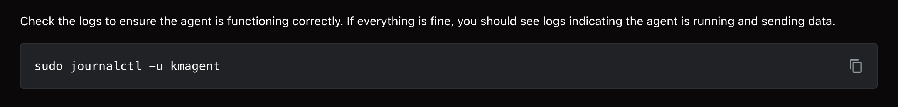
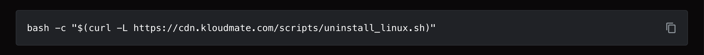

Install the **KloudMate Agent** on a Linux machine.

**Supported Platforms:** Debian/Ubuntu, RHEL/CentOS 7 and later, SLES 15, and openSUSE Leap 15. RHEL and CentOS 7 have [some limits](#rhel-and-centos-7).

If your outbound traffic is restricted, see [Before you start](../before-you-start/) for the URLs and permissions to allow first.

:::note
  The commands below are for reference only. Log in to KloudMate and copy your account-specific command to install the Agent.
:::

## What the Linux Agent Monitors

After installation, the agent sends telemetry to KloudMate. From there you can monitor system health and investigate issues.

Key capabilities:

- Monitoring CPU, memory, disk, and network usage
- Tracking performance trends over time
- Detecting resource bottlenecks
- Collecting and analyzing system and application logs
- Monitoring Docker containers on the host, when Docker is present
- Visualizing data with dashboards
- Creating alerts for critical conditions

## **Accessing Your Data**

View all data in these KloudMate sections:

**1. Infrastructure Monitoring**

- View connected Linux hosts
- Monitor real-time and historical resource usage
- Track host availability and uptime

[Infrastructure Monitoring](../../../infrastructure/)

**2. Dashboards**

- Use the pre-built [Host Metrics – Linux](https://templates.kloudmate.com/host-metrics/index.html) dashboard template to visualize server performance
- Build custom dashboards based on your monitoring needs

[Creating a Dashboard](../../../visualize-data/dashboards/)

**3. Log Explorer**

- Search and filter logs
- Correlate logs with metrics
- Troubleshoot issues

[Log Explorer](../../../logs/log-explorer/)

## Install Agent

**Step 1:** Navigate to the **Settings → Agents & Pipelines** section in your KloudMate account.

**Step 2:** Click **Add Agent**, select **Linux**, and click **Continue**. On the **API key** step, click **Create backend key**, or select **Use existing key** and paste your backend ingest key. Then click **Continue**.



**Step 3:** Copy and run the Linux agent install command in your terminal to download and install the agent.



**Step 4:** Run the agent status command to check if the agent is active.



**Step 5:** Execute the "Check Logs" command to confirm the agent is functioning correctly.



## Check a host before installing

To find out whether a host can run the agent without changing anything on it, run the install script with `--check`:

```bash
curl -fsSL https://cdn.kloudmate.com/scripts/install_linux.sh | bash -s -- --check
```

The check doesn't need an API key. It checks the OS, CPU architecture, kernel version, and systemd, then downloads the latest package to confirm that the host can reach the release server and that its `dpkg` or `rpm` can read the package. Each problem it finds is printed with its fix. If you can't fix one, send the output to [support@kloudmate.com](mailto:support@kloudmate.com).

The install command runs the same checks first, and stops before it changes anything on the host if one fails.

## **Log Integration**

By default, the KloudMate Agent collects host metrics. It does not collect system logs on Linux — to collect the systemd journal, add it with a [custom config override](../../custom-config-override/).

To collect your own application log **files**, use log monitoring. In the agent's **Logs** tab, point the agent at a folder and file-name pattern, then choose how to parse each line: plain text, JSON, or a regular expression. Multiline grouping, for stack traces or pretty-printed JSON, works on top of any format. You can preview the parsed records before you save. See [Log monitoring](../../log-monitoring/).

For a hand-written `filelog` receiver in manual mode, see [Collect File Logs with KloudMate Agent](../../../logs/collect-file-logs/).

## Monitor Docker containers on the host

If the host runs Docker, the agent finds the Docker socket and starts collecting **container metrics and container logs** on its own, the same telemetry a Docker-mode agent collects. This happens as soon as the agent starts, before and independent of application tracing. To turn it off, set `KM_DOCKER_STATS=false` for metrics or `KM_DOCKER_LOGS=false` for logs.

Each container also shows up in the **Application Performance Monitoring** card on the agent's **APM** tab, where you choose **Off**, **eBPF**, or **SDK** per container, the same as for host processes. eBPF captures RED metrics and trace spans in the kernel, with no code change and no restart. **SDK** adds the OpenTelemetry SDK to Java, Node.js, Python, and .NET containers by recreating them with the same settings. It's on by default.

PHP containers get the **SDK** option without a redeploy: the agent injects the tracer and reloads the web server (Apache or php-fpm). On a Linux host this is opt-in, because the tracer reports to port `8126`, which a Datadog agent may already use. See [Container SDK on the Linux agent](../../platform-notes/docker/#container-sdk-on-the-linux-agent). In Docker mode it's on by default.

For monitoring containers, a Linux service and a Docker-mode agent are equivalent. Choose between them by how you want to run the agent, not by what they can see. See [Docker mode vs the Linux agent](../../platform-notes/docker/#docker-mode-vs-the-linux-agent).

## RHEL and CentOS 7

RHEL and CentOS 7 need agent version **2.8.1 or later**. Earlier packages fail to install there with a `GLIBC` dependency error.

Host metrics and logs work as usual. The older kernel and glibc on these systems limit the rest:

- **eBPF monitoring isn't available.** It needs kernel 4.14 or later, and these systems run 3.10. The agent skips it and keeps collecting metrics and logs.
- **.NET auto-instrumentation isn't supported.** The profiler needs a newer glibc, and the .NET versions it supports don't run on these systems. Your .NET applications keep running, without traces from the agent.
- **PHP 8.2 and later uses the trace extension** instead of the native OpenTelemetry extension, which needs a newer glibc. The agent downloads the trace extension when you turn on instrumentation, so the host needs outbound HTTPS to `github.com` at that point.
- **Python auto-instrumentation needs Python 3.10 to 3.14,** so it doesn't cover the Python that ships with these systems.

## Configuration and next checks

New agents start in **managed mode**, with a default of host metrics and eBPF monitoring. You review and change what is collected from the web interface, without editing files on the host. See the [configuration model](../../concepts/config-model/).

The agent's own settings, such as the API key, host name, and self-health reporting, live in `agent.yaml` on the host. See the [configuration reference](../../reference/agent-config/) for the full list of settings and their environment-variable equivalents.

After the agent is running, confirm what it collects and explore what it found:

- Host metrics and logs start flowing automatically. See [Host metrics and logs](../../baseline/host-metrics-and-logs/).
- On a supported Linux kernel (4.14 or newer), [eBPF monitoring](../../ebpf-observability/) turns on automatically and adds RED metrics and a service map.
- To see what the agent found and instrument a service, go to **Settings → Agents & Pipelines**, open the agent's actions menu (⋮), and select **Configure**. See [Discovery](../../concepts/discovery/).

## Next Steps

- Open **Hosts** to confirm your Linux hosts are visible
- Go to **Dashboards** to review system performance
- Use **Logs** to start investigating logs
- Set up **alerts and notifications** for critical events

## Uninstall Agent

Run the provided uninstall command to remove the agent.


