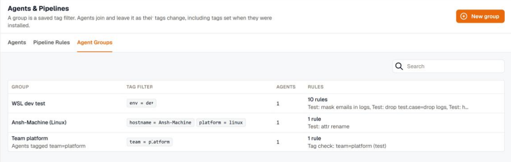
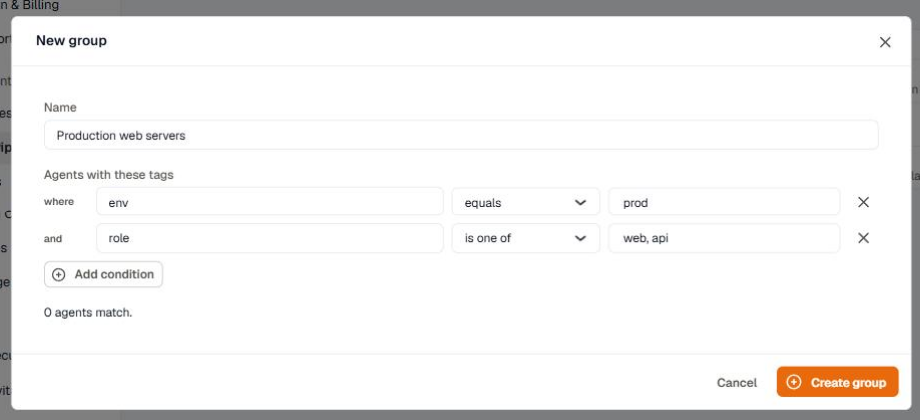
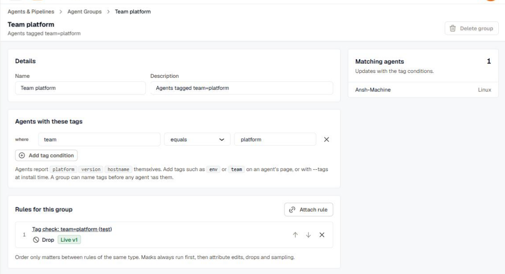
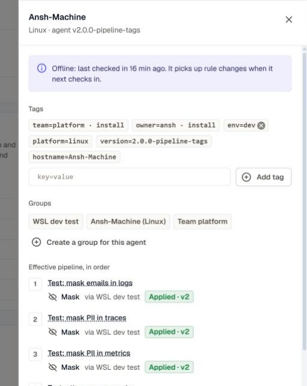

Pipeline rules apply to agent groups. A group is a saved tag filter, such as `env = prod` or `team = payments`, and an agent belongs to every group whose filter it matches. When an agent's tags change, it joins or leaves groups on its own, and the rules it runs change with them.

Open **Settings** → **Agents & Pipelines** → **Agent Groups** to see each group's tag filter, its agents, and the rules that use it.

## Where tags come from

Every agent reports `platform`, `version`, and `hostname` itself. Add your own tags in either of these ways:

- At install time, with the `--tags` flag or the `KM_AGENT_TAGS` environment variable, as `key=value` pairs separated by commas. For example, `KM_AGENT_TAGS=env=prod,team=payments`.
- On the agent's page in KloudMate. A tag set here wins over an install tag with the same key, and it can be removed again.

A group can name tags that no agent has yet. Agents join it as soon as they get the tags.

## Create a group

1. On **Agent Groups**, click **New group**.
2. Enter a name that people will recognize under **Apply to**, for example `Production web servers`.
3. Add tag conditions. An agent must match all of them. For example, `env` equals `prod` and `role` is one of `web, api`.
4. Click **Create group**.

Tag conditions use the same operators as rule conditions, except **is below**. A group with no tag conditions matches every agent.

## Manage a group

Open a group to edit its tag filter and see the agents that match it, updated as you edit.

Under **Rules for this group**, attach a rule, move it up or down, or detach it. Order only matters between rules of the same type, because masks always run first, then attribute edits, drops, and sampling. A rule that reaches an agent through more than one group runs once.

To delete a group, detach its rules first.

## See one agent's rules

On an agent's page, the pipeline rules button opens a panel with the agent's tags, the groups it belongs to, and every rule it runs, in the order it runs them. Each rule shows the group that put it there and its status on the agent, such as **Applied · v2**.

Add a tag in this panel as `key=value`, and the agent joins every group it now matches. **Create a group for this agent** makes a group that matches only this agent.
