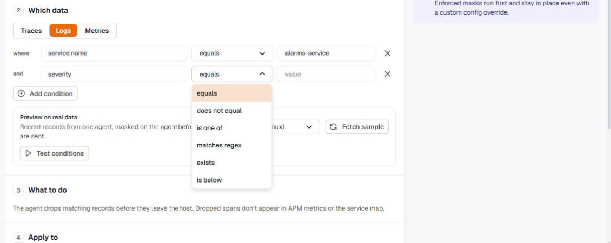
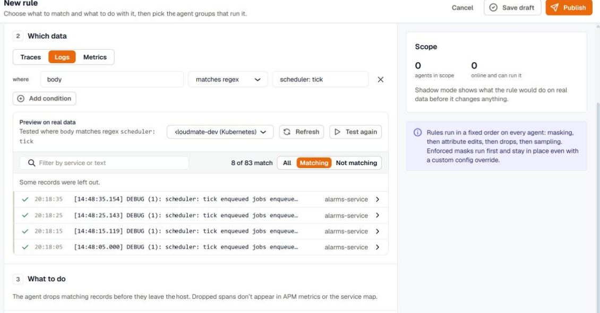
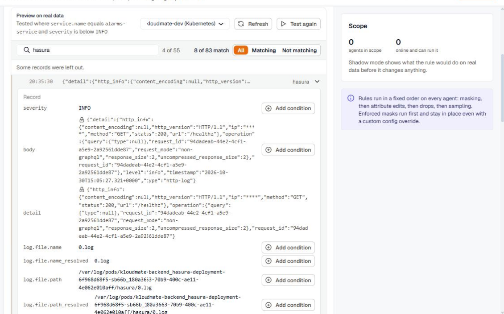
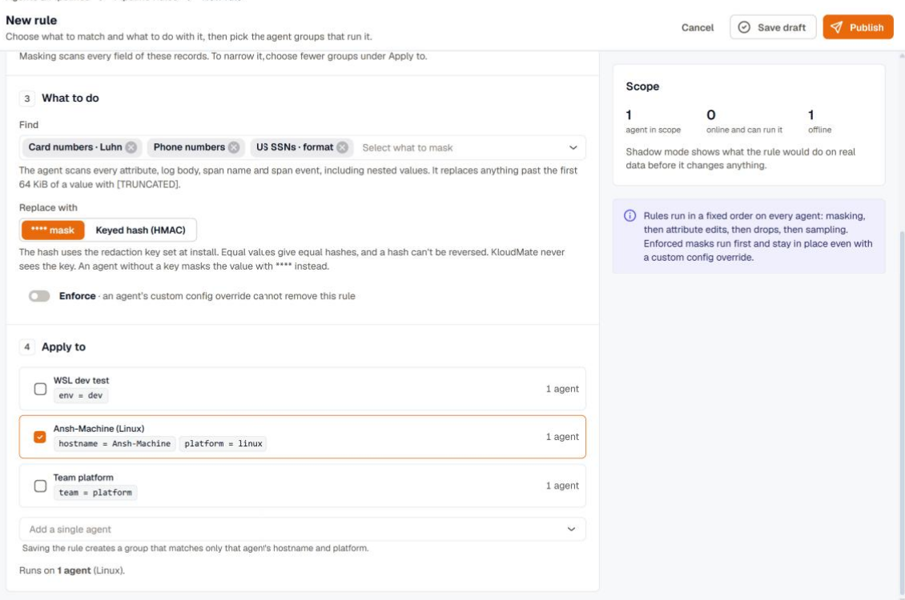

import { LinkCard, CardGrid } from '@astrojs/starlight/components';

A pipeline rule is written in four parts: the rule type, the data it applies to, what it does, and the agents that run it. Before you publish, you can test the rule's conditions against recent records from a real agent and see exactly which ones match.

## Choose the type and the data

1. Open **Settings** → **Agents & Pipelines** → **Pipeline Rules**, and click **New rule**.
2. Choose a rule type: **Drop**, **Mask**, **Edit attributes**, or **Sample**. The rest of the form changes to match the type.
3. Enter a name that describes the outcome, for example `Drop scheduler debug logs`.
4. Under **Which data**, choose **Traces**, **Logs**, or **Metrics**. A sample rule always applies to traces.

## Add conditions

Conditions decide which records the rule acts on. Each condition is a field, an operator, and a value, and a record must match every condition you add. With no conditions, the rule applies to every record of the selected data.

For example, `service.name` equals `alarms-service` and `severity` is below `INFO` matches the TRACE and DEBUG logs of that one service.

The field list shows common names first, followed by the keys your workspace has sent in the last hour. You can also type any attribute name. See [Conditions](../conditions/) for every field and operator.

## Test the conditions on live data

The **Preview on real data** panel fetches recent records from one agent and shows how your conditions would treat them.

1. Choose an agent. Only online agents that can answer a sample request are listed.
2. Click **Test conditions**. The agent answers on its next check-in, usually within a minute.
3. Review the matches. Matching records are marked with a check, and you can show all records, only matching ones, or only the ones that don't match.

The agent masks the sample with every built-in detector before sending it, so the preview never shows raw card numbers, emails, or tokens. Values that were masked are marked with a lock.

If you change a condition after testing, click **Test again** to see what the new conditions match.

### Filter a large sample

Use **Filter by service or text** to narrow the sample to one service or to records that contain a phrase. On a Kubernetes cluster, a sample can hold records from dozens of services, so filtering by service name is the fastest way to find the records you care about.

When a sample has more sources than it can hold, the sources that weren't sampled are listed under the records. Click one to fetch a sample from that source alone.

### Add a condition from a record

Open any sampled record to see every field the agent read: the body, the severity, top-level keys of a JSON body, and the record and resource attributes. Point at a field and click **Add condition** to add it to the rule with its current value, so you don't have to guess field names.

## Choose the agents

Under **Apply to**, select the agent groups that should run the rule. A group is a saved tag filter, such as `env = dev` or `team = platform`, and agents join or leave it as their tags change. The **Scope** panel shows how many agents are in scope, how many are online and can run the rule, and how many are offline.

To target one machine, use **Add a single agent**. Saving the rule creates a group that matches only that agent's hostname and platform. See [Agent groups](../agent-groups/) to create groups of your own.

## Save or publish

- **Save draft** stores the rule without changing any agent. You can come back to it from the rules list.
- **Publish** opens the rollout choices: a staged rollout, every agent now, or shadow mode. See [Publish and roll out](../rollouts/).

<CardGrid>
  <LinkCard title="Rule types" href="../rule-types/" description="What to set for drop, mask, edit attributes, and sample rules." />
  <LinkCard title="Publish and roll out" href="../rollouts/" description="Roll a rule out in stages or in shadow mode first." />
</CardGrid>
