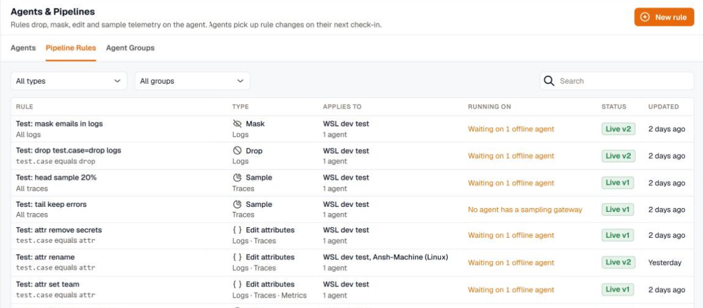

import { LinkCard, CardGrid } from '@astrojs/starlight/components';

Pipeline rules change telemetry on the KloudMate Agent itself, before it leaves the host. You can drop logs, spans, and metrics you don't need, mask personal data and secrets, edit attributes, and sample traces. Rules are written in the KloudMate web interface and apply to groups of agents, so one rule can cover every host in an environment or a single machine.

Because the work happens at the source, a rule affects what you send as well as what you store:

- **Lower egress and ingest cost.** Health checks, debug logs, and noisy spans that a rule drops are never sent over the network.
- **Sensitive data stays in your network.** A mask rule replaces card numbers, emails, tokens, and other personal data on the agent, so KloudMate never receives the original values.

Open **Settings** → **Agents & Pipelines** → **Pipeline Rules** to see the rules in your workspace.

## Rule types

| Type | What it does | Data |
|---|---|---|
| **Drop** | Discards the records that match the rule's conditions. | Logs, traces, or metrics |
| **Mask** | Replaces sensitive values with `****` or a keyed hash. Built-in detectors find card numbers, emails, phone numbers, IP addresses, IBANs, Aadhaar and PAN numbers, US SSNs, and JWTs, and you can add your own regex. | Logs, traces, or metrics |
| **Edit attributes** | Removes, renames, or sets attributes. | Logs, traces, or metrics |
| **Sample** | Keeps a percentage of traces, and can always keep traces with errors or slow requests. | Traces |

Each rule works on one kind of data. To drop the same thing from logs and traces, write two rules.

## How rules run on an agent

Every agent runs its rules in the same order: masks first, then attribute edits, then drops, then sampling. Because masks run first, no later rule and nothing downstream ever sees an unmasked value. A drop condition on a masked field matches the masked text, not the original.

Rule changes reach an agent on its next check-in, which is about once a minute. An agent that is offline applies them when it checks in again. If an agent can't apply a rule, it keeps its previous configuration and reports the failure, so a bad rule never stops an agent from sending data.

An agent's [custom config override](../../custom-config-override/) is applied after the rules and can remove one. Turn on **Enforce** for a mask rule that must always run, even when an override is present.

## Requirements

- An agent version that supports pipeline rules. Older agents in scope show the rule as **Skipped**. See [Upgrade the agent](../../upgrade/).
- For tail sampling (a sample rule that keeps errors or slow traces), a sampling gateway that the agents forward traces to. Agents without one skip the rule.
- For keyed-hash masking, a redaction key set when the agent was installed. Agents without the key mask the value with `****` instead.

## Next steps

<CardGrid>
  <LinkCard title="Create a rule" href="../create-a-rule/" description="Write a rule, test it on live data, and choose the agents that run it." />
  <LinkCard title="Rule types" href="../rule-types/" description="Settings for drop, mask, edit attributes, and sample rules." />
  <LinkCard title="Publish and roll out" href="../rollouts/" description="Staged rollouts, shadow mode, and what each rule did." />
  <LinkCard title="Recipes" href="../recipes/" description="Ready-made rules for common noise, cost, and privacy problems." />
</CardGrid>
