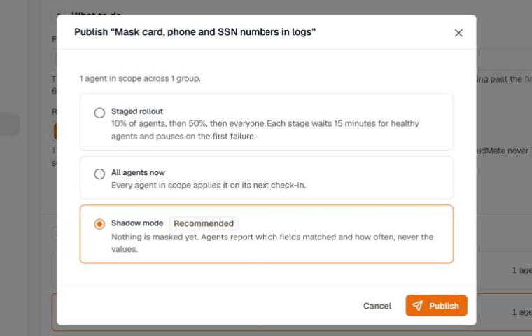
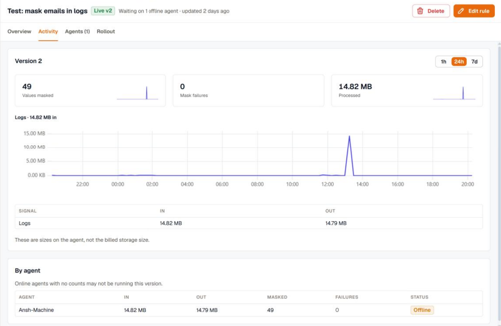

Publishing a rule creates a new version of it. Agents keep running the version they have until the rollout reaches them, so you can change a live rule without a gap in coverage.

Click **Publish** in the rule editor and choose how the rule reaches its agents.

| Option | What happens |
|---|---|
| **Staged rollout** | 10% of the agents in scope get the rule, then 50%, then every agent. Each stage waits 15 minutes for healthy agents and pauses on the first failure. |
| **All agents now** | Every agent in scope applies the rule on its next check-in. |
| **Shadow mode** | Drop and mask rules only. Agents count what the rule would do and change nothing. |

## Try a rule in shadow mode

Shadow mode shows the effect of a drop or mask rule on real traffic before it changes any data.

1. Publish the rule with **Shadow mode**.
2. Open the rule and go to **Activity**. For a drop rule, it shows what the rule would drop and how much data that would save. For a mask rule, it shows how many values would be masked and where they matched. Agents report the field, the detector, and the shape of a match, never the value.
3. When the numbers look right, click **Edit rule** and publish again as a staged rollout or to all agents now.

## Follow a staged rollout

The **Rollout** tab of a rule shows each stage and how far the rollout has got. A stage moves on once its 15-minute soak time has passed and every agent in it reports the new version applied. An agent that stays silent holds the stage, and a failure or a revert pauses the rollout with the reason.

From the **Rollout** tab you can:

- **Pause** and **Resume** the rollout. Agents that already applied the rule keep it while it's paused.
- **Promote** to the next stage now, without waiting for the soak time.
- **Finish rollout** to apply the rule to every agent in scope.
- **Abort rollout** to return the rule to a draft. A draft runs on no agent.

## See what a rule did

Open a rule from the list and go to **Activity**. Agents send counts about once a minute for the live version of the rule.

- The summary at the top depends on the rule type: values masked and mask failures for a mask rule, or records dropped for a drop rule.
- **In** and **Out** compare the size of the data before and after the rule. These are sizes measured on the agent, not your billed storage size.
- **By agent** breaks the same counts down per agent. An online agent with no counts may not be running the current version yet.

The **Agents** tab lists every agent in scope, the group that put it there, and the rule's status on it.

## Rule status on an agent

| Status | Meaning |
|---|---|
| **Applied** | The agent runs this version of the rule. |
| **Shadow** | The agent counts what the rule would do without changing data. |
| **Skipped** | The agent can't run the rule. Its version is too old for pipeline rules, or the rule needs a sampling gateway the agent doesn't have. |
| **Failed** | The agent couldn't apply the rule and kept its previous configuration. |
| **Reverted** | The agent applied the rule, hit a problem, and returned to its previous configuration. |
| **Removed by override** | The agent's [custom config override](../../custom-config-override/) removed the rule. Turn on **Enforce** for masks that must always run. |

A failure or a revert during a staged rollout pauses the rollout.

## Edit or delete a rule

- **Edit rule** opens the editor. Saving a draft doesn't change any agent. Publishing creates the next version and rolls it out the way you choose.
- **Delete** removes the rule. Agents stop running it on their next check-in, and it can't be undone.
