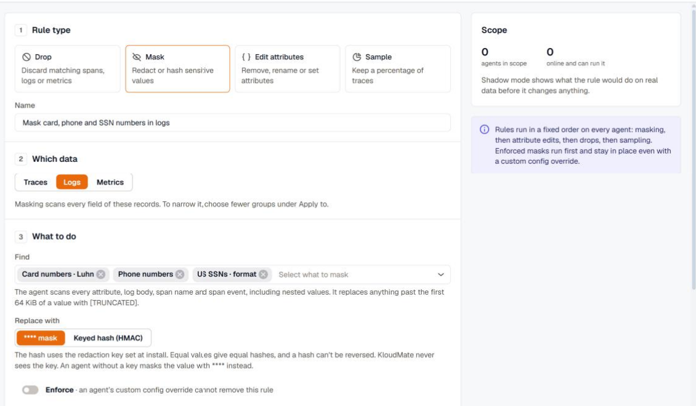
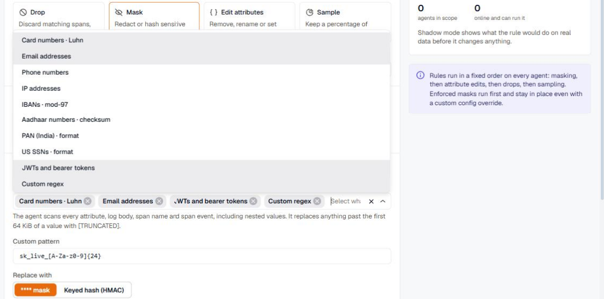
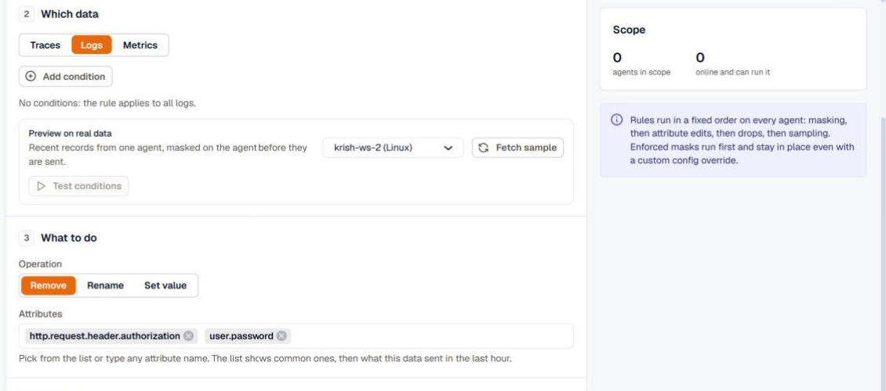
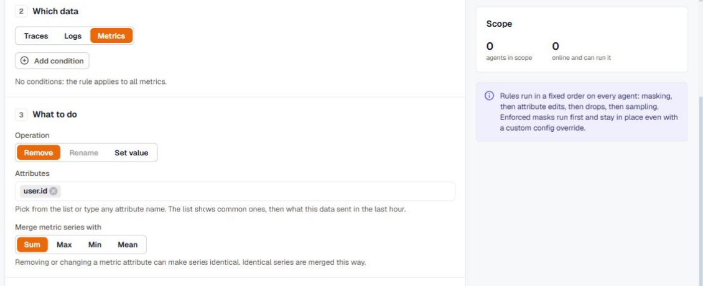
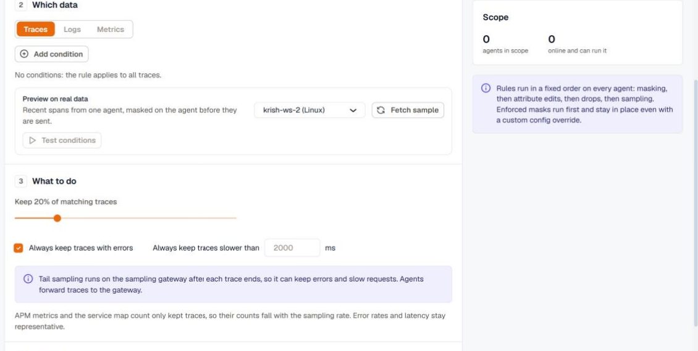

Each rule type has its own settings under **What to do** in the rule editor. Conditions work the same way for every type. See [Conditions](../conditions/).

## Drop

A drop rule discards matching logs, spans, or metrics before they leave the host. It has no settings beyond its conditions.

Dropped spans don't appear in APM metrics or the service map. For example, if you drop the spans of a `/health` endpoint, that endpoint's request rate and latency disappear from APM as well.

When you aren't sure what a drop rule will catch, publish it in [shadow mode](../rollouts/#try-a-rule-in-shadow-mode) first. Agents then count what the rule would drop without dropping anything.

## Mask

A mask rule finds sensitive values anywhere in a record and replaces them on the agent. It scans every attribute, the log body, the span name, and span events, including nested values. Anything past the first 64 KiB of a value is replaced with `[TRUNCATED]`.

### Choose what to find

Pick one or more built-in detectors, or add a custom regex. Detectors marked with a check validate what they find, so a random number of the right length isn't mistaken for a card number.

| Detector | Check |
|---|---|
| Card numbers | Luhn |
| Email addresses | |
| Phone numbers | |
| IP addresses | |
| IBANs | mod-97 |
| Aadhaar numbers | checksum |
| PAN (India) | format |
| US SSNs | format |
| JWTs and bearer tokens | |
| Custom regex | Your own pattern, for example `sk_live_[A-Za-z0-9]{24}` |

### Choose the replacement

- **`****` mask** replaces the value outright.
- **Keyed hash (HMAC)** replaces the value with a hash made with the redaction key set when the agent was installed. Equal values produce equal hashes, so you can still count distinct users or follow one user across records without seeing who they are. A hash can't be reversed, and KloudMate never sees the key. Agents without a key mask the value with `****` instead, and the editor tells you how many agents in scope have no key.

### Enforce a mask

Turn on **Enforce** to keep the rule in place even when an agent has a [custom config override](../../custom-config-override/). Enforced masks run before every other rule.

## Edit attributes

An edit attributes rule changes record attributes on the agent:

- **Remove** deletes one or more attributes, for example `http.request.header.authorization`.
- **Rename** moves an attribute to a new name, for example `userId` to `user.id`.
- **Set value** sets an attribute to a fixed value, for example `team` to `payments`.

Pick attributes from the list or type any attribute name. Add conditions to edit only some records.

### Edit metric attributes

On metrics, removing or changing an attribute can make two series identical. For example, removing `user.id` from a request counter turns one series per user into one series per route. Choose how identical series are merged under **Merge metric series with**: **Sum** for counters, and **Max**, **Min**, or **Mean** for gauges. **Rename** isn't available for metrics.

## Sample

A sample rule keeps a percentage of traces.

How the rule samples depends on its settings:

- **Head sampling** applies when the rule has no keep options and no conditions. The decision is made when a trace starts, which keeps traces that cross hosts complete, and logs that carry a trace ID follow their trace. An environment (the `env` tag) can have one head-sampling rate, so a second head-sampling rule for the same environment is refused.
- **Tail sampling** applies when you turn on **Always keep traces with errors** or set **Always keep traces slower than** a number of milliseconds. The decision is made after each trace ends, on the sampling gateway, so errors and slow requests are kept even at a low rate. Conditions are only available for tail sampling, and limit the rule to matching traces.

APM metrics and the service map count the traces you keep, so request counts fall with the sampling rate. Error rates and latency stay representative.

For per-service sampling of instrumented applications, see [Sampling](../../auto-instrumentation/sampling/).
