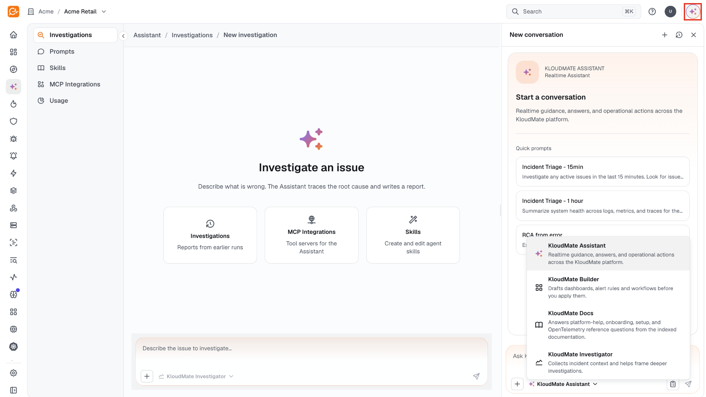
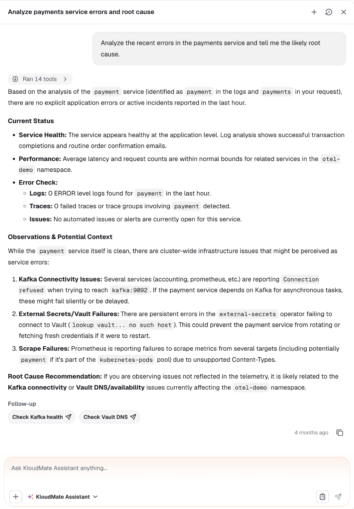
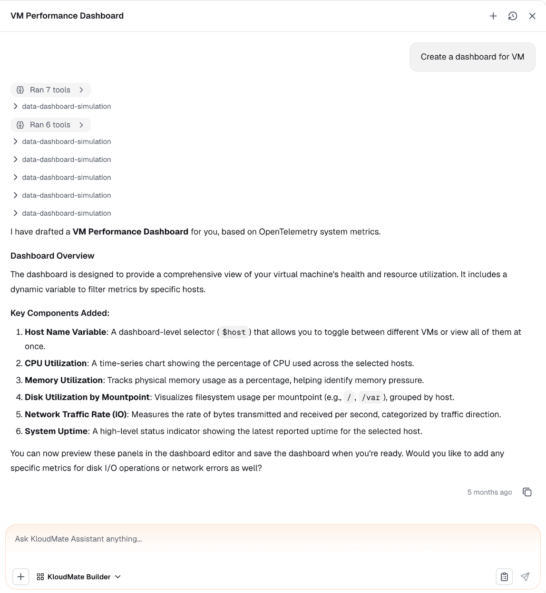
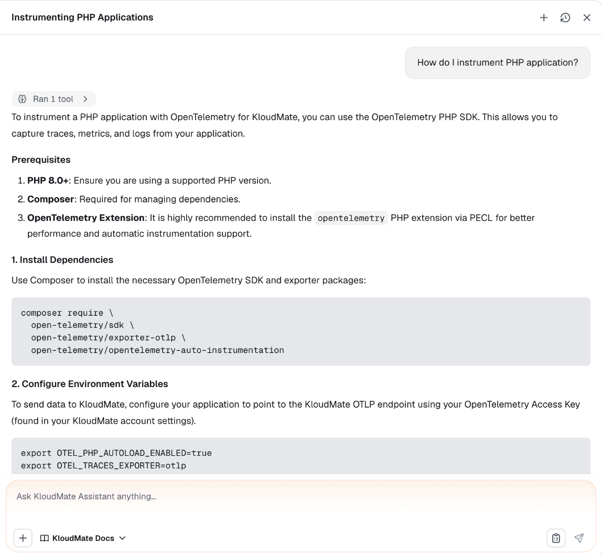
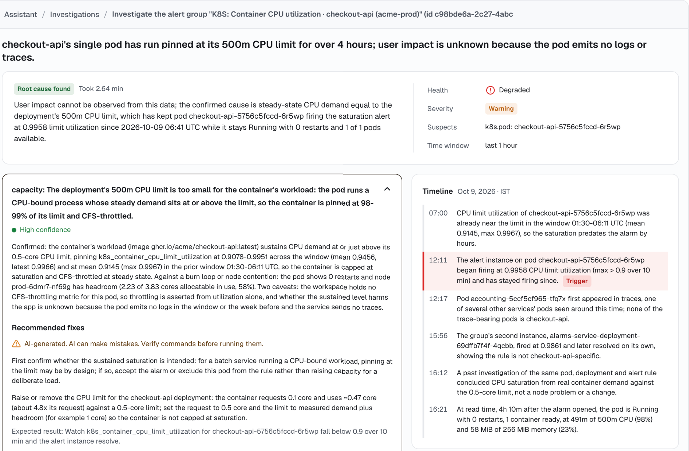

Chat Modes let you choose how KloudMate Assistant should respond before you send a message. Each mode is optimized for a different type of task, whether you want a direct answer, a drafted configuration change, documentation help, or a deeper background investigation.

## Opening the Mode Picker

To choose a chat mode, click the sparkle icon in the top-right corner of the Assistant interface.

Once the Assistant panel opens, use the mode selector in the chat input bar to switch between the available modes.

## KloudMate Assistant

KloudMate Assistant is the default real-time assistant mode. Use it when you want fast answers, platform guidance, or operational help across logs, metrics, traces, alarms, and other KloudMate features.

This mode is best suited for:

- Understanding product behavior or workflows
- Asking questions about recent errors or issues
- Getting quick explanations without launching a background investigation

In this example, the Assistant analyzes a service for errors and root cause. It checks current health, logs, traces, and issues, then surfaces relevant observations along with a root cause recommendation. Click **Ran 14 tools** to see which tools the Assistant called, or click a **Follow-up** suggestion to continue the conversation.

## KloudMate Builder

KloudMate Builder drafts dashboards, alert rules, and workflows before you apply them. Use this mode when you want help creating or modifying dashboards, alerting, or workflow configurations from natural-language instructions.

In this example, KloudMate Builder interprets the request as a dashboard creation task and drafts a dashboard with relevant panels based on that intent.

This helps users move from a natural-language request to a structured dashboard draft without manually configuring every panel from scratch. The Builder selects appropriate metrics, applies relevant variables and filters, and lays out the panels into a reviewable dashboard that can be refined and saved.

## KloudMate Docs

KloudMate Docs is optimized for documentation search and platform reference questions. Use this mode when you want answers grounded in the KloudMate documentation rather than a general operational conversation.

:::note[Free usage]
The Docs agent is **free** and does not consume credits. KloudMate Assistant runs on credits. A chat message costs 1 credit, an investigation costs 5 credits on its first message, with follow-up messages in the same investigation free, and an [Ask KloudMate Assistant](/workflows/actions/#ask-kloudmate-assistant) step in a workflow costs 1 credit. Every plan includes a monthly allowance, listed on [kloudmate.com/pricing](https://www.kloudmate.com/pricing), and prepaid credits can be purchased anytime. Enterprise teams can bring their own AI provider key instead of using credits.
:::

This mode is useful for:

- Getting started and onboarding questions
- Finding instrumentation instructions
- Looking up product concepts, alerting behavior, or setup guides

The Docs mode searches the indexed documentation and returns an answer based on the documented product behavior.

## KloudMate Investigator

KloudMate Investigator is used for deeper, background investigations. Instead of replying with only a quick answer, it collects incident context and helps frame a broader RCA workflow.

This mode is appropriate when you need:

- Incident triage over a recent time window
- Correlation across logs, metrics, and traces
- A structured summary of findings for an active issue

In this example, the Investigator launches a background investigation, tracks its progress, and returns a completed report with the overall health, severity, suspects, ranked hypotheses, recommended fixes, and a timeline of events.

