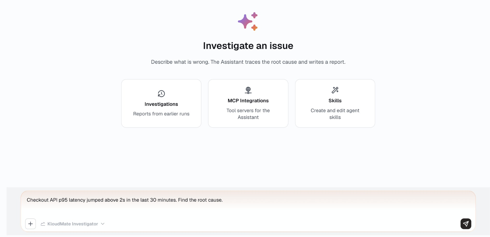
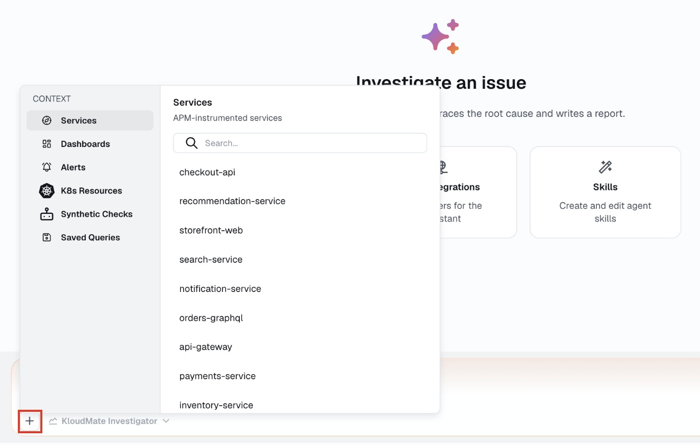
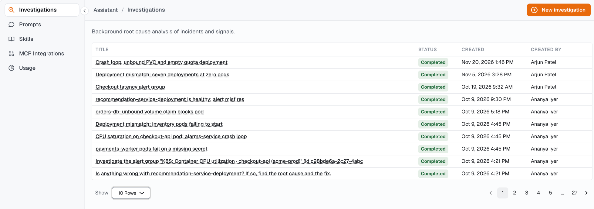
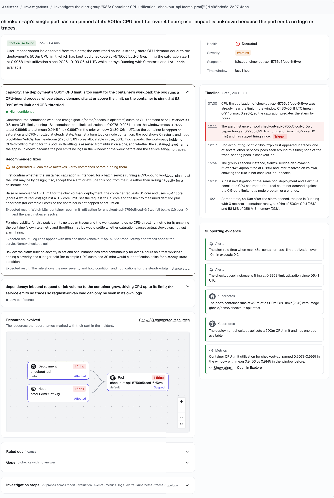

Investigations is your primary workspace for diagnosing issues, exploring anomalies, and uncovering insights. You can ask questions across metrics, logs, and traces, and iteratively troubleshoot problems in a conversational flow.

Opening **Assistant** lands you on the **Investigations** tab, which lists past and active investigations. Click **New investigation** to start one. The **Investigate an issue** page opens with quick-access cards above the chat input:

- **Investigations:** Returns you to the **Investigations** tab, where you can find and revisit reports from earlier runs.
- **MCP Integrations:** Opens the **MCP Integrations** tab, where you connect tool servers for the Assistant.
- **Skills:** Opens the **Skills** tab, where you can create and edit agent skills.

## Adding Context to a Message

The + button in the chat input bar opens a context picker that lets you attach relevant resources to your message before sending it. This helps the Assistant understand the scope of your query without requiring you to describe everything from scratch. Select a category on the left panel, then browse the available resources on the right and attach those relevant to your investigation.

Available context categories include:

- **Services:** Attach APM-instrumented services you want the Assistant to focus on.
- **Dashboards:** Link workspace dashboards to provide visual context.
- **Alerts:** Include alert rules relevant to your query.
- **K8s Resources:** Reference Kubernetes Clusters, Namespaces, Deployments, and Pods.
- **Synthetic Checks:** Attach uptime or browser monitors.
- **Saved Queries:** Include saved log, trace, or metric queries to anchor the investigation.

## Triggering an Investigation

The **KloudMate Assistant** can quickly investigate issues or errors from logs and traces, summarize their causes, and suggest probable root causes to speed up resolution. This reduces **root cause analysis (RCA)** time for engineering teams.

### Decoding Issues

The Issues section in KloudMate aggregates all errors and warnings detected from logs and traces into a unified dashboard view.
Navigate to any issue’s details page and click **Investigate with KloudMate Assistant** for instant analysis.
The Assistant decodes the issue context, explains what went wrong, and provides actionable steps for probable RCA, including potential service impacts.

### Analyzing Error Logs and Traces

The **Logs/Traces** page displays all ingested telemetry data with severity-based filtering to isolate errors quickly.
Select any error log or trace to open its details view, then click **Investigate with KloudMate Assistant**.
The Assistant analyzes the full context, including stack traces, attributes, and timestamps, to deliver an overview of the problem, its service impact, and step-by-step fix recommendations.

### Key Benefits

- **Faster Troubleshooting:** Real-time AI insights reduce MTTR by automating initial diagnostics.
- **Unified Visibility:** Correlates logs, traces, and issues without switching contexts.
- **Actionable Guidance:** Delivers plain-language root cause hypotheses and remediation steps for immediate use.

## Investigations List

Open **Assistant → Investigations** to see the full investigations list.

The list shows all past and active investigations in your workspace. Each row displays the following information:

- **Title:** A brief summary or auto-generated description of the investigation.
- **Status:** The current state of the investigation, typically shown as Completed or In Progress.
- **Created:** The date and time the investigation was initiated.
- **Created By:** The user who triggered the investigation.

## Starting a New Investigation

To start a new investigation, open **Assistant → Investigations** and click **New investigation**. In the chat that opens, describe the issue or symptom you want analyzed. The KloudMate Investigator collects your description and begins a background RCA workflow.

## Viewing an Investigation

Click any investigation title to open the full report. The report opens with a one-line summary of what the investigation found, followed by the evidence behind it.

The summary panel at the top shows a status badge, such as **Root cause found**, and how long the investigation took. Next to the summary, it lists the overall **Health**, the **Severity**, the **Suspects** (the resources most likely at fault), and the **Time window** that was analyzed.

Below the summary, each hypothesis gets its own card, ranked by how likely it is. Each card includes:

- **Cause:** A label for the type of cause, such as `capacity` or `dependency`, followed by a description of the suspected root cause.
- **Confidence:** How strongly the evidence supports the hypothesis, for example **High confidence** or **Low confidence**.
- **Explanation:** What was confirmed, what was ruled out against it, and any caveats.
- **Recommended fixes:** Steps to resolve the issue, each with the **Expected result** you should see once the fix works. Fixes are AI-generated, so verify any command before you run it.

The rest of the report backs up the hypotheses:

- **Timeline:** The key events in order, with the alert trigger highlighted.
- **Supporting evidence:** The individual findings from alerts, Kubernetes, metrics, logs, and traces. For a metric finding, click **Show chart** to see the data or **Open in Explore** to query it further.
- **Resources involved:** A map of the resources the report names, each marked as **Suspect** or **Affected**, with the number of firing alerts. Click **Show connected resources** to see related resources.
- **Ruled out:** Causes the investigation checked and rejected.
- **Gaps:** Checks the investigation couldn't answer from the available data.
- **Investigation steps:** Every probe the investigation ran, grouped by data source.
