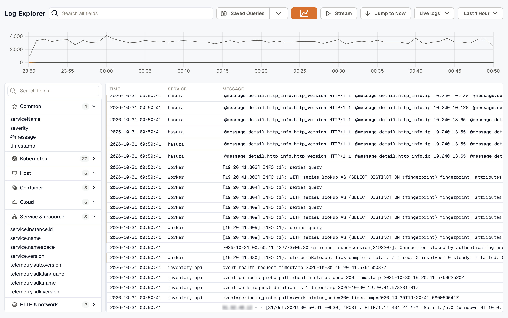
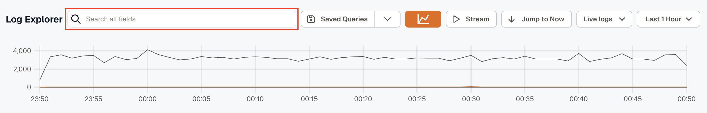
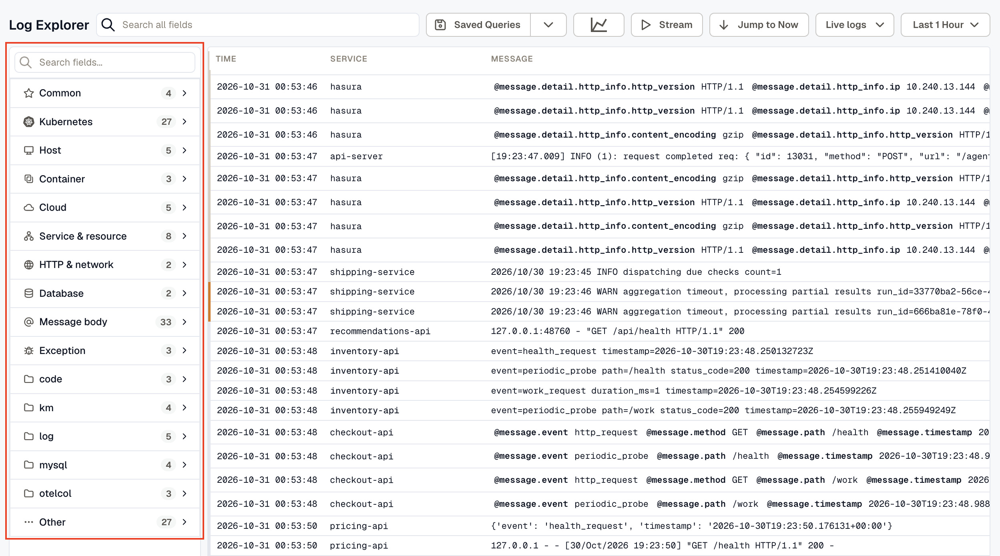
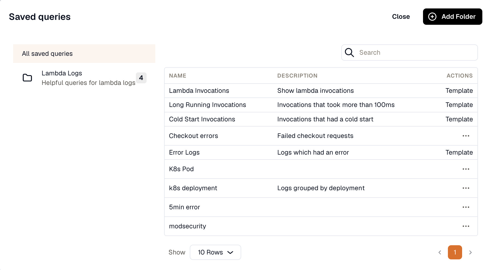
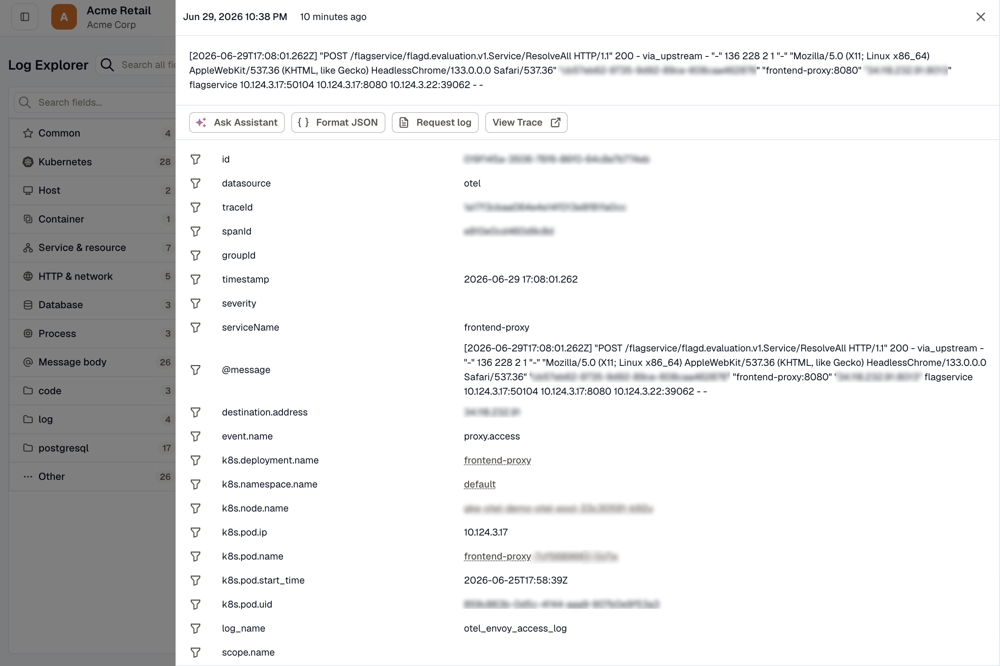
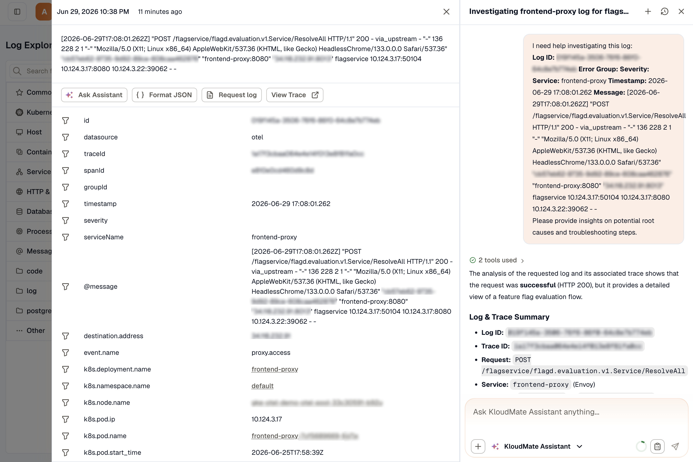
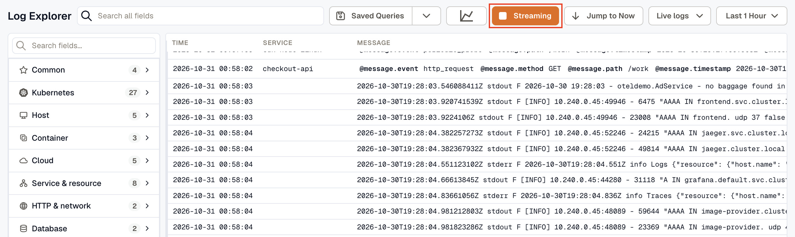

Open **Logs** from the left navigation menu to access Log Explorer.

Log Explorer indexes logs from all connected services and applications. Use it to search large log volumes, inspect structured payloads, save frequently used queries, and investigate issues without leaving the platform.

## Log Explorer Walkthrough

The main view lists log entries in a table. Each row represents a single log entry and shows the most useful attributes for quick triage.

To see log volume over time, click the chart icon next to **Saved**. The **Log volume** chart stacks errors, warnings, and all other logs in each interval.

Select any log entry to inspect its full payload, labels, and metadata.

## Search and Filter Logs

### Search

The search bar at the top of Log Explorer shows your search as chips. Each chip is one condition, and a log entry must match every chip to appear.

To search for text anywhere in a log entry, type it in the bar and press Enter. The text becomes a free-text chip that searches every string field, so `timeout` finds entries with that word in the message or in any text attribute.

To filter on a field, click the bar and pick a field, then an operator, then a value. For example, pick `severity`, then `=`, then `ERROR`. If the field or value you want isn't listed, type it.

The `in` and `not in` operators take several values. Select them from the list, or type them separated by commas, such as `ERROR, WARN`, and press Enter.

On string fields, `matches` and `not matches` compare the value against a regular expression. The expression must match the whole value, so `http.route matches "/api/v[0-9]+/.*"` matches `/api/v2/users` but not `/internal/api/v2/users`.

To remove a condition, click the **×** on its chip.

### Edit the search as KMQL

Click the `</>` icon at the end of the search bar to see and edit the search as [KMQL](../../visualize-data/kmql/) text. In the text view, put free text in double quotes. For example, `severity = ERROR "timeout"` finds error logs that contain the word `timeout`. Press Enter to run the search, and click `</>` again to go back to chips.

Use the text view to build an OR group, such as `(k8s.namespace.name = default or service.name = checkout)`. An OR group shows as a single chip, and you can only change it in the text view. A search that can't be shown as chips stays in the text view.

If the text doesn't parse, Log Explorer shows the reason and doesn't run the search until you fix it. The search is kept in the address as KMQL in the `q` parameter. Links that use the old `filter` or `query` parameters aren't read, so they open Log Explorer with no search applied. Rewrite the search as KMQL in `q`.

### Filter

Use the sidebar filters to narrow the result set by relevant dimensions. Combine multiple filters to isolate a specific set of logs.

You can also filter from a log entry. In the log detail panel, click **Filter by value** (the filter icon) next to a field to add that field and value to the search. A filter added from the sidebar or the detail panel is combined with the current search using AND.

Refine results further by adjusting the selected time range from the time picker.

## Saved Queries

Save, reuse, and browse queries from the **Saved** menu next to the search bar:

- **Save this query** saves the current search. Enter a name, description, and folder, then click **Save**.
- **Recent** lists the most recently saved queries. Click one to run it.
- **All saved queries** opens every saved query, organized in folders.

Use folders to keep saved queries organized by service, team, or use case.

When you edit a saved query, you write its **Filters** as KMQL text. If a saved query's filters can't be written as KMQL, Log Explorer shows the reason and doesn't run the query. Edit the query and rewrite its filters in KMQL to use it again.

## Inspect Log Entries

Select any log entry to view detailed information and analysis.

**Ask Assistant** opens KloudMate Assistant directly from the issue. It reviews the error log and its associated trace, generates a Log & Trace Summary, identifies the probable root cause, and suggests next steps for faster resolution.

Refer to the [KloudMate Assistant](../../kloudmate-assistant/) documentation for more details.

### Open one log from a link

A link with `?logId=<log id>&ts=<time in epoch milliseconds>` opens that log's detail panel. Log Explorer looks for the log within 5 seconds of `ts`, or across the page's time range when there's no usable `ts`. If no log matches, Log Explorer says the log wasn't found. Closing the panel removes both parameters from the address.

The **View log** link on a logs **Records** table builds this link for you. See [Data links](../../visualize-data/dashboards/panel-options/data-links/).

## Stream Logs

Use **Stream** to watch logs as they are ingested into KloudMate.

## Search Archived Logs

If your organization archives logs to S3 with [Cold Storage](../../platform/settings/cold-storage/), you can search logs that are older than your log retention. When the selected time range starts before your retention, Log Explorer offers to rehydrate it. To search a rehydration, click **Live logs** and select it under **Rehydrated**.

See [Rehydrate archived logs](../../platform/settings/cold-storage/rehydrate-logs/) for how rehydration works and what it costs.

## Related Resources

- [KMQL](../../visualize-data/kmql/)
- [Collect File Logs with KloudMate Agent](../collect-file-logs/)
