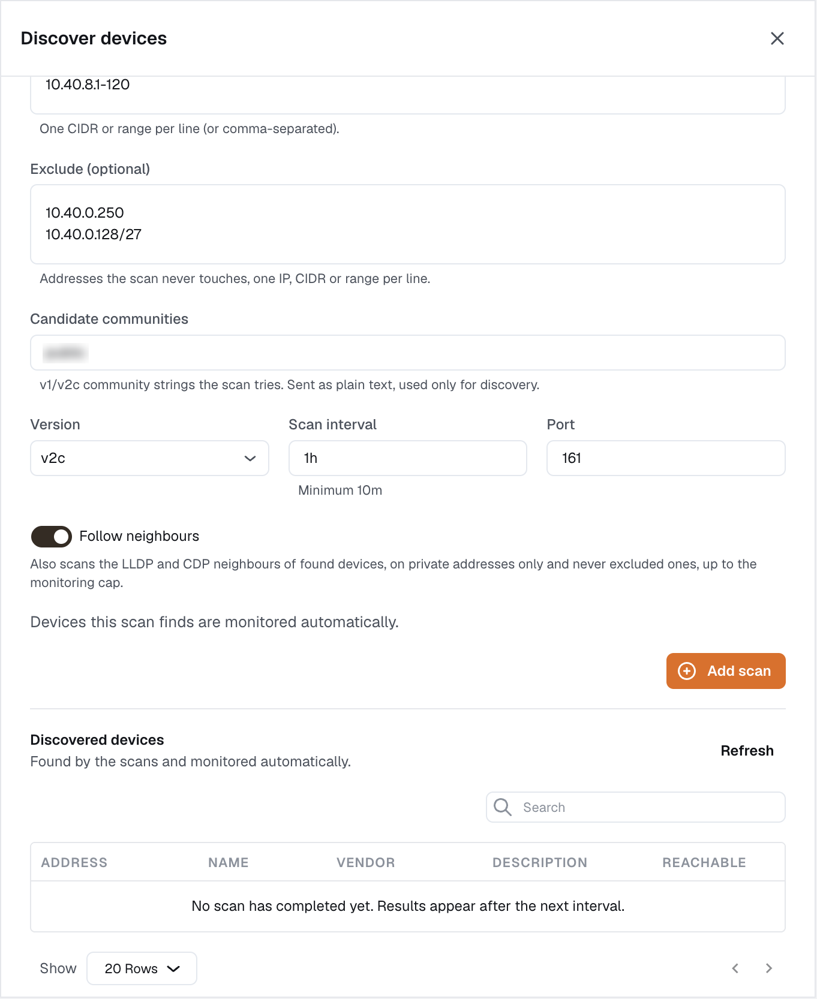
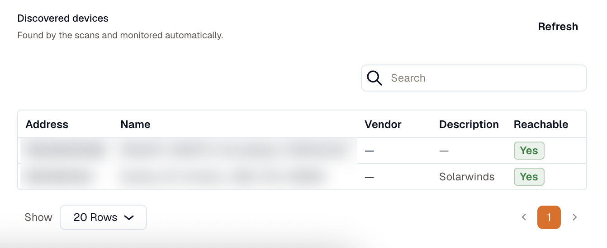

Discovery is the quickest way to onboard a site. You give the agent a few IP ranges and the credentials to try, and it scans them, finds the devices that answer SNMP, and starts monitoring them automatically. For a handful of known addresses, [Add SNMP devices](/network-monitoring/monitoring-snmp/) is the more direct route.

## Before you start

- A Linux or Docker KloudMate Agent with network access to the ranges you want to scan. Kubernetes agents can't run discovery.
- The v1/v2c community strings or the SNMPv3 user the devices use. Discovery tries them against every address in range.
- For SNMPv3 discovery, exclusions, and **Follow neighbours**, agent 2.11.0 or later. See [Agent version](#agent-version).

## Add a scan

In **Network Monitoring**, open the **Add** menu and choose **Discover devices**. Fill in the scan:

- **Ranges to scan**: one CIDR or range per line (or comma-separated), for example `10.0.0.0/24`, `10.0.1.1-50`, or `10.0.1.1-10.0.3.254`. Discovery scans IPv4 only, and the ranges in one scan can cover at most 65,536 addresses in total, the size of a `/16`.
- **Exclude (optional)**: addresses the scan never probes, one IP, CIDR, or range per line. See [Exclude addresses](#exclude-addresses).
- **Version**: v2c, v1, or v3.
- **Candidate communities**: for v1 and v2c, the community strings to try, such as `public, private`.
- **SNMPv3 user**: for v3, a **Username** and **Security level** (`noAuthNoPriv`, `authNoPriv`, or `authPriv`), plus the **Auth protocol** and password and the **Priv protocol** and password that the level needs. A scan tries one v3 user, so add a scan per user if your devices use several.
- **Scan interval**: how often to re-scan, for example `1h`. The minimum is `10m`, and a shorter interval is raised to it.
- **Port**: the SNMP port to probe, `161` by default.
- **Follow neighbours**: also scan the LLDP and CDP neighbours of the devices the scan finds. See [Follow neighbours](#follow-neighbours).

Communities and v3 passwords are sent to the agent as plain text and used only for discovery.

You can add several scans on one agent, each with different ranges, ports, or credentials, and the agent runs each on its own interval and combines the results.

## Exclude addresses

Use **Exclude** for addresses a scan must never touch, such as a fragile appliance or a network that belongs to someone else. For example, scanning `10.0.0.0/24` with `10.0.0.128/25` excluded probes only `10.0.0.1` to `10.0.0.127`.

The agent checks each address against the exclusions instead of listing every excluded address, so a wide prefix such as `10.0.0.0/8` works and has no size limit. An excluded CIDR also covers its network and broadcast addresses. Exclusions apply to neighbours that **Follow neighbours** finds, too.

## Follow neighbours

Turn on **Follow neighbours** to reach devices outside your ranges through the LLDP and CDP tables of the devices you've already found. The scan reads each found device's neighbour management addresses with the credential that answered it, probes those addresses with the scan's credentials, and repeats this for every new device, until no new addresses turn up.

The crawl stays contained:

- It follows only private IPv4 addresses, in `10.0.0.0/8`, `172.16.0.0/12`, and `192.168.0.0/16`.
- It never probes an excluded address.
- It stops once the scan has found 256 devices, the same cap that limits how many devices one scan monitors.

## What happens next

Every device a scan finds is monitored automatically, using the credential that answered it. Results appear after the next scan interval.

On agent 2.11.0 or later, newly found devices are added to the running agent without restarting data collection, unless they're the first SNMP devices on that agent. Older agents briefly restart data collection whenever the set of monitored devices changes. Either way, a steady scan that keeps finding the same devices changes nothing.

:::caution
A single scan monitors up to 256 devices. Point scans at focused ranges rather than an entire `/16`, or a large range will leave some devices unmonitored.
:::

The **Discovered devices** panel lists what the scans found: address, name, vendor, description, and whether each is reachable. **Refresh** reloads it. Monitored devices also show up on the **All devices** tab like any other SNMP device.

## When one device answers on several addresses

Routers and layer-3 switches often answer SNMP on more than one of their addresses. A scan treats two addresses as the same device only when they report the same LLDP chassis ID (`lldpLocChassisId`) or, on SNMPv3, the same engine ID. It then keeps one address for that device and monitors it once.

A device that reports neither, such as a v2c device without LLDP, can't be matched, so every address it answers on is listed and monitored as a separate device. To avoid the duplicates, exclude the extra addresses.

## Adjust what's monitored

Discovery is sticky. A device stays monitored even if a later scan misses it once, so a brief blip doesn't make it vanish. Instead it reports **Down**, which is the accurate state. To stop monitoring devices, narrow or remove the range that covers them (or delete the scan) from **Configure**. The agent then re-accumulates from the ranges that remain. See [Manage and troubleshoot](/network-monitoring/manage-troubleshoot/).

## Agent version

SNMPv3 discovery, **Exclude**, and **Follow neighbours** need agent 2.11.0 or later. On an older agent, or one whose version isn't known, the form disables these options, apart from clearing a value a scan already has. If a scan uses them and its agent is older:

- A scan with exclusions or a v3 user doesn't run at all on that agent, so it never probes addresses you excluded. It runs once the agent is on 2.11.0 or later.
- **Follow neighbours** is dropped, and the scan runs without it.
