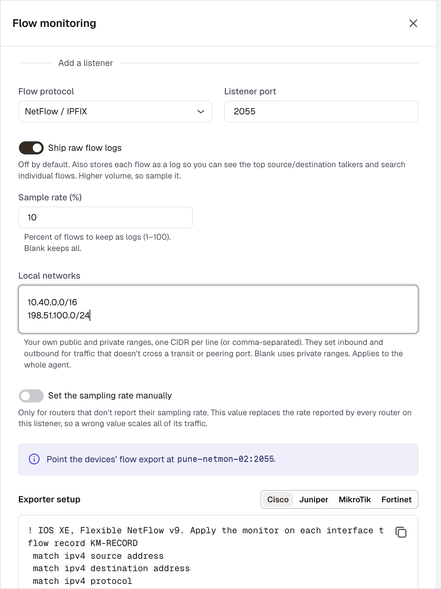
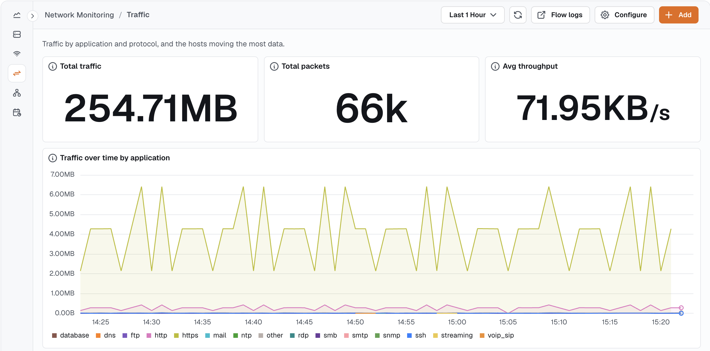

import { Tabs, TabItem } from '@astrojs/starlight/components';

SNMP shows how much traffic crosses an interface, but not what that traffic is. Flow monitoring fills that gap. It breaks the load down by application, across HTTPS, streaming, DNS, database, and the rest, ranks the subnets and hosts that send and receive the most, and names the services and CDNs behind the traffic. You add a listener on the agent, point your devices' flow export at it, and the results show up on the **Traffic** tab.

The agent listens for NetFlow, IPFIX, and sFlow. It classifies each flow by its well-known port and rolls the flows into per-application byte and packet counts. Top talkers and service names need agent 2.11.0 or later.

## Add a listener

In **Network Monitoring**, open the **Add** menu and choose **Flow monitoring**:

- **Flow protocol**: **NetFlow / IPFIX** or **sFlow**.
- **Listener port**: the UDP port the agent listens on. It defaults to `2055` for NetFlow and `6343` for sFlow.

Add one listener per protocol your devices export. NetFlow and sFlow can run at the same time on different ports, and the agent combines their results. Every listener on an agent needs its own port, and that includes [trap and syslog receivers](/network-monitoring/traps-and-syslog/). If two listeners share a port, only one of them is set up on the agent.

Then configure each device to send flow records to `agent-ip:port`. The form shows an **Exporter setup** snippet for Cisco, Juniper, MikroTik, and Fortinet, filled in with the listener's port.



:::caution
Flow volume can be high, so turn on sampling at the sending device rather than exporting every flow. Applications are identified by well-known port, not by deep packet inspection. All traffic on port 443 is labeled `https`, so an app on a non-standard port shows up as `other`.
:::

## Configure the exporting device

These are starting configurations for the default ports. Replace `<agent-ip>` with the agent's address, use your listener port if you changed it, and replace the interface names with your own.

<Tabs syncKey="flow-vendor">
<TabItem label="Cisco">

NetFlow v9 on IOS XE, with Flexible NetFlow. Apply the monitor on each interface where traffic enters:

```text
flow record KM-RECORD
 match ipv4 source address
 match ipv4 destination address
 match ipv4 protocol
 match transport source-port
 match transport destination-port
 match interface input
 collect interface output
 collect counter bytes long
 collect counter packets long
 collect timestamp absolute first
 collect timestamp absolute last
!
flow exporter KM-EXPORTER
 destination <agent-ip>
 transport udp 2055
 export-protocol netflow-v9
 template data timeout 60
!
flow monitor KM-MONITOR
 record KM-RECORD
 exporter KM-EXPORTER
 cache timeout active 60
!
interface GigabitEthernet0/0/0
 ip flow monitor KM-MONITOR input
```

sFlow on NX-OS:

```text
feature sflow
sflow agent-ip <switch-ip>
sflow collector-ip <agent-ip> vrf default
sflow collector-port 6343
sflow sampling-rate 4096
sflow data-source interface ethernet1/1
```

</TabItem>
<TabItem label="Juniper">

IPFIX with inline J-Flow on MX routers:

```text
set services flow-monitoring version-ipfix template km-ipv4 ipv4-template
set services flow-monitoring version-ipfix template km-ipv4 flow-active-timeout 60
set services flow-monitoring version-ipfix template km-ipv4 flow-inactive-timeout 15
set forwarding-options sampling instance km-sample input rate 1000
set forwarding-options sampling instance km-sample family inet output flow-server <agent-ip> port 2055
set forwarding-options sampling instance km-sample family inet output flow-server <agent-ip> version-ipfix template km-ipv4
set forwarding-options sampling instance km-sample family inet output inline-jflow source-address <router-ip>
set chassis fpc 0 sampling-instance km-sample
set interfaces ge-0/0/0 unit 0 family inet sampling input
```

sFlow on EX and QFX switches:

```text
set protocols sflow collector <agent-ip> udp-port 6343
set protocols sflow sample-rate ingress 2048
set protocols sflow polling-interval 20
set protocols sflow interfaces ge-0/0/0
```

</TabItem>
<TabItem label="MikroTik">

NetFlow v9 on RouterOS. MikroTik devices send NetFlow or IPFIX, so use a NetFlow listener for them:

```text
/ip traffic-flow set enabled=yes interfaces=all active-flow-timeout=1m inactive-flow-timeout=15s
/ip traffic-flow target add dst-address=<agent-ip> port=2055 version=9
```

</TabItem>
<TabItem label="Fortinet">

NetFlow on FortiOS 7.2.8 and later. Earlier versions set `collector-ip` and `collector-port` directly under `config system netflow`:

```text
config system netflow
    config collectors
        edit 1
            set collector-ip <agent-ip>
            set collector-port 2055
        next
    end
    set active-flow-timeout 1
    set inactive-flow-timeout 15
end
config system interface
    edit "port1"
        set netflow-sampler rx
    next
end
```

sFlow on FortiOS 7.2.8 and later. Earlier versions set `collector-ip` and `collector-port` directly under `config system sflow`:

```text
config system sflow
    config collectors
        edit 1
            set collector-ip <agent-ip>
            set collector-port 6343
        next
    end
end
config system interface
    edit "port1"
        set sflow-sampler enable
        set sample-rate 2000
    next
end
```

</TabItem>
</Tabs>

## What you get

Both metrics are byte and packet totals per application, per interval:

- `netflow_app_bytes`
- `netflow_app_packets`

Each carries three attributes: `app` (`https`, `dns`, `voip_sip`, `database`, and so on, plus `other`), `transport` (`tcp` or `udp`), and `exporter`, the management IP of the device that sent the flow. Because `exporter` matches a device's address, KloudMate ties the traffic mix back to the SNMP device that carries it, so a saturated interface and its application breakdown sit in one place.

Agent 2.11.0 or later also emits:

- `netflow_talker_src_bytes` and `netflow_talker_dst_bytes`, by `src_subnet` or `dst_subnet` (a `/24` for IPv4, a `/48` for IPv6).
- `netflow_talker_src_ip_bytes` and `netflow_talker_dst_ip_bytes`, by `src_ip` or `dst_ip`.
- `netflow_service_bytes`, by `service`, `category`, and `classified_by`.
- `netflow_cdn_bytes`, by `cdn`, `category`, and `classified_by`.

Each has a matching `_packets` metric, and each carries `direction` and `exporter`.

## Where results show up

Open the **Traffic** tab for the workspace-wide view: top applications, top transports, top talkers, services and CDNs, and flow health over the selected window. Each device drawer also has a **Traffic** tab, scoped to the flow that device exports.



## Find the top talkers

The **Top talkers** panel ranks the subnets and hosts that move the most traffic. Switch between **Source subnets**, **Destination subnets**, **Source hosts**, and **Destination hosts**. A subnet is the `/24` (IPv4) or `/48` (IPv6) that an address falls in, so you can spot a busy office network first and then drill down to its hosts.

Each agent reports only its busiest talkers every minute and groups the rest, and the panel leaves that group out. When the exporter samples flows, the agent scales the sampled volumes up, so the numbers are estimates rather than exact byte counts.

### Compare two time windows

To see what changed, pick a baseline: **Previous period**, **Same time yesterday**, or **Same time last week**. The table shows each talker's bytes in the selected window and in the baseline window, plus the change as a percentage. A talker with no traffic in the baseline is marked **New**, and one with no traffic now is marked **Gone**.

For example, with the last hour selected and **Same time last week** as the baseline, a host that started a large transfer this week appears on **Source hosts** with a large increase, or as **New**.

## Name services and CDNs

On agent 2.11.0 or later, the agent names the service at the remote end of each flow, such as `youtube`, `netflix`, `microsoft`, or `zoom`, with a category such as `video`, `cloud`, or `conferencing`. It checks, in order:

1. **Address prefix**: a curated list of prefixes, such as the public DNS resolvers of Google, Cloudflare, and Quad9, and Amazon CloudFront's published ranges.
2. **Network (ASN)**: the remote network's autonomous system number, matched against a curated list of the networks that carry one operator's traffic. The ASN comes from the router's flow export, or from the IP-to-ASN dataset when the router sends none.
3. **Port**: a flow that matches neither gets no service name. It keeps its application from the well-known port.

Delivery networks such as Cloudflare, Akamai, Fastly, and CloudFront carry traffic for many different customers, so flows to them are named only by CDN, with no service. Operators that deliver their own content, such as Google, Netflix, Meta, and Apple, get both a service and a CDN name.

The **Services and CDNs** section of the Traffic tab shows:

- **Top services**: named services and their category. Traffic without a service name is left out.
- **Top CDNs**: delivery networks, including operators that deliver their own content.
- **How services were named**: the share of bytes named **By address prefix**, **By network (ASN)**, or **By port**, plus the traffic left **Not named** and the traffic **Grouped past the top list**.

Check **How services were named** before you rely on the rankings. A large **Not named** or **By port** share means most of your traffic goes to networks the curated lists don't cover, so the top services only describe the part that was named.

### The IP-to-ASN dataset

When a router doesn't export ASNs, which is common without a full BGP table, the agent looks them up in the [IPtoASN](https://iptoasn.com/) dataset. It downloads `https://iptoasn.com/data/ip2asn-combined.tsv.gz` about once a week and keeps it in its data directory, `/var/lib/kmagent` on Linux. It downloads the dataset only when the agent has a flow listener.

The agent host needs outbound HTTPS access to `iptoasn.com`. If a download fails, the agent keeps using the last dataset it has and tries again 6 hours later. Until the first download succeeds, flows from routers that don't export ASNs can't be named by network.

## Check flow health

The **Flow health** section of the Traffic tab tells you whether flow is arriving and how much of the interface traffic it covers.

**Flow listeners** shows one row per agent over the selected window:

| Column | What it counts |
|---|---|
| **Records** | Flow records the agent decoded. |
| **Dropped** | Flow packets the agent received but never decoded, for example because its queue was full. |
| **Kernel drops** | Flow packets the kernel dropped at the listener's socket because the agent didn't read them in time. Linux only. |
| **Not matched to SNMP** | Records whose interface matched no SNMP-polled interface, so they have no interface name. |
| **Sampling unknown** | Records with no sampling rate the agent could resolve. Their volumes undercount. |

An agent shows **Dropping** when any packets were dropped or kernel-dropped, and **No records** when nothing arrived.

**Flow against SNMP** compares the flow bytes on each interface with the SNMP in and out octets for the same interface. An interface that exports all of its traffic with the right sampling rate comes out near 100%. A share well under 100% usually means the interface doesn't export flow, or the sampling rate is wrong. The panel only lists interfaces on devices that both export flow and are polled over SNMP from the same address. It also appears on each device's **Traffic** tab.

## Search individual flows with raw flow logs

The metrics above don't keep individual flows. To search single flows by address and port, turn on raw flow logs when you add or edit a listener:

- **Ship raw flow logs**: off by default. When on, the agent also stores each flow as a log with its source and destination address and port.
- **Sample rate (%)**: the percentage of flows to keep as logs, from 1 to 100. Leave it blank to keep all of them.

Raw flow logs carry more volume than the metrics, so sample them on a busy link. With them enabled, the Traffic tab's **Top hosts from raw flow logs** section ranks top sources, destinations, and conversations from those logs.
