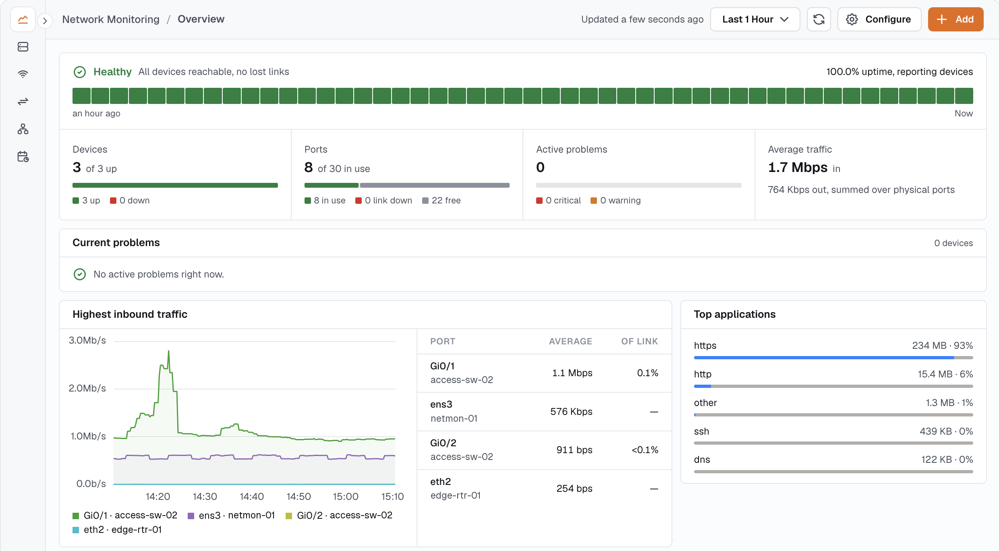

Use **Network Monitoring** to watch the routers, switches, firewalls, access points, and PDUs that carry your traffic. You poll them over SNMP for health and interface metrics, check reachability for the sites that can't speak SNMP, read the traffic mix from NetFlow or sFlow, and collect the traps and syslog your devices send.

A Linux or Docker [KloudMate Agent](/kloudmate-agent/) does the collecting. It polls devices over the network, so one agent can watch an entire site, and nothing gets installed on the devices themselves.

:::note
Network monitoring runs on Linux and Docker agents only. Kubernetes agents can't poll SNMP, run reachability checks, or listen for flow, traps, or syslog.
:::

## What you can monitor

- **SNMP devices**: interface throughput and errors, CPU, memory, uptime, and vendor-specific health. Built-in profiles cover Cisco, Juniper, Arista, HPE, Aruba, Dell, Fortinet, Palo Alto, MikroTik, F5, APC, and many more.
- **Sites without SNMP**: a gateway-and-internet ping pair that shows whether the local network is up and whether the ISP link is working, with jitter and a hop-by-hop path to the internet.
- **Traffic flow**: the per-application byte and packet mix on a link, the top talkers, and the services and CDNs behind the traffic, from NetFlow, IPFIX, or sFlow exporters.
- **Device events**: SNMP traps and syslog, matched to the device that sent them.
- **Routing and links**: LLDP and CDP topology from every device, plus BGP peers, MPLS L3VPN VRFs, and IP SLA probes once you turn those capabilities on.

## The Network Monitoring tabs

Open **Network Monitoring**. You land on the **Overview** tab.

| Tab | What it shows |
|---|---|
| **Overview** | Network-wide health: overall status and uptime, the busiest ports, the probable cause of an outage, current problems, and every device grouped by site, role, or vendor. |
| **All devices** | The full, searchable table of SNMP devices with their current status and last-seen time. |
| **Reachability** | Ping results, jitter, and traced paths for sites monitored without SNMP. |
| **Traffic** | The application mix, top talkers, services, and flow health from your flow listeners. |
| **Topology** | A link map drawn from LLDP and CDP neighbour data, with the links that were lost. |
| **SLA and capacity** | Availability per site and device, and p95 utilization per port, over a period. |

For how to read each tab, see [Using Network Monitoring](/network-monitoring/network-page/).

## Set it up

Everything is configured in **Network Monitoring**. There are no collector files to hand-edit. Use the **Add** menu:

- [Add SNMP devices](/network-monitoring/monitoring-snmp/): poll known devices with the guided wizard.
- [Discover devices](/network-monitoring/discover-devices/): scan IP ranges and monitor what answers.
- [Monitor sites without SNMP](/network-monitoring/reachability-checks/): add gateway and internet ping checks.
- [Flow monitoring](/network-monitoring/flow-monitoring/): listen for NetFlow, IPFIX, or sFlow.
- [Traps and syslog](/network-monitoring/traps-and-syslog/): receive SNMP traps and syslog from your devices.

To change or remove anything later, open **Configure**. See [Manage and troubleshoot](/network-monitoring/manage-troubleshoot/).

## Before you start

- A KloudMate Agent running on a Linux host or in Docker, with network access to the devices or sites you want to watch. If you don't have one yet, install the [Linux agent](/kloudmate-agent/installation/linux-agent/) or [Docker agent](/kloudmate-agent/installation/docker-agent/).
- SNMP enabled on each device (v1, v2c, or v3), and the agent host's IP address allowed in the device's SNMP access list.

Once data starts flowing, use [Explore](/visualize-data/explore/) for ad hoc queries, [Dashboards](/visualize-data/dashboards/) for curated views, and [Alerts](/alerts/create-alerts/) to get notified when something goes down.
