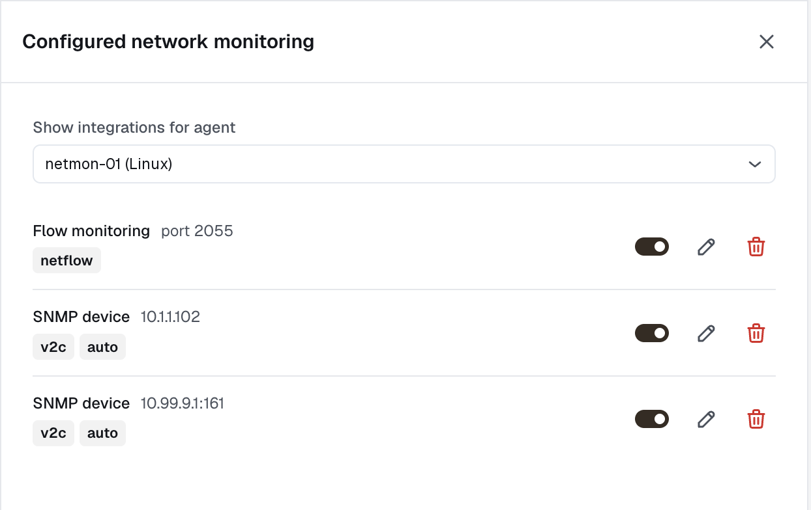

SNMP devices, ping probes, flow listeners, discovery scans, and trap and syslog receivers are all managed from one place. This page covers changing what you've configured and fixing the common reasons something isn't reporting.

## Manage what's configured

In **Network Monitoring**, select **Configure**. Pick a collector agent to see everything it's set to monitor, grouped by kind: **SNMP device**, **Ping probe**, **Flow monitoring**, **Discovery**, **SNMP traps**, and **Syslog**. For any entry you can:

- **Enable or disable** it. Disabling stops the polling without deleting the configuration, so you can turn it back on later.
- **Edit** it to change credentials, targets, capabilities, polling intervals, ports, or scan ranges.
- **Remove** it.

Enabling and disabling take effect on their own. Any edit that changes what the agent collects, and any add or remove, briefly restarts data collection on that agent, so expect a short gap in that poller's telemetry. The exception is on agent 2.11.0 or later: a change that only affects SNMP devices is applied without a restart, unless it adds the agent's first SNMP device or removes its last one.

## An SNMP device won't report

If a device stays **Down** or never appears on the **All devices** tab, work down this list:

1. **Reachability**: the agent host must have a network path to the device on UDP port 161. Check firewalls and routing between them.
2. **Credentials**: confirm the community string (v1/v2c) or v3 user, and that the version matches what the device expects. A v2c community won't authenticate against a v3-only device.
3. **SNMP access list**: many devices restrict SNMP by source IP. Add the agent host's address to the device's allowed list, or no metrics come back even when everything else is correct.
4. **Agent placement**: network monitoring runs on Linux and Docker agents only. A Kubernetes agent is rejected for SNMP, ping, flow, discovery, traps, and syslog.
5. **SNMP enabled**: confirm the SNMP service is actually running on the device.

## A device shows "Not reporting"

**Not reporting** means data stopped arriving, which isn't the same as the device being down. Two things cause it:

- The **poller** is offline. Check the Overview for a poller-not-reporting banner. If the agent stopped sending its heartbeat, every device it watches goes stale until it comes back.
- The device genuinely stopped responding and its last data aged out. Confirm reachability and credentials as above.

A device turns **Not reporting** once its last data is more than three polling intervals old, and at least 5 minutes old. A device polled every 15 minutes therefore takes 45 minutes to be flagged.

Discovery is sticky, so a device found by a scan stays listed even after it stops answering. That's deliberate, so you don't lose sight of it.

## A reachability check won't run

The gateway probe uses ICMP, which needs `CAP_NET_RAW` or root on the agent host. Running the agent in Docker without `--cap-add=NET_RAW` is the usual cause of a gateway probe that never reports. The internet probe uses TCP and doesn't need that permission, so if only the gateway probe is failing, check ICMP privilege first. See [Monitor sites without SNMP](/network-monitoring/reachability-checks/).

If the **Path** panel stays empty with **Trace path** on, check that the agent is on 2.11.0 or later, runs on Linux, and can open raw sockets. Without raw socket rights, the agent logs `km_ping: no path metrics from this host`. On a Linux host, run `journalctl -u kmagent | grep "no path metrics"`.

## Flow monitoring shows no traffic

- Confirm each device's flow export points at the agent's IP and the **listener port** you configured (`2055` for NetFlow, `6343` for sFlow by default).
- Check that the device is actually exporting flows and that sampling isn't set so aggressively that little arrives.
- NetFlow and sFlow need separate listeners on separate ports. A device exporting sFlow to a NetFlow listener won't be understood.
- Check the **Flow listeners** panel on the **Traffic** tab. **No records** means the agent decoded no flow. **Dropped** and **Kernel drops** mean flow arrived but some of it was lost. See [Check flow health](/network-monitoring/flow-monitoring/#check-flow-health).

If traffic arrives but most of it isn't named by service, and the router doesn't export ASNs, check that the agent host can reach `https://iptoasn.com` over HTTPS. See [The IP-to-ASN dataset](/network-monitoring/flow-monitoring/#the-ip-to-asn-dataset).

If a device is reachable but a specific metric is missing, check that the matching capability is on. BGP, MPLS L3VPN, and IP SLA metrics only appear when you enable those capabilities on the device in the [SNMP wizard](/network-monitoring/monitoring-snmp/). LLDP and CDP neighbours need no capability on agent 2.11.0 or later.

## Listener ports clash

Every flow listener, trap receiver, and syslog receiver on an agent needs its own port, whatever its protocol. The form won't save a port that another listener of the same kind already uses, or a UDP port that another UDP listener uses. If two listeners still end up on one port, for example a TCP syslog receiver on a flow listener's port, only one of them is set up on the agent.

A port can also be held by something outside KloudMate, such as a syslog daemon on the agent host that's set to listen on `514`. The agent then leaves that receiver out and logs `network events: receiver left out` with the reason. Stop the other process or pick a different port. On a Linux host, run `journalctl -u kmagent | grep "network events"`. In Docker, run `docker logs km-agent 2>&1 | grep "network events"`.

## Traps or syslog don't arrive

Work down this list:

1. **Agent version**: receivers need agent 2.11.0 or later. An older agent ignores them.
2. **Destination**: the device must send to the agent host's address and the receiver's port, over the right protocol. Open that port in any firewall between them.
3. **Community**: for traps, the device's community must be on the receiver's **Communities** list, or the list must be blank. Traps with other communities are rejected without being counted.
4. **Binding**: check the agent's log for `network events: receiver left out`, as described in [Listener ports clash](#listener-ports-clash).

If events show up in [Logs](/logs/log-explorer/) but not on the device's **Events** tab, the agent couldn't match the sender's IP to an SNMP device. Poll the device over SNMP from the same agent that receives its events, and check that the address it sends from is one it reports. See [How events map to devices](/network-monitoring/traps-and-syslog/#how-events-map-to-devices).

## Events are being dropped

When an agent lost traps or syslog messages in the last hour, the **Traps and syslog** form shows a warning with the counts for that agent. The reason tells you where they were lost: `queue_full` when the trap queue was full during a burst, `refused` when the agent's logs pipeline didn't accept a trap, and `socket` when the kernel dropped packets before the agent read them. See [Dropped events](/network-monitoring/traps-and-syslog/#dropped-events).

## Options are disabled on older agents

These options need agent 2.11.0 or later. An agent whose version isn't known counts as older.

| Option | On an older agent |
|---|---|
| **Polling interval** of 5 or 15 minutes | The field stays at 60 seconds. A slower interval saved earlier is dropped, and the device is polled every 60 seconds. |
| **Trace path** on a reachability check | The switch is disabled. Saved path settings are dropped, and the probe runs without tracing. |
| SNMPv3 and **Exclude** in discovery | Disabled in the form. A scan that already uses them doesn't run on that agent. |
| **Follow neighbours** in discovery | The switch is disabled. A saved setting is dropped, and the scan runs without it. |
| Trap and syslog receivers | The form won't add one. A saved receiver is ignored until the agent is upgraded. |

Data that older agents don't collect, such as CDP neighbours, per-VLAN MAC tables, jitter, top talkers, and service names, stays empty until you [upgrade the agent](/kloudmate-agent/upgrade/).
