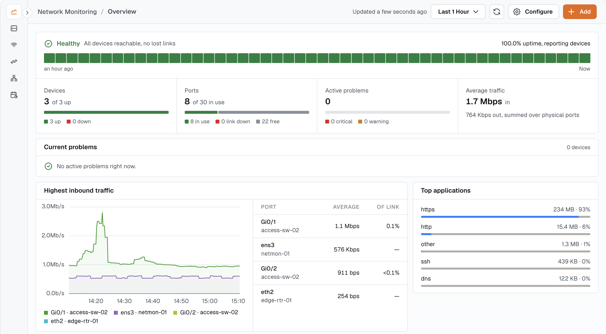
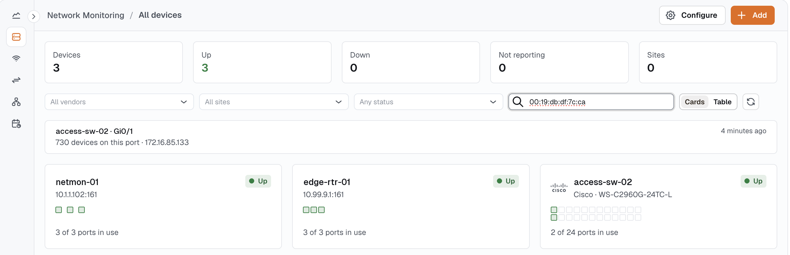
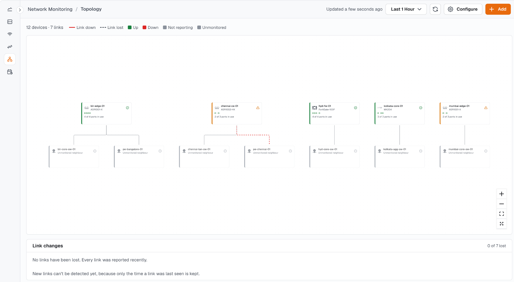
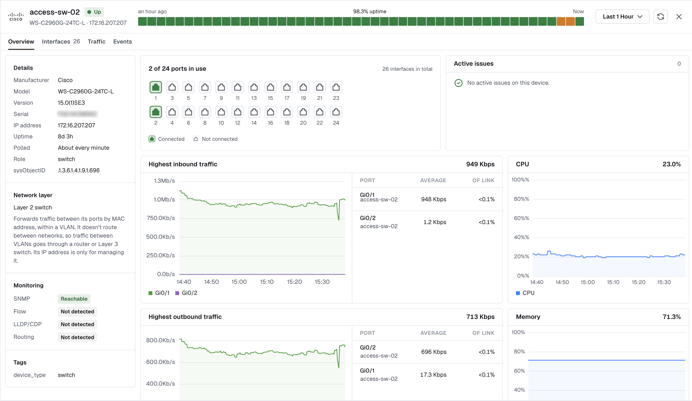
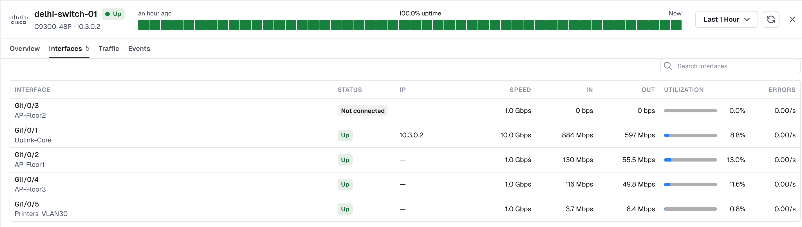

Once devices are reporting, you watch them in **Network Monitoring**. It opens on the **Overview** tab, built to answer one question fast: is anything wrong, and where? From there you can drill into any device or port. This page explains how to read each surface.

## Overview tab

The Overview leads with problems, not a wall of devices. It covers the time range you pick, refreshes itself, and shows how long ago it updated.

The **health strip** across the top gives the overall state (**Healthy**, **Degraded**, or **Critical**), what's wrong in a few words, and fleet uptime over the range as a bar. Below it, counts summarize your devices by status, your ports by use, the active problems by severity, and the average traffic in and out.

The rest of the page shows:

- **Highest inbound traffic** and **Highest outbound traffic**: the busiest ports across all devices. Select a port to open it.
- **Probable cause**: when devices are down, where the outage most likely starts. See [Probable cause](#probable-cause).
- **Current problems**: active issues, worst first, one row per affected device. A device with several faults collapses into a single row with its most severe problem as the headline. Filter the feed by **Devices down**, **Uplinks / ISP down**, **Links down**, **BGP / VRF down**, or **Interfaces errored**.
- **Top applications**: the application mix from your flow listeners.
- **Devices**: every device grouped by **Site**, **Role**, or **Vendor**, with its status, availability over the range, ports, ports in use, and traffic. Devices that need attention come first in each group.

[Reachability-check sites](/network-monitoring/reachability-checks/) appear in the problems feed too. A failed gateway probe shows as the gateway being unreachable, and a failed internet probe as an uplink problem. A site that stops reporting entirely shows as **Site not reporting**. For a site with one internet link, that's how an outage surfaces, because the agent can't send a failure over the link that's down.

### Probable cause

When one or more SNMP devices are down, the **Probable cause** panel names the down device furthest upstream on the topology map. If every device a down device connects up through is also down, the outage is put down to that upstream device. For example, if a core switch goes down and takes three access switches with it, the panel names the core switch and lists the three access switches as also down below it.

Under each cause, the panel lists evidence from the selected time range, newest first: links that stopped being reported, and [traps and syslog](/network-monitoring/traps-and-syslog/) from the affected devices.

The panel is labelled **Rule-based**. It works from the topology map and the device states only, so treat the device it names as a place to start, not a confirmed root cause. Without LLDP or CDP links between your devices, it can't tell upstream from downstream, so each down device counts as its own cause. The panel appears only when a device is down and there's something to show: other down devices below it, or evidence.

## Device statuses

Status appears as a color, a label, and an icon throughout the page:

| Status | Meaning |
|---|---|
| **Up** | The device is reachable and reporting. |
| **Down** | A reachability check failed; the device didn't answer. |
| **Not reporting** | The device's last data is more than three polling intervals old, and at least 5 minutes old. It's still listed, with "last seen X ago." |
| **Warning** | The device is up but has an active issue, such as an errored interface. |
| **Unknown** | Status can't be determined. |

**Not reporting** and **Down** are different on purpose. Down means the agent polled the device and got no answer. Not reporting means the data itself stopped arriving, often because the agent that polls it is offline rather than because the device is. Because the threshold follows each device's [polling interval](/network-monitoring/monitoring-snmp/#polling-interval), a device polled every 15 minutes isn't flagged between polls.

That distinction drives the **poller-not-reporting banner**. If a collector agent stops sending its heartbeat, the Overview shows a banner naming the affected poller instead of marking every device it watched as down. Device status under that agent may be stale until it reports again.

## All devices tab

**All devices** is the flat, searchable list of every SNMP device, as cards or as a table. Filter by vendor, site, or status, and read each device's current status and **Last seen** time. A device that stopped reporting stays in the list as **Not reporting** rather than disappearing.

To find where a machine is plugged in, enter its MAC address in **Find a device by MAC address**. The search covers the MAC tables that switches reported in the last 7 days. An address seen on several ports is usually plugged into the port with the fewest devices, and that port is listed first.

## Reachability and Traffic tabs

- **Reachability** shows the ping results, jitter, and traced paths for sites monitored without SNMP. See [Monitor sites without SNMP](/network-monitoring/reachability-checks/).
- **Traffic** shows the application mix, top talkers, services and CDNs, and flow health from your flow listeners. See [Flow monitoring](/network-monitoring/flow-monitoring/).

## Topology tab

The **Topology** tab draws a link map from LLDP and CDP neighbour data. Devices are nodes, neighbour links are edges, and both use the same status colors as the Overview. Gateways and routers sit at the top and access points at the bottom. A link whose port is down is drawn in red, and a lost link is dashed. Select a link to open its port.

On agent 2.11.0 or later, the agent collects LLDP and CDP neighbours from every SNMP device, so the map fills in without any setup. Older agents collect only LLDP, and only from devices that were set up with the **LLDP neighbours** capability. A neighbour that isn't polled over SNMP still appears on the map as an **Unmonitored** node.

### Link changes

The map includes every link reported in the last 7 days. The **Link changes** panel below it lists the links that have been lost: links that neither end has reported for more than three polling intervals of the slower device, and at least 15 minutes. For each lost link, it shows the ports at both ends, whether LLDP or CDP found it, whether either device is down or not reporting, and when the link was last seen.

A lost link next to a device that's down or not reporting usually says more about the device than the link. A lost link between two healthy devices points at the link itself, such as a moved cable, a disabled port, or a neighbour protocol that was turned off. New links aren't listed, because only the time each link was last seen is kept.

## SLA and capacity tab

The **SLA and capacity** tab reports availability and port capacity over a period, the last 7 days by default.

- **Availability by site**: the average availability of each site's devices.
- **Availability by device**: each device's availability, worst first, with a history bar. Select a device to open it.
- **Interface capacity**: the 95th percentile (p95) of each physical port's traffic rate over the period, in and out, against the port speed. **p95 utilization** uses the busier direction. Select a port to open it.

A device's availability is the share of its polls that it answered over the period: the average of `km_snmp_up` across every poll. Time when nothing polled the device, such as while its agent was offline, is left out rather than counted as downtime. Availability below 99.9% is highlighted as a warning, and below 99% as an error. The history bar samples the period, so it can miss a short outage that the percentage still counts.

Utilization above 60% is highlighted as a warning, and above 80% as an error. Because p95 ignores the busiest 5% of the period, a port with occasional bursts can show a low p95 while still saturating briefly.

## Device drawer

Selecting a device opens its drawer. The header shows the device's status, and the tabs depend on what the device reports:

- **Overview**: the device's details (manufacturer, model, version, serial, address, uptime, how often it's polled, role, and site), its ports at a glance, active issues, the busiest ports, CPU, memory, errors and discards, top applications, [sensors](/network-monitoring/monitoring-snmp/#sensors), and the monitored hosts on its ports.
- **Interfaces**: every interface with its operational state, sorted so down ports surface first. Admin-disabled ports are marked as disabled, not counted as faults.
- **Routing**: BGP peers, MPLS L3VPN VRFs, and IP SLA results. This tab appears only when the device has those capabilities enabled.
- **Traffic**: the flow this device exports, when flow monitoring is set up.
- **Events**: the [traps and syslog](/network-monitoring/traps-and-syslog/#the-events-tab) this device sent.

Select a port anywhere on the page to open the port drawer. It shows the port's details, what it's connected to, link uptime, traffic and utilization, errors, the flow through it, and who's on it.

## Hosts on switch ports

Switches report the MAC addresses they've learned on each port (see [Neighbours and MAC address tables](/network-monitoring/monitoring-snmp/#neighbours-and-mac-address-tables)). KloudMate matches those addresses to the hosts that run a KloudMate Agent, so you can see which server is on which switch port.

- **Monitored hosts on this device**, on a switch's **Overview** tab, lists the monitored hosts in its MAC table over the last 24 hours, with the port each is on. Select a host to open that port.
- **Who's on this port**, in the port drawer, lists every address the switch learned on the port in the last 24 hours, with the manufacturer, the IP address when known, the monitored host when it matches, and when it was last seen.

A host is matched by MAC address first, then by IP address. MAC matching needs the host's agent on 2.11.0 or later, which reports the host's MAC addresses. IP matching only works when the switch's own ARP table has the host's address, which a layer-2 switch usually doesn't. An address that two hosts share, such as a Docker bridge address, matches neither host.

A port with five or more learned addresses usually leads to other equipment, such as another switch or a hypervisor. Hosts found on such a port are marked **Behind this port**, because they're connected further down the line rather than plugged in directly.
