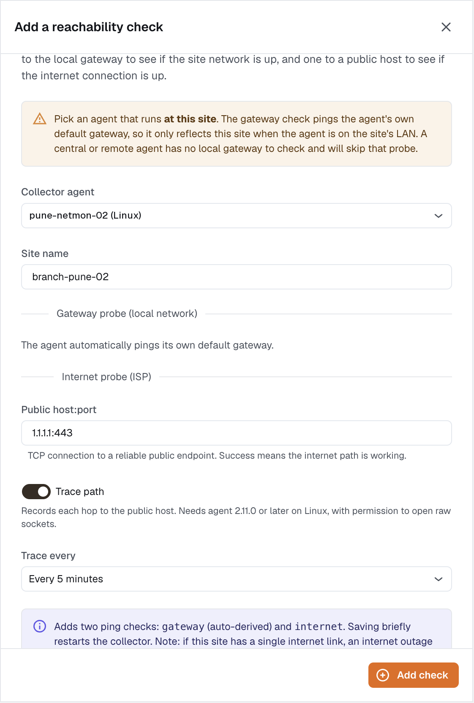
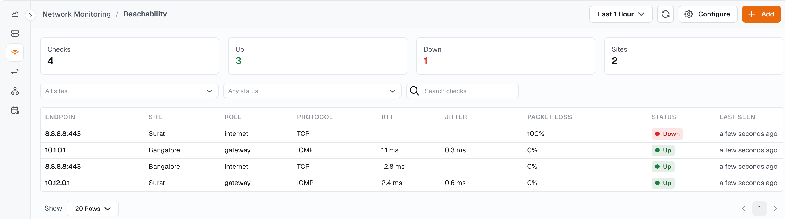

Not every site has a device you can poll. A branch office might sit behind a consumer router or a cheap gateway that doesn't support SNMP. For those sites, add a **reachability check**: a pair of ping probes that tell you whether the local network is up and whether the internet connection is working. You can also track jitter and trace the internet probe's path hop by hop.

## How the two probes split the problem

A reachability check runs two probes from the agent:

- **Gateway probe**: an ICMP ping to the site's LAN gateway. It answers "is the local network up?" The agent pings **its own default gateway** — you don't enter an address — so the check only makes sense when the agent runs on the site's network.
- **Internet probe**: a TCP connection to a public host. It answers "is the ISP link working?"

Read together, the two probes tell you where a fault is. Gateway up and internet down points at the ISP or the WAN link, not the local network. Both down points at the site itself: power, the gateway, or the agent's own connectivity.

:::caution[Single-link sites: an internet outage looks like "not reporting"]
If the site has a single internet connection, the agent uses that same link to send data to KloudMate. When the link goes down, the internet probe can't report its own failure — so the check shows as **not reporting** rather than a failed internet probe. Alert on "not reporting" (no data) for these sites, the same way you'd catch an agent going offline. A site with a second, independent link is the only case where a failed internet probe (`km_ping_up = 0`) reliably arrives.
:::

## Before you start

- A Linux or Docker KloudMate Agent **running at the site** — on the same local network as the gateway. The gateway probe pings the agent's own gateway, so a central or remote agent has no site gateway to check and skips that probe.
- For the gateway probe, ICMP permission on the agent host. ICMP needs `CAP_NET_RAW` or root, so add `--cap-add=NET_RAW` when running the agent in Docker. The internet probe uses TCP and works without extra privileges.

## Add a reachability check

In **Network Monitoring**, open the **Add** menu and choose **Reachability check**:

- **Agent**: pick the agent running **at this site**. The gateway probe uses this agent's own gateway.
- **Site name**: a label such as `hotel-blr-01`. It applies to both probes so they group under one site.
- **Public host:port**: a reliable public endpoint to connect to, for example `1.1.1.1:443`. A successful connection means the internet path is working.
- **Trace path** (optional): record each hop between the agent and the public host. See [Trace the path to the internet](#trace-the-path-to-the-internet).

The agent discovers and pings its own default gateway. Saving adds both probes and briefly restarts data collection on the agent.

## Where results show up

Open **Network Monitoring → Reachability**. Each probe is a row with its endpoint, site, role (gateway or internet), protocol, round-trip time, jitter, packet loss, status, and when it was last seen. Summary tiles at the top count how many checks are up, down, and not reporting. Select a row to open the site's drawer, with charts for reachability, round-trip time, packet loss, and jitter, and the traced path.

The agent emits these metrics per probe:

- `km_ping_up`: `1` when the target is reachable, `0` when it isn't
- `km_ping_rtt`: round-trip time in milliseconds
- `km_ping_packet_loss`: percentage lost (ICMP probes only)
- `km_ping_jitter`: jitter in milliseconds (ICMP probes only)

Each carries the `site` and `role` tags you set, so you can build [Dashboards](/visualize-data/dashboards/) and [Alerts](/alerts/create-alerts/) that group by site or fire only when an internet probe drops.

## Jitter

Jitter tells you how steady the round-trip time is, which matters more than the average for voice and video calls. Each ICMP probe sends several echoes, and jitter is the mean difference between consecutive round trips that were answered. For example, round trips of 20, 30, and 25 ms give a jitter of 7.5 ms.

Jitter is measured on ICMP probes, which in a reachability check is the gateway probe. A probe needs at least two answered echoes to report it. It needs agent 2.11.0 or later, and the column stays empty on older agents.

## Trace the path to the internet

When the internet probe fails or slows down, the traced path shows where along the way it happens: on the site's own link, at the ISP, or further out. Turn on **Trace path** when you add the check, then pick how often to trace under **Trace every**: every minute, every 5 minutes (the default), every 15 minutes, or every hour. To add tracing to an existing check, open **Configure**, edit the site's internet probe, and turn on **Trace path**.

Each trace sends three TCP SYN packets per hop to the public host and port, raising the TTL one hop at a time, and reads the ICMP replies from the routers on the way. It stops when the public host answers, when a router reports it unreachable, or after 30 hops. Because a trace can send up to 90 packets, the agent won't trace more often than once a minute.

Trace path only works on the internet probe, since it uses TCP. It needs:

- Agent 2.11.0 or later. On an older agent, or one whose version isn't known, the switch is disabled.
- An agent running on Linux.
- Permission to open raw sockets to read the ICMP replies: `CAP_NET_RAW` or root on a host, or `--cap-add=NET_RAW` in Docker. The standard Docker install runs the agent with `--privileged`, which includes it.

Without raw socket rights, the agent logs `km_ping: no path metrics from this host` once and sends no path data. The probe itself keeps running.

### Read the hop view

Open the site's drawer from the **Reachability** tab. The **Path** panel at the top shows the latest trace to each traced endpoint, marked **Reached** or **Not reached**, with one row per hop:

- **Address**: the router that answered, or **No answer** when none of the hop's probes did.
- **RTT**: the mean round trip of the hop's answered probes.
- **Loss**: the share of the hop's probes that got no answer.

A hop listed twice answered from two addresses, which usually means a load-balanced route. A router that rate-limits its own replies can show loss on its hop even though traffic through it, and to the target, isn't lost. Hops after the last one that answered are left out.

The path is stored as metrics on the internet probe:

- `km_ping_path_hop_rtt` and `km_ping_path_hop_loss`, per hop, with `hop_index` and `hop_address` (`*` when the hop didn't answer)
- `km_ping_path_hops`: the number of hops to the target, or to the last hop that answered
- `km_ping_path_reached`: `1` when the trace reached the target, `0` when it didn't
