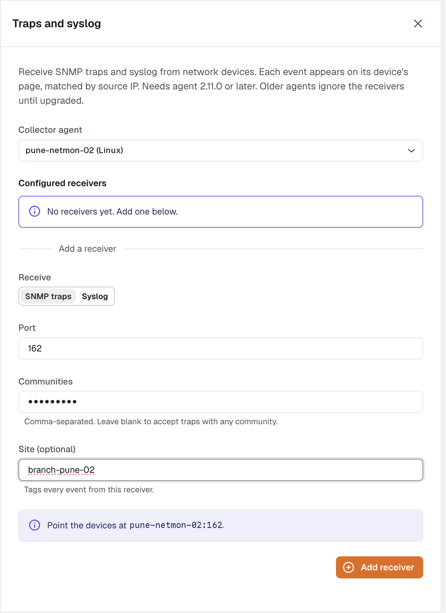

Polling tells you how a device is doing every minute or so. Traps and syslog tell you what happened in between: a link that flapped, a fan that failed, a configuration change, a login. Add a receiver on an agent and point your devices at it. Every event lands in [Logs](/logs/log-explorer/), and events from devices that the same agent polls over SNMP also appear on that device's **Events** tab.

Receivers need a Linux or Docker KloudMate Agent on version 2.11.0 or later. Kubernetes agents can't run them.

## Add a receiver

In **Network Monitoring**, open the **Add** menu and choose **Traps and syslog**. Pick the collector agent, then fill in the receiver:

- **Receive**: **SNMP traps** or **Syslog**.
- **Port**: the port to listen on. It defaults to `162` for traps and `514` for syslog.
- **Communities** (traps): the community strings to accept, comma-separated. Leave it blank to accept traps with any community. See [Limit traps by community](#limit-traps-by-community).
- **Protocol** (syslog): **UDP** or **TCP**.
- **Message format** (syslog): **RFC 3164 (BSD)** or **RFC 5424**. Pick the format your devices send.
- **Site (optional)**: a label such as `hotel-blr-01`, added to every event from this receiver.

Select **Add receiver**. The receiver starts within a minute. Then configure each device to send traps or syslog to the agent's address and the port you chose.

You can run several receivers on one agent, for example traps on `162`, syslog over UDP on `514`, and syslog over TCP on `1514` for devices that send RFC 5424. Each receiver needs its own port, and that includes [flow listeners](/network-monitoring/flow-monitoring/). If two listeners on an agent share a port, only one of them is set up.

To change or remove a receiver, open **Traps and syslog** again and pick the agent, or edit the **SNMP traps** or **Syslog** entry from **Configure**.

## Ports, privileges, and Docker

Ports `162` and `514` are below 1024, so the agent needs root, or the `CAP_NET_BIND_SERVICE` capability, to bind them. The Linux agent runs as root, and the standard Docker install runs the agent with `--privileged --network host`, so both can use the default ports. With host networking, the receivers listen on the Docker host's own addresses, and devices send to the host's IP.

Receivers listen on every IPv4 address of the agent host. Open the ports in any firewall between your devices and the agent: UDP for traps and UDP syslog, and TCP for TCP syslog.

If the agent can't bind a port, because another process holds it or the agent lacks the rights, it leaves that receiver out and logs `network events: receiver left out` with the reason. The agent's other receivers and integrations keep running. On a Linux host, run `journalctl -u kmagent | grep "network events"`. In Docker, run `docker logs km-agent 2>&1 | grep "network events"`.

## Limit traps by community

Receivers accept SNMPv1 and SNMPv2c traps. When **Communities** lists one or more strings, the receiver rejects any trap whose community isn't on the list, before the trap is queued. Rejected traps aren't stored, and they don't count as dropped events. Leave the field blank to accept every community.

## How events map to devices

For every trap and syslog message, the agent takes the sender's IP address and looks it up in the SNMP devices that the same agent polls, matching their management address and every interface address they report. When it finds a match, it names the event after that device. When it doesn't, it uses the sender's IP as the device name.

So to see a device's events on its page, poll the device over SNMP from the same agent that receives its traps and syslog. For example, if a router polled as `edge-rtr-01` at `10.0.0.1` sends syslog from its loopback `10.255.0.1`, the event is still named `edge-rtr-01`, as long as the router reports that loopback address over SNMP.

Each event keeps its severity and message, and carries these attributes:

| Attribute | Value |
|---|---|
| `device.name` | The matched SNMP device's name, or the sender's IP when nothing matched. |
| `device.address` | The sender's IP address. |
| `network.event.source` | `snmp_trap` or `syslog`. |
| `site` | The receiver's **Site**, when you set one. |

To find events from devices that aren't polled over SNMP, search [Logs](/logs/log-explorer/) for records that have `network.event.source`, and filter `device.name` by the sender's IP.

## The Events tab

Open a device from **Network Monitoring** and select the **Events** tab. It lists the traps and syslog messages that device sent in the selected time range, newest first, with the time, source, severity, and message, up to the latest 100. Select **Open in logs** to see every event in [Logs](/logs/log-explorer/) with the same filters.

Events also feed the **Probable cause** panel on the Overview. When a device is down, its recent traps and syslog messages are listed as evidence. See [Using Network Monitoring](/network-monitoring/network-page/#probable-cause).

## Dropped events

A burst of traps or syslog can arrive faster than the agent forwards it. The agent counts the events it loses in `kmagent_network_events_dropped`, by `source` (`snmp_trap` or `syslog`) and `reason`. When you open **Traps and syslog** and pick an agent that lost events in the last hour, the form shows a warning with the counts.

| Reason | Source | What happened |
|---|---|---|
| `queue_full` | Traps | The trap receiver's in-memory queue, which holds 16,384 traps, was full. |
| `refused` | Traps | The agent's logs pipeline didn't accept the trap. |
| `socket` | Traps and UDP syslog | The kernel dropped packets at the receiver's socket because the agent didn't read them in time. Counted on Linux only. |

If drops keep coming back, spread the sending devices across more agents, or reduce what the devices send, for example by raising their syslog severity threshold.

## Agent version

Receivers need agent 2.11.0 or later. On an older agent, or one whose version isn't known, the form won't add a receiver. A receiver that's already configured for an older agent is ignored by that agent and starts once you upgrade it.
