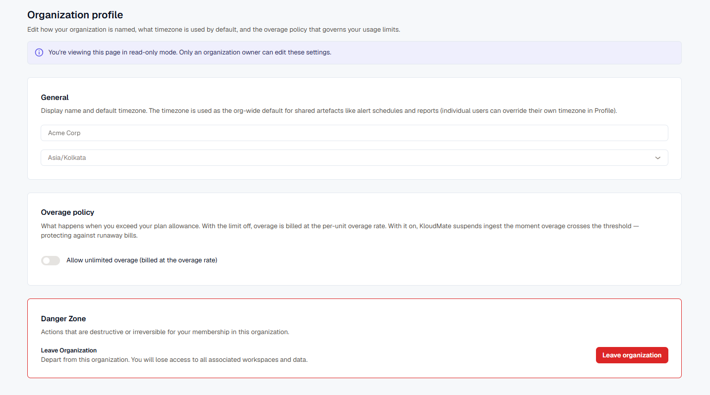

Organization settings apply org-wide: the display name, default timezone, overage policy, and MFA requirement.

Open **Settings → Organization** to view or edit these settings.

:::note
Only an organization owner can edit these settings. Other members see the page in read-only mode.
:::

## General

Set the organization's display name and default timezone. The timezone is the org-wide default for shared artifacts like alert schedules and reports; individual users can override it for themselves in their own [Profile & Security](../profile-security/) settings.

## Overage Policy

Controls what happens when usage exceeds your plan's allowance:

- **Off (default):** overage is billed at the per-unit overage rate.
- **On:** KloudMate suspends ingest the moment usage crosses the threshold, protecting against runaway bills.

Toggle **Allow unlimited overage** to switch between the two.

## Require MFA for All Members

Owners can require every member of the organization to use multi-factor authentication (MFA). This is available on all plans.

1. Make sure you've set up MFA yourself in [Profile & Security](../profile-security/). You can't turn the requirement on without it.
2. Open **Settings → Organization → Profile**.
3. In the **Security** card, turn on **Require multi-factor authentication**.
4. Confirm. Members without MFA must set it up before they can sign in to this organization with a password, switch to it, or accept an invite to it.

Turn the switch off to remove the requirement. Turning it off needs only that you're an owner. You don't need MFA on your own account, so an owner who signs in with SSO can still remove it.

Only a signed-in owner can change the requirement. API keys can't turn it on or off.

### What Members See

The requirement applies when a member's session enters this organization: at sign-in, when switching to it, and when accepting an invite to it. Other organizations the member belongs to that don't require MFA still let them in with a password alone.

- A member without MFA whose password sign-in opens this organization sets MFA up right after the password: scan a QR code, enter a 6-digit code, and copy the recovery code, which is shown only once.
- Opening this organization from another one is refused until the member sets up MFA. The organization switcher shows "*Organization* requires MFA. Set it up in Profile & Security." with a link to **Profile & Security**. A link or saved workspace in this organization opens a page with buttons to go back to the member's other organization, retry, or open **Profile & Security**. If there's no workspace to go back to, that page offers the MFA setup itself.
- Accepting an invite to this organization offers MFA setup on the invite page. After the member sets it up and copies the recovery code, the invite is accepted.
- Sessions already open in this organization keep working.
- Members who already use MFA notice no change.
- Members can't turn MFA off while this organization, or any other organization they belong to, requires it.

The **MFA** column in the **Users** list shows whether MFA is on for each member. **Off** means the member hasn't set up an authenticator app. It doesn't mean they're out of compliance if they sign in with SSO, which doesn't ask for one.

:::note
Sessions that signed in with SSO are exempt at sign-in, when switching organizations, and when accepting an invite, whichever identity provider was used, because the identity provider handles the second factor.
:::

## Leave an Organization

Instead of asking an owner to remove you, you can leave an organization yourself — useful cleanup if you've accumulated memberships in organizations or workspaces you no longer use.

- **Non-owners** can leave at any time.
- **Owners** must transfer ownership to another member first. An organization always needs at least one owner, so the leave action stays unavailable until ownership is transferred.

Use **Leave organization** in the **Danger Zone**. Leaving removes your access to the organization and every workspace and data set associated with it.

## Related

- [Workspaces](../workspaces/)
- [Users & Permissions](../users-permissions/)
- [Profile & Security](../profile-security/)
