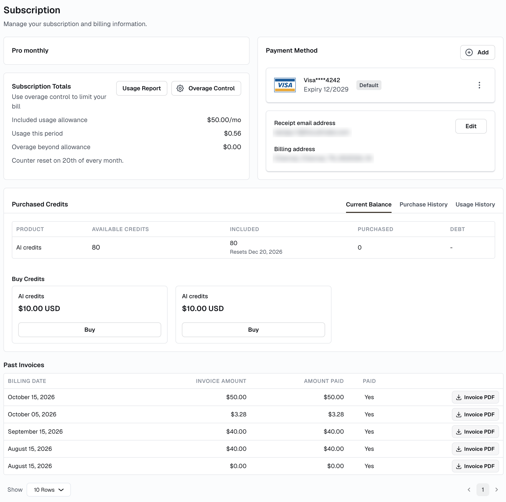
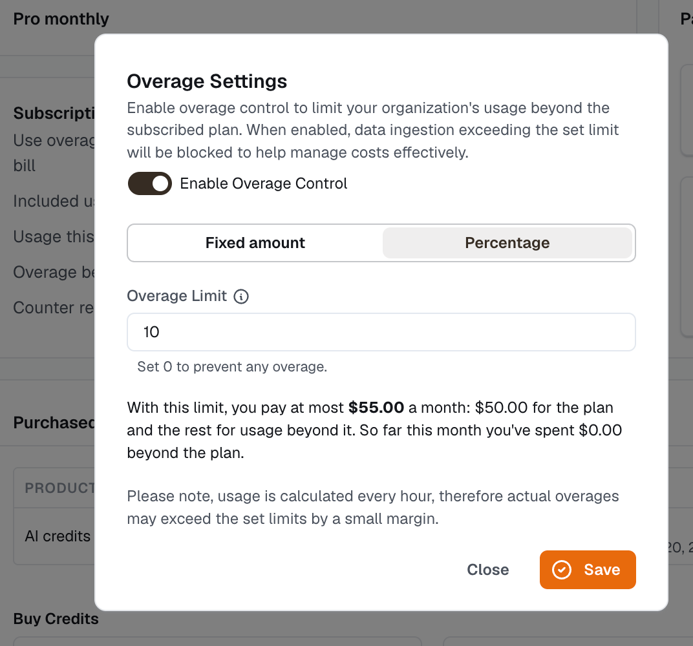

Use **Subscription & Billing** to review the current plan, manage payment methods, and control overage costs.

This page includes:

- The active subscription plan
- Payment method and billing details
- Usage totals relevant to billing
- AI credit balance, with options to buy more credits
- Historical invoices

Every member of the organization can see the plan, usage, and purchased credits. Only an Owner or a Billing admin can:

- See the payment method, the billing contact and address, and invoices
- Change the subscription plan
- Add or remove payment methods
- Update billing contact or billing address information
- Buy credits or change **Overage Control**

See [Roles and permissions](../roles/#billing).

## Control Overage Costs

To prevent unexpected charges, set an overage limit under **Overage Control**. Overage is what you use beyond the usage your plan includes.

You can limit overage using either:

- A fixed amount, on plans paid by card
- A percentage of your plan's monthly fee

Overage Control isn't shown on the Free plan, during a trial, or on a prepaid plan, because none of these is billed for overage.

As you set the limit, the dialog shows the most you'd pay in a month with that limit in place.

Set the value to `0` if you want to block all overage charges entirely.
