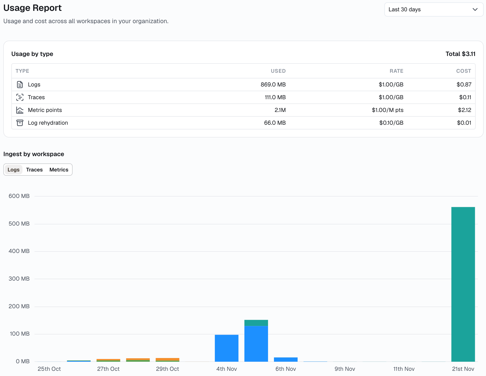
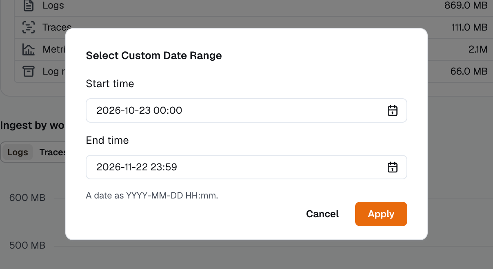

The usage report shows usage and cost across all workspaces in your organization for the selected period.

It includes:

- **Usage by type:** the amount used, the rate, and the cost for logs, traces, metric points, and log rehydration, with the total cost for the period
- **Ingest by workspace:** a daily chart of ingested logs, traces, or metrics, broken down by workspace

Use the period selector to switch between quick ranges (the last 24 hours, 7 days, or 30 days), the current billing period, and previous billing periods.

## Custom Date Range Reports

To report on any other window, select **Custom range…** from the period selector, then enter a start time and an end time in `YYYY-MM-DD HH:mm` format.

