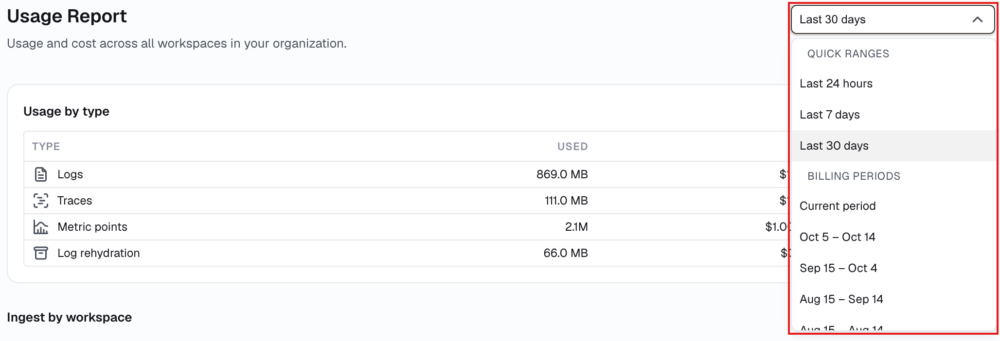

The usage report shows usage and cost across all workspaces in your organization for the selected period.

It includes:

- **Usage by type:** the amount used, the rate, and the cost for each type you used: logs, traces, metrics, voice calls, workflow runs, log rehydration, RUM sessions, session replays, and profiles, with the total cost for the period
- **Usage breakdown:** pick a usage type and split it by workspace, source, source type, service, app, workflow, or feature. A chart shows the largest groups, and a table lists every group with its share and its change from the previous period. Owners and billing admins can also split AI credits by person.

Use the period selector to switch between quick ranges (the last 24 hours, 7 days, or 30 days), the current billing period, and previous billing periods.

## Custom Date Range Reports

To report on any other window, select **Custom range…** from the period selector, then enter a start time and an end time in `YYYY-MM-DD HH:mm` format.

