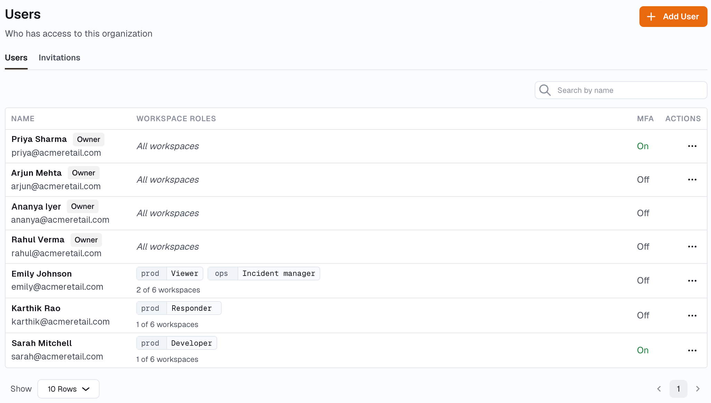
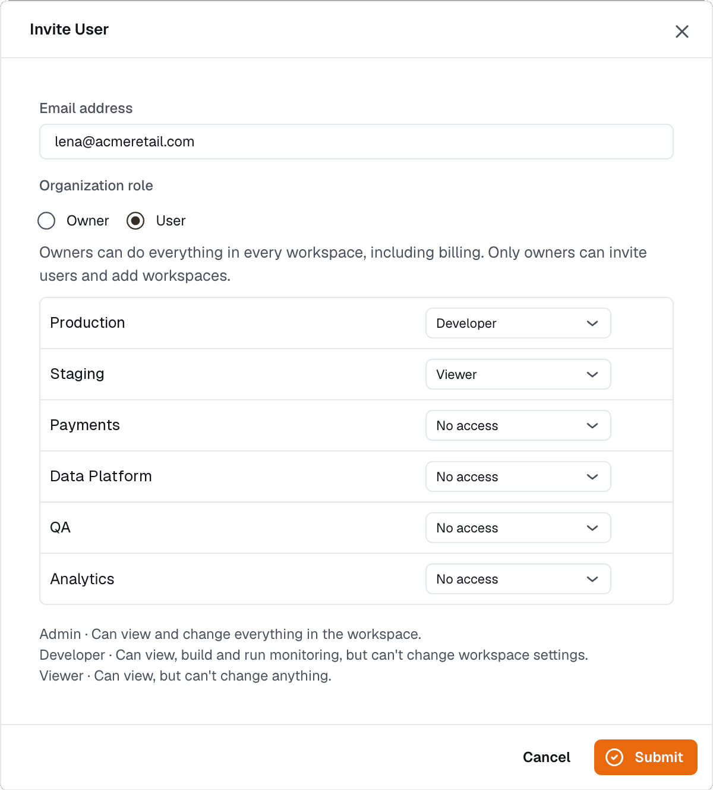

import { Steps } from '@astrojs/starlight/components';

Use **Settings → Users** to invite people to your organization and decide what they can do in each workspace. Every member can see the list of users. Only an Owner or an organization Admin can invite, change, or remove users.

Each person has an organization role (**Owner**, **Admin**, **Billing admin**, or **User**) and a role in each workspace. For what each role can do, see [Roles and permissions](../roles/).

## Invite a user

<Steps>

1. Open **Settings → Users** and click **Add User** to open the **Invite User** dialog.

2. Enter the person's **Email address**.

3. Under **Organization role**, select **User**, **Billing admin**, **Admin**, or **Owner**. An Owner is an Admin in every workspace, so you don't pick workspace roles for an Owner. Only an Owner can pick **Owner** or **Billing admin**.

4. For anyone but an Owner, pick a role in each workspace they need: **Admin**, **Developer**, **Viewer**, or one of your [custom roles](../roles/custom-roles/). Leave **No access** in the other workspaces. They need a role in at least one workspace.

5. Click **Submit**.

</Steps>

The person gets the invitation by email. After they sign in, they can also accept it from **Settings → Pending Invitations**. If your plan doesn't include custom roles, you can't pick one.

## Manage invitations

Invitations that haven't been accepted yet are on the **Invitations** tab. An invitation expires 7 days after you send it.

- To send an invitation again, click **Resend**. This works on an expired invitation too. The person gets the invitation by email again, and it's valid for another 7 days.
- To change the roles on an invitation, invite the same email address again with the new roles.
- To cancel an invitation, click its delete icon.

Only an Owner can resend an invitation for an Owner or a Billing admin. You can resend the same invitation once a minute at most.

## Change a user's roles

<Steps>

1. Open **Settings → Users**.

2. Open the actions menu on the user's row and click **Edit**.

3. Change the **Organization role**, or the **Role** in each workspace. Select **No access** to remove the user from a workspace.

4. Click **Save**.

</Steps>

These rules apply to every change:

- Only an Owner can make someone an Owner or a Billing admin, change their role, or remove them.
- Nobody can change their own roles. Ask an Owner or an Admin.
- An organization always has at least one Owner. To change the role of the only Owner, make another member an Owner first.

## Remove a user

Open the actions menu on the user's row, click **Edit**, then click **Remove user from Organization**. The person loses access to the organization and every workspace in it.

## Add users through single sign-on

If your organization uses single sign-on, people can get an account the first time they sign in through your identity provider. You pick the organization role and the workspace roles that those new accounts get. See [Provisioning & enforcement](../sso/provisioning-and-enforcement/).

## Related

- [Roles and permissions](../roles/)
- [Custom roles](../roles/custom-roles/)
- [Workspaces](../workspaces/)
- [Single Sign-On (SSO)](../sso/)
