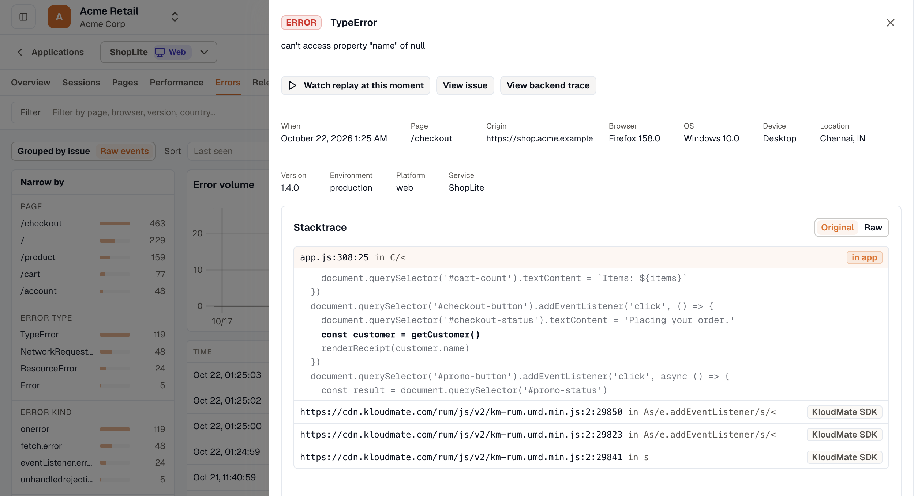

import { Steps, Tabs, TabItem } from '@astrojs/starlight/components';

Production JavaScript is minified, so a browser error's stack points at a position such as `index-4f2a.js:1:84210`. Upload the source maps from each build, and the stack trace on the issue page and in the error drawer shows the original file, line, and column instead, along with the lines of source around it. Switch to **Raw** to see the stack as the browser reported it.



You upload the maps from your build, usually in CI, with the `@kloudmate/sourcemaps` package. They're stored in your workspace and never served publicly. Stacks are mapped when you open an error, not when it's reported, so maps you upload after a deploy also apply to errors that build has already reported.

A map is kept for 90 days after it was last used. Mapping a stack counts as a use, and so does an upload from a later build that contains the same map. Source maps work with the browser SDK and are included in every plan.

## Create an upload key

Uploads authenticate with a **Backend** ingest key (`sk_…`). The Frontend key your app sends RUM data with won't work, and neither will a personal API key (`uk_…`).

<Steps>

1. In the workspace your app sends RUM data to, go to **Settings → Ingest Keys** and click **Add New**.

2. Choose **Ingest Key - Backend**, add a note such as `sourcemaps-ci`, and click **Submit**.

3. Copy the key and store it as a CI secret named `KM_SOURCEMAPS_TOKEN`. The key is shown only once.

</Steps>

Maps are stored per workspace, so create the key in the same workspace as the app. A key from another workspace uploads the maps where your errors never look for them.

:::caution
A Backend key can send any telemetry into your workspace from anywhere. Keep it in your CI secret store, and never commit it or put it in client code.
:::

Then pass it to the build step. For example, in GitHub Actions:

```yaml
- run: npm run build
  env:
    KM_SOURCEMAPS_TOKEN: ${{ secrets.KM_SOURCEMAPS_TOKEN }}
    KM_RELEASE: ${{ github.sha }} # the same value as the SDK's `version`
```

`KM_RELEASE` is optional. See [How a frame finds its map](#how-a-frame-finds-its-map) for when it matters.

## Install the package

Add `@kloudmate/sourcemaps` as a dev dependency, so every build runs the version you pinned:

```bash
npm i -D @kloudmate/sourcemaps
```

The package needs Node.js 18.17 or later and is ESM-only. A CommonJS config can `require()` it on Node.js 20.19, 22.12, or later.

## Upload from your build

Use the plugin for your bundler if there is one. For any other bundler, run the CLI after the build.

### Vite and Rollup

```ts
// vite.config.ts
import { defineConfig } from 'vite';
import { kloudmateSourcemaps } from '@kloudmate/sourcemaps/vite';

export default defineConfig({
  build: { sourcemap: 'hidden' },
  plugins: [kloudmateSourcemaps({ app: 'shop-web' })],
});
```

`sourcemap: 'hidden'` writes the maps without adding a `sourceMappingURL` comment to your scripts, so no deployed script points at a map that isn't there. The same plugin works in a Rollup config.

### webpack and Rspack

```js
// webpack.config.mjs or rspack.config.mjs
import { kloudmateSourcemaps } from '@kloudmate/sourcemaps/webpack';

export default {
  mode: 'production',
  devtool: 'hidden-source-map',
  plugins: [kloudmateSourcemaps({ app: 'shop-web' })],
};
```

### What the plugins do

On a production build, each plugin:

1. Injects a debug ID into every script and its map.
2. Uploads the maps KloudMate doesn't already have. Rebuilding unchanged code uploads nothing.
3. Removes every `.map` file from the build output, including `.map.gz` and `.map.br` copies, so your source is never deployed.

Development builds, watch mode, Vite SSR builds, and library builds are left alone. If the upload fails, the plugin logs the error and the build carries on. Set `failOnError: true` to fail the build instead.

:::caution
The maps are removed even when `KM_SOURCEMAPS_TOKEN` isn't set, so a build made without the token has no maps left to upload. Set `deleteAfterUpload: false` to keep them, for example in a local build you want to inspect.
:::

### Plugin options

Both plugins take the same options.

| Option | Default | Description |
| --- | --- | --- |
| `app` | None, required | Must equal the SDK's `applicationName` exactly. |
| `release` | `KM_RELEASE` | Should equal the SDK's `version`. Frames with a debug ID match without it. |
| `urlPrefix` | Vite's `base` or webpack's `output.publicPath`, else `~/` | The URL path the output directory is served from. `/shop/`, `~/shop`, and `https://cdn.example.com/shop/` all mean the same thing, because `~` stands for any origin. A `publicPath` of `auto` counts as `~/`. |
| `deleteAfterUpload` | `true` | Removes every `.map` file from the output, whether or not it was uploaded. |
| `failOnError` | `false` | Fails the build when KloudMate is unreachable or refuses the upload. |
| `token` | `KM_SOURCEMAPS_TOKEN` | The upload key. Use the environment variable rather than writing the key into config. |
| `url` | `KM_SOURCEMAPS_URL`, else `https://api.kloudmate.com` | The KloudMate API base URL. |

### Any other bundler: the CLI

For Next.js, Angular, esbuild, or any bundler without a plugin, run the CLI after the build. Run `inject` first, then `upload`:

```bash
npx @kloudmate/sourcemaps inject ./dist
npx @kloudmate/sourcemaps upload ./dist --app shop-web --release "$APP_VERSION" --delete-after-upload
```

`inject` adds a debug ID to every script in the directory that has a map, and records it in the map. It changes the built scripts, so run it before any step that hashes them, such as subresource integrity or a service worker manifest. `upload` pairs each script with its map through its `sourceMappingURL` comment, or a `<file>.map` file next to it.

Unlike the plugins, the CLI keeps the maps unless you pass `--delete-after-upload`.

:::caution
Always call the CLI by its scoped name, `@kloudmate/sourcemaps`, so `npx` runs the version installed in your project. Any other name could resolve to an unrelated npm package, which would then run in your CI with access to your token and your maps.
:::

#### CLI reference

```text
npx @kloudmate/sourcemaps inject <dir>
npx @kloudmate/sourcemaps upload <dir> --app <name> [--release <version>] [--url-prefix <path>]
                                       [--delete-after-upload] [--url <api>] [--strict]
```

The key always comes from `KM_SOURCEMAPS_TOKEN`. Without it, `upload` sends nothing.

| Flag | Description |
| --- | --- |
| `--app` | Required for `upload`. Must equal the SDK's `applicationName` exactly. |
| `--release` | Should equal the SDK's `version`. Defaults to `KM_RELEASE`. |
| `--url-prefix` | The URL path `<dir>` is served from, such as `/shop/` or `https://cdn.example.com/shop/`. Defaults to `~/`, the site root. |
| `--delete-after-upload` | Deletes every `.map` file in `<dir>`, whether or not it was uploaded, even when no key is set. |
| `--url` | The KloudMate API base URL. Defaults to `KM_SOURCEMAPS_URL`, else `https://api.kloudmate.com`. |
| `--strict` | Exits non-zero when the upload fails. Without it, failures are logged and the command exits 0, so an upload problem never breaks the build. |

#### Recipes

<Tabs>
<TabItem label="Next.js">

Turn on browser source maps. This works for both webpack and Turbopack builds:

```js
// next.config.js
module.exports = { productionBrowserSourceMaps: true };
```

Then run the CLI on `.next/static`, which is served under `/_next/static`:

```jsonc
// package.json
"build": "next build && npx @kloudmate/sourcemaps inject .next/static && npx @kloudmate/sourcemaps upload .next/static --app shop-web --url-prefix /_next/static --delete-after-upload"
```

With a `basePath`, or a path in `assetPrefix`, add it to the prefix, for example `--url-prefix /shop/_next/static`. Don't use `experimental.sri`, because its hashes are computed before `inject` changes the files.

</TabItem>
<TabItem label="Angular">

In `angular.json`, turn on hidden script maps for the production configuration:

```jsonc
"configurations": {
  "production": {
    "sourceMap": { "scripts": true, "styles": false, "hidden": true, "vendor": true }
  }
}
```

Then run the CLI on the browser output:

```jsonc
// package.json
"build": "ng build && npx @kloudmate/sourcemaps inject dist/shop-web/browser && npx @kloudmate/sourcemaps upload dist/shop-web/browser --app shop-web --release \"$APP_VERSION\" --delete-after-upload"
```

Projects on the older `browser` builder output to `dist/shop-web`, without the `browser` folder. If the app is served under a `baseHref` such as `/shop/`, add `--url-prefix /shop/`.

If you use `@angular/service-worker`, regenerate its manifest after `inject`, or the service worker rejects the changed files. Run this from the project root, adding the `baseHref` as a third argument if the app has one:

```bash
ngsw-config dist/shop-web/browser ngsw-config.json
```

</TabItem>
<TabItem label="esbuild">

Build with `sourcemap: 'external'`, which writes the maps without pointing the scripts at them:

```js
await esbuild.build({
  entryPoints: ['src/main.ts'],
  bundle: true,
  minify: true,
  sourcemap: 'external',
  outdir: 'dist',
});
```

Then run `inject` and `upload` on `dist`, as shown above.

</TabItem>
</Tabs>

## How a frame finds its map

Each frame in a stack is matched to an uploaded map by its debug ID when it has one, and otherwise by app, release, and path.

**By debug ID.** The plugins and `inject` write a debug ID into each script and its map. `@kloudmate/rum-web` 2.6.0 and later reports the debug ID of every script in an error's stack, so each frame matches the map from the exact build that produced it, whatever its release or path. The `/v2/` CDN script picks up new versions on its own. If you install the SDK from npm, upgrade to 2.6.0 or later.

**By app, release, and path.** A frame with no debug ID is matched on all three:

- **App:** the `app` you upload with must equal the SDK's [`applicationName`](../instrumentation-guide/sdk-reference/#initoptions) exactly.
- **Release:** the `release` you upload with should equal the SDK's `version`. When several uploads hold a file at the same path, the one from the error's release is used. Without a matching release, the frame maps only if every upload for that path holds the same map.
- **Path:** the URL path the script was served from, on any origin, without the query string. An upload is named from the URL prefix plus the file's path in the output directory, so if you serve your scripts from a subpath such as `/shop/`, set `urlPrefix` or `--url-prefix` to match.

A frame falls back to this match when the SDK is older than 2.6.0 or the maps were uploaded with the CLI but never injected. With the CLI, it also applies to an error thrown while a script's top-level code first runs, because that happens before the script registers its debug ID.

Content-hashed file names such as `index-4f2a.js` change whenever their code does, so release matters most for files with fixed names, such as `main.js`.

### Recommended setup

- **Build hidden source maps:** `build.sourcemap: 'hidden'` in Vite, `devtool: 'hidden-source-map'` in webpack and Rspack. Your scripts then carry no `sourceMappingURL` comment that points at a map.
- **Keep the maps out of the deploy:** The plugins delete them by default. With the CLI, pass `--delete-after-upload`.
- **Upload in CI:** Run the upload in the same job that builds what you deploy, with the key as a CI secret. The maps then always come from the build that ships.
- **Set a release:** Set the SDK's `version`, and pass the same value as `release` or `KM_RELEASE`.

## Self-hosted and other regions

The package uploads to `https://api.kloudmate.com` by default. If your workspace uses a different API host, such as a [KloudMate Infinity](../../platform/infinity/) deployment, set `KM_SOURCEMAPS_URL` in the build, or pass `url` to the plugin or `--url` to the CLI:

```bash
npx @kloudmate/sourcemaps upload ./dist --app shop-web --url https://api.kloudmate.example.com
```

If the build log says `the KloudMate sourcemaps API is not available at <url>`, the URL is wrong or that deployment doesn't serve the source maps API.

## Troubleshoot unmapped frames

A frame that couldn't be mapped carries a badge in the stack trace that names the reason.

### no source map

No uploaded map matches this file. Frames from third-party scripts you don't build, such as an analytics tag, always show this badge. For your own scripts, check these in order:

1. The build uploaded maps. A successful upload logs a line such as `[@kloudmate/sourcemaps] shop-web@1.4.0: 12 maps uploaded, 0 already stored`. If the log says `KM_SOURCEMAPS_TOKEN is not set`, add the secret to the build. If it says `no source maps to upload`, turn on source maps in your bundler. A `401` means the key isn't a Backend ingest key.
2. `app` equals the SDK's `applicationName` exactly.
3. The upload key belongs to the workspace your app sends RUM data to.
4. The URL prefix matches the path your scripts are served from. This only matters for frames without a debug ID.
5. The map hasn't expired. A map unused for 90 days is deleted, so rebuild and upload it again.

### ambiguous release

Several uploads hold a different map for this path, and none of them was uploaded with the error's release. Set the SDK's `version`, and pass the same value as `release` when you upload.

### map unavailable

The map is recorded, but it couldn't be read from storage at that moment. This is temporary, so reopen the error shortly.

### invalid map

The stored file isn't a valid source map. Check that your bundler writes valid source map JSON, then rebuild and upload again. An upload skips any map KloudMate already holds byte for byte, so uploading the same file again won't change the result.

### position not in map

The map has no entry for this line and column, which means it was built from different code than the script that threw. Upload the maps from the build you deployed, ideally in the same CI job.

### no source

The frame maps to its original file, line, and column, but the map doesn't embed the source, so no lines can be shown. Most bundlers embed it by default. It goes missing when it's turned off, for example by webpack's `nosources-source-map` devtool or esbuild's `sourcesContent: false`.

### KloudMate SDK

The frame is inside the KloudMate RUM SDK, not your code, so there's nothing to fix.

***

## Related Resources

- [Web setup](../instrumentation-guide/web/)
- [SDK reference](../instrumentation-guide/sdk-reference/)
- [The Errors tab](../rum-interface/#errors)
- [Ingest Keys](../../platform/settings/api-keys/#ingest-keys)
