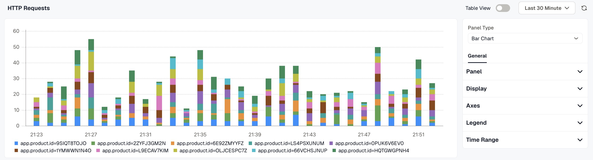
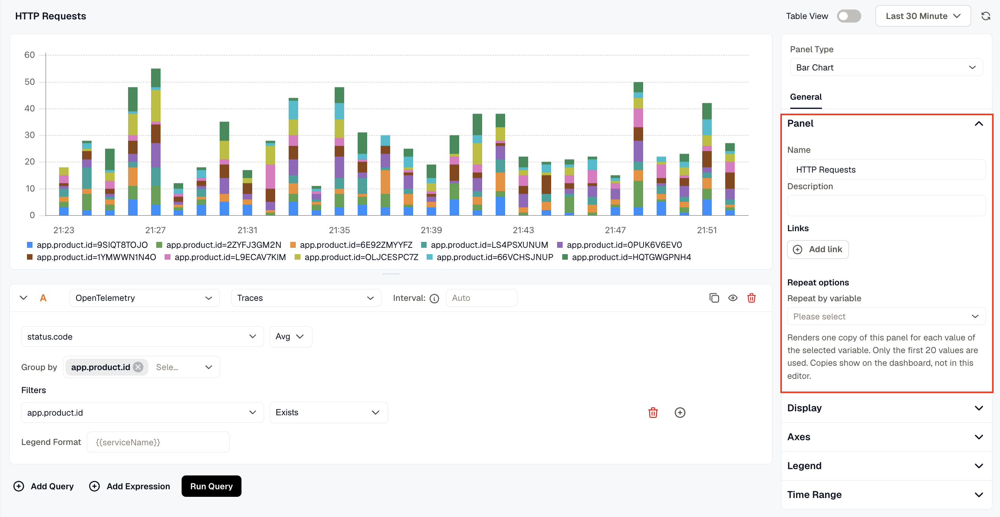
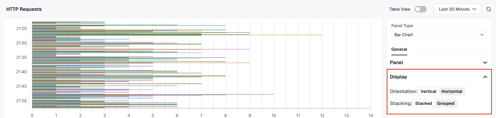
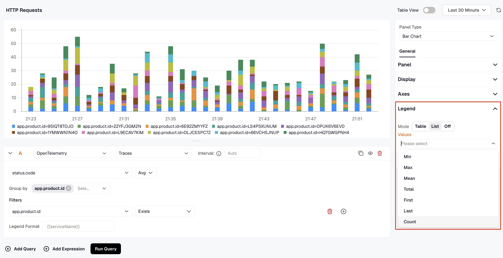

A Bar Chart panel compares values as bars. The X axis can be time or a category, so you can draw request counts per minute, or one bar per service from a query that returns one value for each service.

## Panel

- **Name** is the title shown on the dashboard.
- **Description** appears behind the info icon in the panel header.
- **Links** connect the panel to related resources, such as a runbook or another dashboard. Click **Add link** to add one.
- **Repeat by variable** draws one copy of the panel for each value of a dashboard variable, up to the first 20 values. Choose a **Direction**, and for horizontal repeats, a **Max per row**. The copies appear on the dashboard, not in the editor.

## Standard options

**Display name** renames a series. **Format** sets the unit and how values are written on the Y axis and in the tooltip. If you leave **Unit** on **Auto**, the panel uses the unit the metric declares. See [Format values and units](../../panel-options/format-and-units/).

## Display

- **Orientation:** **Vertical** or **Horizontal** bars. Horizontal bars leave more room for long category labels.
- **Stacking:** **Stacked** puts each series on top of the previous one. **Grouped** places them side by side.

## Axes

- **X-Axis:** **Date style** sets how times are written along the axis. **Auto** picks a format from the length of the time range.
- **Y-Axis:** **Min** and **Max** pin the ends of the axis instead of fitting it to the data.

## Legend

**Mode** shows the legend as a **Table** or a **List**, or turns it **Off**. **Values** adds summary values next to each series: **Min**, **Max**, **Mean**, **Total**, **First**, **Last**, or **Count**.

## Time range

Turn on **Override dashboard time range** to give this panel its own time range. **Time shift** moves the panel's range back in time, for example `-1d` to show the same window yesterday. See [Time Range Expressions and Settings](../time-range-expressions-and-settings/) for the supported units and syntax.

## Overrides

Use the **Overrides** tab to set **Display name** or **Format** for some series only. See [Overrides](../../panel-options/overrides/).

## Transform

Use the **Transform** tab to reshape the query results before the panel draws them. See [Transformations](../../panel-options/transformations/).

## Related

- [TimeSeries Panel](../timeseries-panel/)
- [Panel options](../../panel-options/)
- [Queries and data sources](../queries-and-data-sources/)
