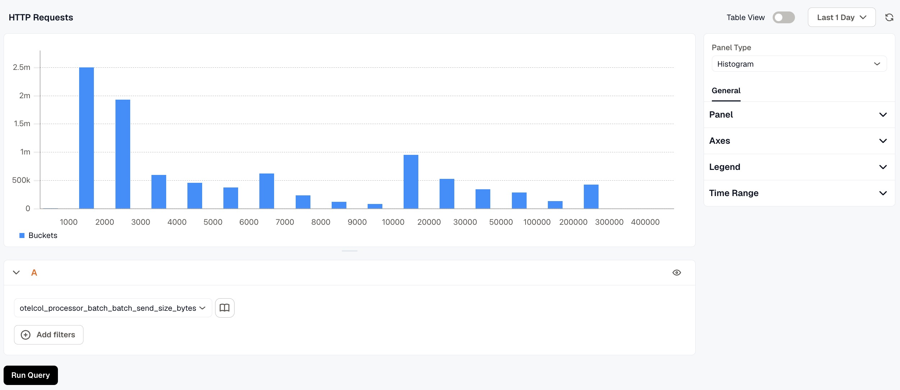
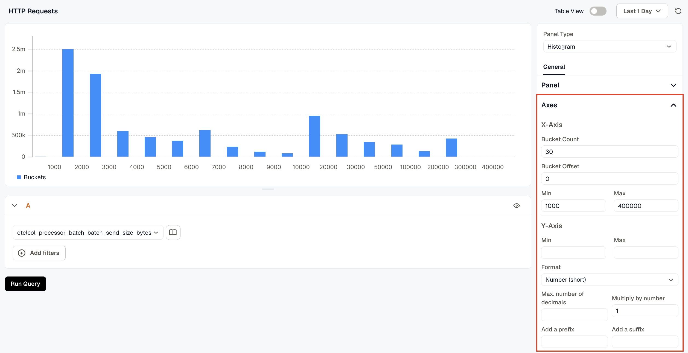

A Histogram panel shows how values are distributed over the selected time range. Each bar is a bucket, its height is the number of values that fell into it, and the X axis shows the bucket boundaries. Use it to see the shape of request durations or payload sizes, and switch time ranges to see how the distribution moved after a deployment or a traffic spike.

You can point the panel at either of these:

- **A histogram metric** with **Returns** set to **Distribution**, which is the default for a new Histogram panel. The panel draws the metric's own buckets.
- **A plain numeric series**, such as a latency series. The panel puts the values into buckets itself. It picks a bucket width of 1, 2, or 5 times a power of ten, so the boundaries are round numbers, and it keeps empty buckets so gaps in the distribution stay visible.

The last bucket, labeled `+Inf`, holds every value above the highest boundary. In a latency distribution, that bucket is often the slow tail.

## Panel

- **Name** is the title shown on the dashboard.
- **Description** appears behind the info icon in the panel header.
- **Links** connect the panel to related resources, such as a runbook or another dashboard. Click **Add link** to add one.
- **Repeat by variable** draws one copy of the panel for each value of a dashboard variable, up to the first 20 values. Choose a **Direction**, and for horizontal repeats, a **Max per row**. The copies appear on the dashboard, not in the editor.

## Standard options

**Display name** renames the series. **Bucket format** sets how the bucket boundaries on the X axis are written. The counts stay plain numbers.

A histogram metric usually doesn't declare a unit for its bucket boundaries, so set **Unit** yourself. For example, choose **Milliseconds** for a request duration histogram. When the panel buckets a plain series, the boundaries use that series' unit. See [Format values and units](../../panel-options/format-and-units/).

## Axes

**X-Axis**:

- **Buckets** sets how many bars the range is divided into. For a histogram metric, a smaller number merges neighboring buckets.
- **Offset** moves the bucket boundaries along the axis. For example, an offset of `10` turns the bucket `[0, 50]` into `[10, 60]`.
- **Min** and **Max** narrow the range, and the panel re-buckets within it. Narrowing a 0 to 100 chart to 0 to 20 gives you a closer look at that range with the full number of buckets, not a cropped chart with a few wide bars.

**Y-Axis**: **Min** and **Max** pin the ends of the count axis, and **Decimals** sets the decimal places of its labels.

## Legend

**Mode** shows the legend as a **Table** or a **List**, or turns it **Off**. **Values** adds summary values next to each series, such as **Min**, **Max**, or **Mean**. Leave **Values** empty to show labels only.

## Time range

Turn on **Override dashboard time range** to give this panel its own time range. **Time shift** moves the panel's range back in time, for example `-1d` to show the same window yesterday. See [Time Range Expressions and Settings](../time-range-expressions-and-settings/) for the supported units and syntax.

## Overrides

Use the **Overrides** tab to set **Display name** or **Bucket format** for some series only. See [Overrides](../../panel-options/overrides/).

## Transform

Use the **Transform** tab to reshape the query results before the panel draws them. See [Transformations](../../panel-options/transformations/).

## Related

- [Heatmap Panel](../heatmap-panel/)
- [Queries and data sources](../queries-and-data-sources/)
- [Panel options](../../panel-options/)
