import { Image } from 'astro:assets';
import overridesDropdown from './images/adding-a-panel-overrides.png';
import generalSettings from './images/adding-a-panel-general-settings.png';

Panels are the individual widgets on a dashboard. Each panel draws the result of one or more queries, and a dashboard puts the metrics, logs, and traces you care about on one page.

From your dashboard, click **Add** at the top right and choose what to add:

- **Add panel** opens the panel editor so you can build a new panel from scratch.
- **Add section** groups panels under a collapsible heading.
- **Import** reuses a panel from a template or an existing dashboard.

## Add a Panel

1. Click **Add panel**. The panel editor opens with a query editor at the bottom.

   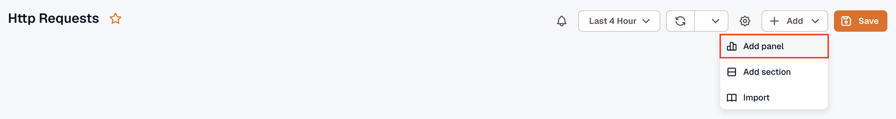

2. Build the query. Pick a data source, such as **KloudMate** or a connected AWS account, then choose the data set and metric, and add any grouping and filters. [Queries and Data Sources](./queries-and-data-sources/) covers each source's fields.

   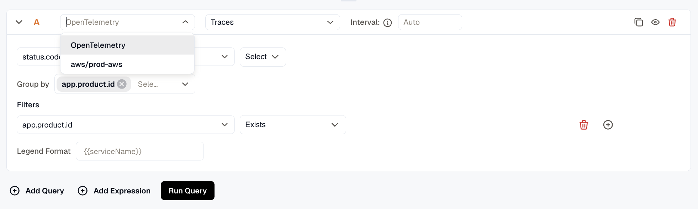

   Click **Add Query** to draw several queries on one panel, for example to compare two metrics.

   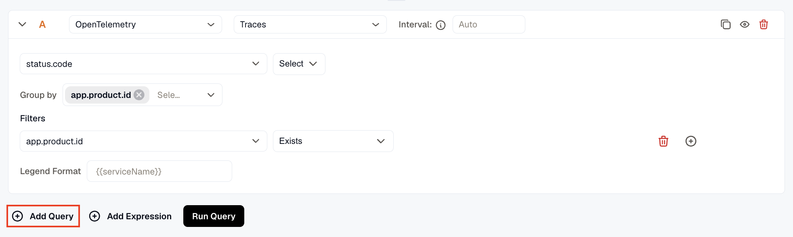

   Click **Add Expression** to calculate with the query results, for example to divide errors by requests. See [Expressions](../../../alerts/expressions/) for the syntax.

   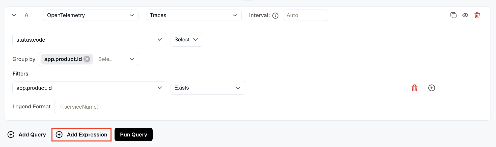

3. Click **Run Query** to run the query and preview the result.

   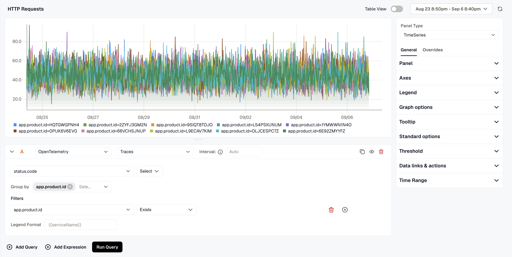

4. Select a **Panel Type** from the dropdown on the right. For example, use **TimeSeries** for trends over time or **Stats** for a single current value.

   The available types are **TimeSeries**, **Stats**, **Gauge**, **Table**, **Pie Chart**, **Bar Chart**, **Histogram**, **Heatmap**, **Alerts List**, **Issues List**, and **Text**.

   Switching the panel type keeps your queries and the last result, so you don't need to run the query again. It also keeps the **Transform** steps, and the **Options** and **Overrides** settings that the new type has. Switching to **Alerts List** or **Issues List** replaces the queries with the list's own query. A query whose **Returns** is **Single value** is changed to **Time series** when you switch to **TimeSeries**, and runs again.

   If the panel can't draw the result, it explains why in place of the chart, and the editor offers a button for each type that can, such as **Switch to table**. On a dashboard, the same panel names the types to try instead. When only some of the queries fit, the panel draws those and notes how many were left out.

5. Under **Options** > **Panel**, enter a **Name** and a **Description** so the panel is easy to identify on the dashboard. The description can run over several lines, and it appears behind the info icon in the panel header. Click **Add link** to link the panel to related resources. See [Adding Links to Dashboards](../adding-links-to-dashboards/).

   Under **Repeat options**, set **Repeat by variable** to render one copy of this panel for each value of the selected variable. Only the first 20 values are used, and the copies show on the dashboard, not in the editor.

   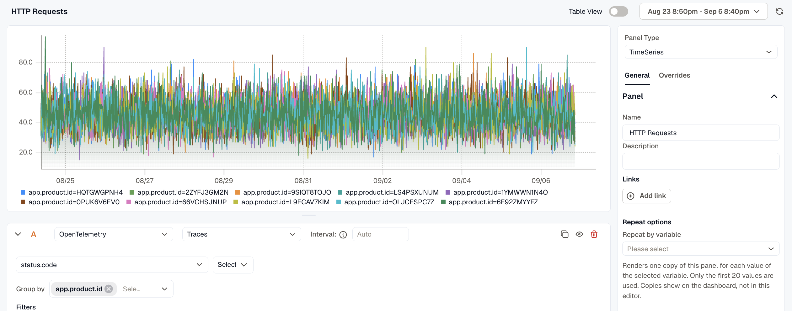

6. Customize the panel with the tabs on the right:

   - **Options** holds the panel's name, **Standard options** such as the unit and color scheme, and the settings for the panel type, such as axes, legend, and thresholds.
   - **Transform** reshapes the query result before the panel draws it, for example to join two queries or sort rows.
   - **Overrides** changes the display of specific fields only, matched by name, a regex, type, label, or query.

   The **Transform** and **Overrides** tabs show how many steps or rules you've added, for example **Overrides (2)**. **Alerts List** and **Issues List** panels have the **Options** tab only. See [Panel Options](../panel-options/) for every setting.

   <Image src={generalSettings} alt="The Options tab with the Panel and Standard options sections" width={289} densities={[1, 2]} />

   <Image src={overridesDropdown} alt="The Overrides tab with the Applies to list open" width={294} densities={[1, 2]} />

7. Toggle **Table View** at the top of the panel editor to switch between the chart and a table of the raw values. Use it to inspect exact data points.

   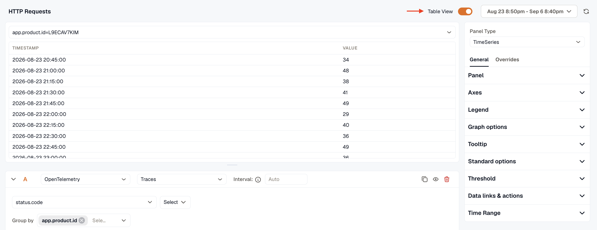

8. Use the time range picker at the top to set the time window for this panel.

   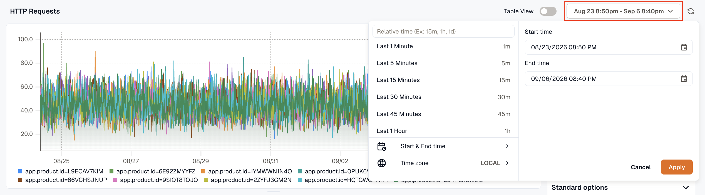

9. Click **Save & Close** to save the panel and return to the dashboard, or **Save** to save without leaving the editor.

   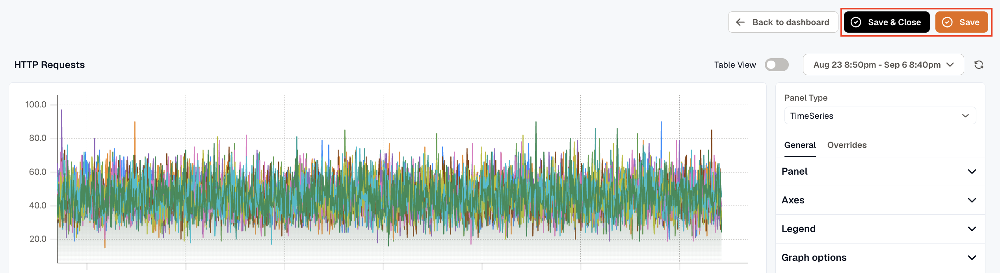

***

## Add a Section

Select **Add section** from the **Add** menu to group related panels under a collapsible heading. This keeps a busy dashboard organized, for example, separating infrastructure panels from application panels.

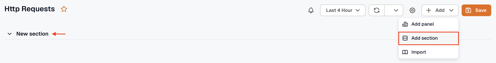

A new section appears on the dashboard with an editable name. Add panels underneath it the same way you'd add any other panel.

***

## Import a Panel

Select **Import** from the **Add** menu to add a pre-built panel to your dashboard without building it from scratch. The **Import Panel** dialog has a tab for each place you can import from:

**Import from Templates:** Select a template from the dropdown to import a panel from a pre-built KloudMate template.

**Import from My Dashboards:** Select an existing dashboard from the dropdown to reuse a panel you've already built. This saves time when the same metric needs to appear across multiple dashboards.

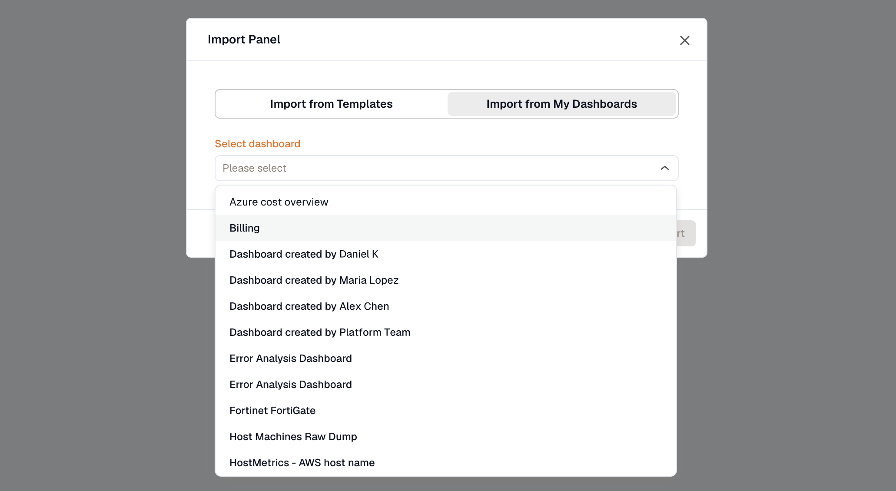

After you import a panel, you can **edit**, **delete**, or **duplicate** it from the panel's more options menu.

## Related

- [Queries and Data Sources](./queries-and-data-sources/)
- [Panel Options](../panel-options/)
- [Managing Panels](../managing-panels/)
