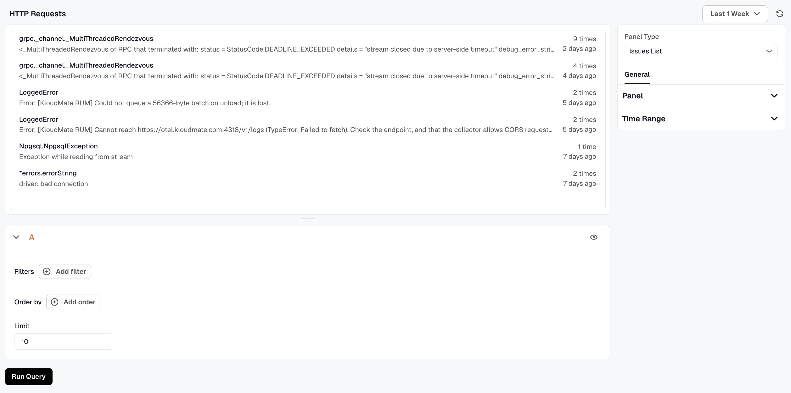

An Issues List panel shows the issues captured in the selected time range, so the errors for a service sit on the same dashboard as its charts. Filter the list to the issues that matter for the dashboard, for example those of one service.

The panel always reads issues. The query editor has no data set picker or aggregation builder: use **Filters** to narrow the list, **Order by** to sort it, and **Limit** to set the page size. The columns are fixed.

The list is paged. The page size is the query's **Limit** (10 for a new panel), and numbered pages appear under the list when there are more issues than fit on one page. On a publicly shared dashboard, the assignee names are left out.

The **Options** tab has the **Panel** and **Time range** sections. The panel has no **Overrides** or **Transform** tab.

## Panel

- **Name** is the title shown on the dashboard.
- **Description** appears behind the info icon in the panel header.
- **Links** connect the panel to related resources, such as a runbook or another dashboard. Click **Add link** to add one.
- **Repeat by variable** draws one copy of the panel for each value of a dashboard variable, up to the first 20 values. Choose a **Direction**, and for horizontal repeats, a **Max per row**. The copies appear on the dashboard, not in the editor.

## Time range

Turn on **Override dashboard time range** to give this panel its own time range. **Time shift** moves the panel's range back in time, for example `-1d` to show the same window yesterday. See [Time Range Expressions and Settings](../time-range-expressions-and-settings/) for the supported units and syntax.

## Related

- [Alert List Panel](../alert-list-panel/)
- [Queries and data sources](../queries-and-data-sources/)
