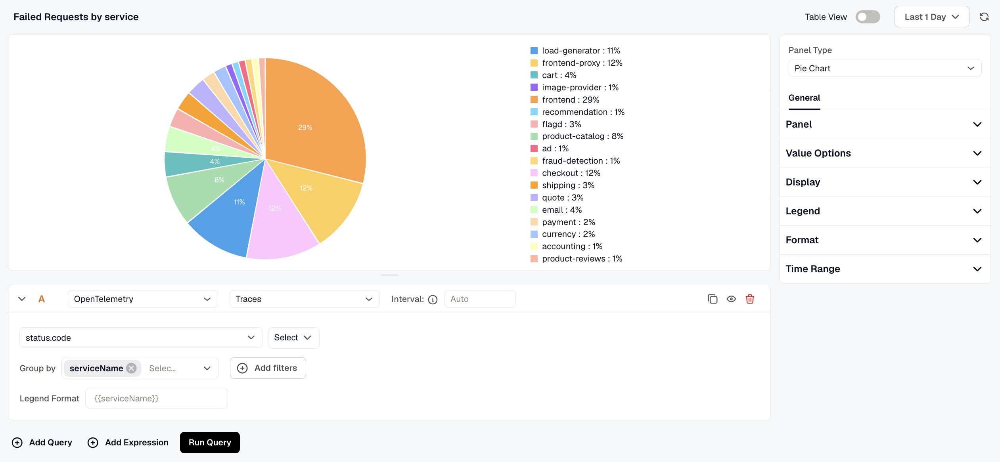
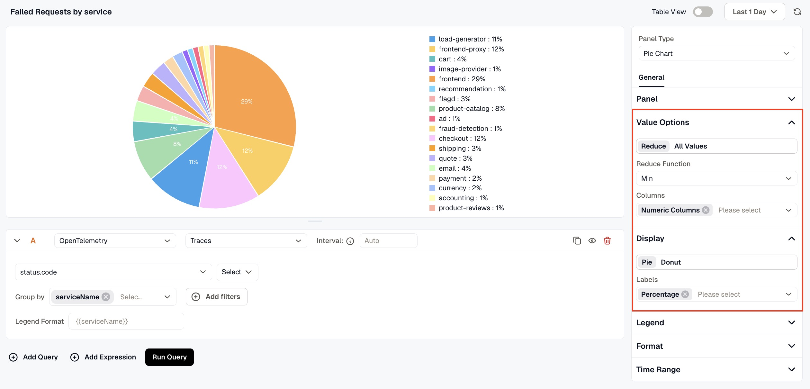

A Pie Chart panel shows how a total splits into parts, as a pie or a donut. Use it for a share at a glance, such as the requests each service handled over the selected time range.

## Panel

- **Name** is the title shown on the dashboard.
- **Description** appears behind the info icon in the panel header.
- **Links** connect the panel to related resources, such as a runbook or another dashboard. Click **Add link** to add one.
- **Repeat by variable** draws one copy of the panel for each value of a dashboard variable, up to the first 20 values. Choose a **Direction**, and for horizontal repeats, a **Max per row**. The copies appear on the dashboard, not in the editor.

## Standard options

**Display name** renames a slice. **Format** sets the unit and how slice values are written. If you leave **Unit** on **Auto**, the panel uses the unit the metric declares. See [Format values and units](../../panel-options/format-and-units/).

## Value options

- **Reduce** turns each series into one slice. **Reduce Function** sets how: **Max**, **Min**, **Last**, **Total**, or **Mean**.
- **All Values** draws one slice per data point. **Limit** caps the number of values each series contributes. Leave it blank to show every value.

**Columns** sets which series appear: **All Columns**, **Numeric Columns**, or the series you pick by name.

Slice shares are rounded for display. Slices take their colors from the same palette as the other charts on the dashboard. Each slice keeps its color by name, so a series keeps its color when the data changes, and no two slices share a color.

## Display

Choose **Pie** or **Donut**. **Labels** sets what's written on each slice: **Value**, **Percentage**, or **Name**.

## Legend

Turn on **Show legend** to add a legend. **Mode** shows it as a **List** or a **Table**, **Placement** puts it on the **Right** or at the **Bottom**, and **Legend Values** adds the **Value** or **Percentage** next to each entry.

## Time range

Turn on **Override dashboard time range** to give this panel its own time range. **Time shift** moves the panel's range back in time, for example `-1d` to show the same window yesterday. See [Time Range Expressions and Settings](../time-range-expressions-and-settings/) for the supported units and syntax.

## Overrides

Use the **Overrides** tab to set **Display name** or **Format** for some series only. See [Overrides](../../panel-options/overrides/).

## Transform

Use the **Transform** tab to reshape the query results before the panel draws them. See [Transformations](../../panel-options/transformations/).

## Related

- [Bar Chart Panel](../bar-chart-panel/)
- [Panel options](../../panel-options/)
- [Queries and data sources](../queries-and-data-sources/)
