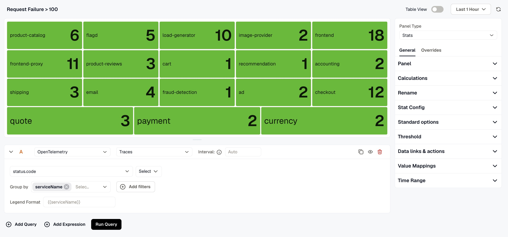
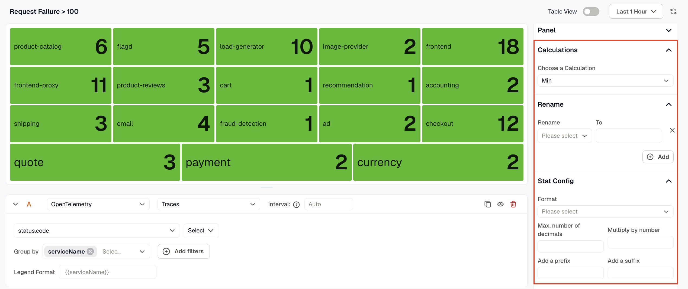
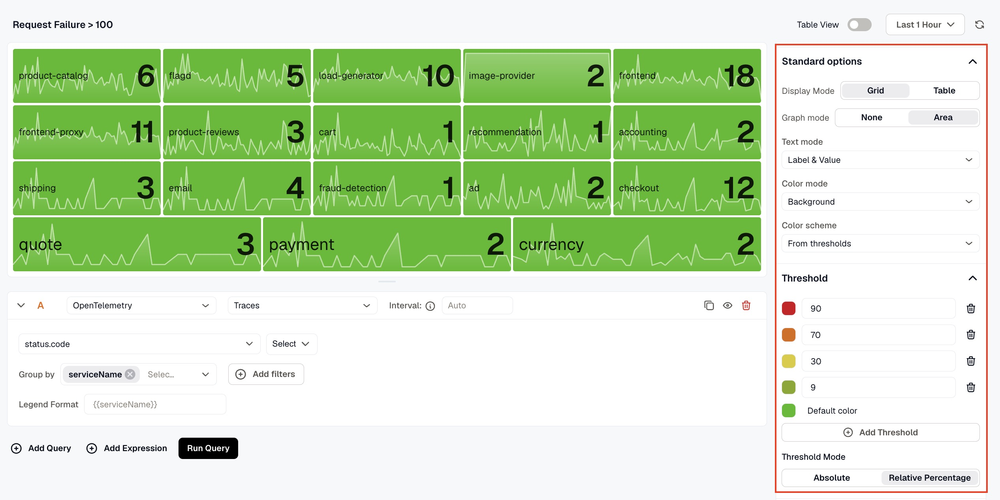
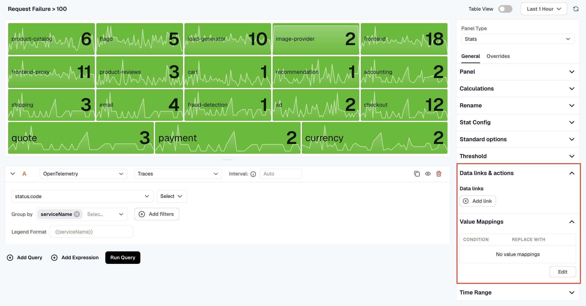

A Stats panel reduces each series to one number and shows it as a tile. Use it for headline values such as the error count over the last hour or the current p95 latency of a service.

## Panel

- **Name** is the title shown on the dashboard.
- **Description** appears behind the info icon in the panel header.
- **Links** connect the panel to related resources, such as a runbook or another dashboard. Click **Add link** to add one.
- **Repeat by variable** draws one copy of the panel for each value of a dashboard variable, up to the first 20 values. Choose a **Direction**, and for horizontal repeats, a **Max per row**. The copies appear on the dashboard, not in the editor.

## Standard options

- **Display name** renames a tile's label.
- **Range** sets the **Min** and **Max** a value is measured against. You need it when a percentage threshold uses **The field's own range** (see [Stat options](#stat-options)).
- **Format** sets the unit and how the number is written. If you leave **Unit** on **Auto**, the tile uses the unit the metric declares.
- **Color scheme** sets the tile color: **Single color**, **From thresholds**, or a palette that gives every tile its own color. A **Single color** takes priority over thresholds.
- **No-data value** sets what a tile shows when its query returns no value, for example `0` for a count that matched nothing. Without it, the tile shows **No Data**.

See [Format values and units](../../panel-options/format-and-units/) and [Colors and value mappings](../../panel-options/colors-and-value-mappings/).

## Calculations

**Choose a Calculation** sets how each series is reduced to one number: **Min**, **Max**, **Mean**, **Total**, **First**, **Last**, or **Count**. When you leave it empty, the tile shows the last value.

To use a different calculation for some series, set **Calculations** in an override. For example, show **Total** for a request count and **Last** for a queue depth on the same panel.

## Rename

Click **Add**, pick a tile label under **Rename**, and type the new label in **To**. The list offers the labels the panel currently draws.

## Stat options

- **Display Mode:** **Grid** lays the tiles out in a grid, **Stack** puts them in a single column, and **Inline** places them side by side in one row.
- **Graph mode:** **None** shows the value alone. **Area** draws a small area chart of the series behind it.
- **Text mode:** what each tile shows: **Auto**, **Value**, **Label**, or **Label & Value**.
- **Color mode:** where the tile's color goes: **None**, **Value** (the number), or **Background** (the whole tile).
- **Threshold range** appears when a threshold uses **Relative Percentage**. It sets what the percentage is measured against:
  - **Whole panel** (the default) runs from the smallest to the largest value of every series behind the panel's tiles, counting every point in the time range and each tile's value.
  - **Per query** does the same with the series of the tile's own query.
  - **The field's own range** uses the **Range** set in Standard options. A tile with no range set stays in the default color.

## Threshold

Thresholds change a tile's color when its value crosses a step, and **Color mode** decides whether the number or the whole tile takes that color. Click **Add Threshold** for each step, and click **Set default color** to choose the color for values below every step. See [Thresholds](../../panel-options/thresholds/).

## Data links & actions

Clicking a tile opens a menu of its data links. Add links to every tile here, or to selected tiles with an override. See [Data links](../../panel-options/data-links/).

## Value mappings

Value mappings replace a tile's value with text and a color. For example, map `0` to `Healthy` in green. See [Colors and value mappings](../../panel-options/colors-and-value-mappings/).

## Time range

Turn on **Override dashboard time range** to give this panel its own time range. **Time shift** moves the panel's range back in time, for example `-1d` to show the same window yesterday. See [Time Range Expressions and Settings](../time-range-expressions-and-settings/) for the supported units and syntax.

## Overrides

Use the **Overrides** tab to change options for some tiles only. A rule picks series with **Applies to** and can set **Display name**, **Range**, **Calculations**, **Format**, **Color scheme**, **Threshold**, **Data links & actions**, and **Value mappings**. See [Overrides](../../panel-options/overrides/).

## Transform

Use the **Transform** tab to reshape the query results before the panel draws them. See [Transformations](../../panel-options/transformations/).

## Related

- [Gauge Panel](../gauge-panel/)
- [Panel options](../../panel-options/)
- [Queries and data sources](../queries-and-data-sources/)
