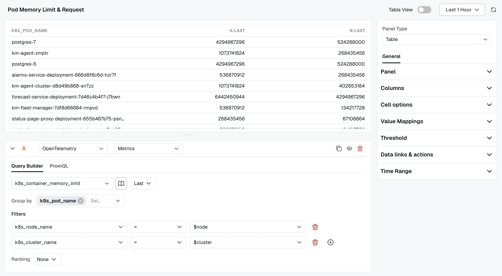
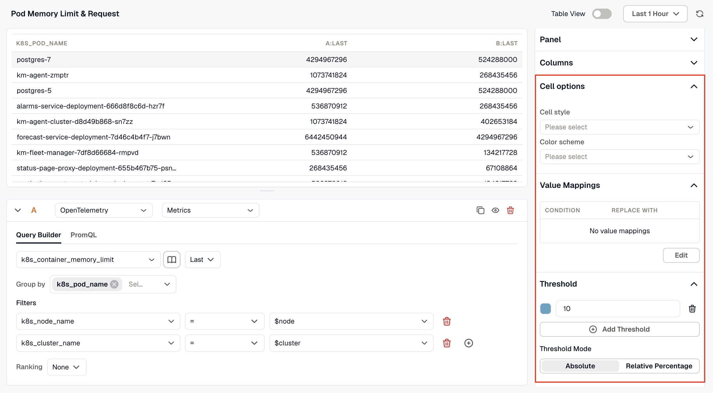

A Table panel shows query results as rows and columns. Use it to compare values across hosts, pods, or services, or to list individual log records and spans.

## Show logs and traces

To list log records or spans, use a Table panel. In the query, choose the **Logs** or **Traces** data set and open the **Records** tab. Each record becomes a row.

Dashboards that had Logs List or Spans List panels show them as Table panels.

## Sort and limit rows

Below the query editor, **Order by** sorts the rows by a column (**Select column**) in the direction you pick under **Order**. **Limit** caps the number of rows. Both apply to every query the table joins.

## Choose a query or series

When the panel returns more than one table, or a query returns several series, a picker at the foot of the panel lets you choose which one to show. The choice isn't saved with the panel.

## Panel

- **Name** is the title shown on the dashboard.
- **Description** appears behind the info icon in the panel header.
- **Links** connect the panel to related resources, such as a runbook or another dashboard. Click **Add link** to add one.
- **Repeat by variable** draws one copy of the panel for each value of a dashboard variable, up to the first 20 values. Choose a **Direction**, and for horizontal repeats, a **Max per row**. The copies appear on the dashboard, not in the editor.

## Standard options

Every option in this section applies to all columns when you set it in the **Options** tab. To set it for one column, use an override.

- **Display name** renames a column. Set it in an override, for example to rename `A:LAST` to `Memory limit`.
- **Range** sets the **Min** and **Max** that a **Gauge** cell fills against. Each column keeps its own range.
- **Format** sets the unit and how numbers are written. A number column with no unit and no format shows plain digits, such as `90331`.
- **Color scheme** sets the color that cells and chips use: **Single color**, **From thresholds**, or a palette.

See [Format values and units](../../panel-options/format-and-units/) and [Colors and value mappings](../../panel-options/colors-and-value-mappings/).

## Cell options

**Cell type** sets how a cell draws. Set it here for every column, or per column with an override, so one table can show a duration as a bar, a status as a chip, and a count as text.

| Cell type | What the cell shows |
| --- | --- |
| **Auto** (default) | The formatted value as text. |
| **Colored text** | The text in the threshold color. |
| **Colored background** | The threshold color behind the cell. Turn on **Apply to entire row** to color the whole row. |
| **Gauge** | A bar that fills its share of the column's **Range**. **Bar** is **Basic** (a flat bar) or **Gradient** (shaded along the threshold steps). **Value** is **Show value** or **Bar only**. |
| **Chip** | Each value in a chip, colored by the column's **Color scheme**. |
| **Links** | The column's data links, drawn in the cell. |
| **JSON** | The value as pretty-printed JSON. |
| **Image** | The image at the URL the value holds. |

A cell type draws only on the columns it suits. **Gauge** needs a number column, **Chip** a text, true or false, or enum column, **Image** a text column, and **JSON** a JSON or text column. Any other column keeps drawing as text.

## Column layout

**Width** sets a fixed column width; leave it on **Auto** to size the column automatically. **Align** places the content **Left**, **Center**, or **Right**. Set both per column with an override.

## Value mappings

Value mappings replace a cell's value with text and a color. They work on text and true or false columns as well as numbers. For example, map `down` to `Down` in red on a status column. The mapping color shows on every cell type, including chips. See [Colors and value mappings](../../panel-options/colors-and-value-mappings/).

## Threshold

Thresholds set the color for **Colored text** and **Colored background** cells, and the shading of a **Gradient** gauge. See [Thresholds](../../panel-options/thresholds/).

## Data links & actions

A cell with one data link turns its value into the link. A cell with several opens a list of them when you click the value. To draw the links inside the cell instead, use the **Links** cell type. See [Data links](../../panel-options/data-links/).

## Time range

Turn on **Override dashboard time range** to give this panel its own time range. **Time shift** moves the panel's range back in time, for example `-1d` to show the same window yesterday. See [Time Range Expressions and Settings](../time-range-expressions-and-settings/) for the supported units and syntax.

## Overrides

Per-column settings live in the **Overrides** tab. A rule picks columns with **Applies to**, for example **Fields with names**, and can set **Display name**, **Range**, **Cell options**, **Column layout**, **Format**, **Color scheme**, **Value mappings**, **Threshold**, and **Data links & actions**. For example, one rule can rename a `duration` column, format it in milliseconds, and draw it as a **Gauge**. See [Overrides](../../panel-options/overrides/).

## Transform

To reorder columns, add an **Organize fields** step in the **Transform** tab. See [Transformations](../../panel-options/transformations/).

## Related

- [Panel options](../../panel-options/)
- [Queries and data sources](../queries-and-data-sources/)
- [Transformations](../../panel-options/transformations/)
