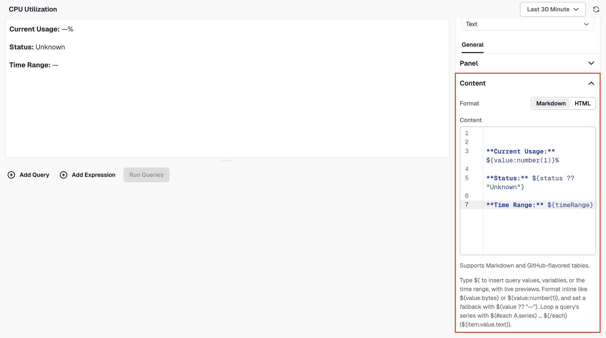

A Text panel adds notes, instructions, or links to a dashboard, written in Markdown or HTML. It can also show live values from its queries, such as "Error rate over the last hour: 0.4%", so a sentence stays current as the data changes.



## Panel

- **Name** is the title shown on the dashboard.
- **Description** appears behind the info icon in the panel header.
- **Links** connect the panel to related resources, such as a runbook or another dashboard. Click **Add link** to add one.
- **Repeat by variable** draws one copy of the panel for each value of a dashboard variable, up to the first 20 values. Choose a **Direction**, and for horizontal repeats, a **Max per row**. The copies appear on the dashboard, not in the editor.

## Standard options

**Format** sets how `.text` tokens are written (see [Format a value](#format-a-value)). **Display name** renames a series. To format one query's values differently from the rest, add an override with **Applies to** set to **Fields returned by query**. See [Format values and units](../../panel-options/format-and-units/).

## Content

**Format** switches the editor between **Markdown** and **HTML**.

- **Markdown** supports GitHub-flavored tables, so you can write headings, lists, links, and tables.
- **HTML** gives you an **HTML** editor and a **CSS** editor, and a **Transparent background** switch. The HTML is rendered in isolation with its own CSS: scripts are removed and embeds are sandboxed. In the CSS, `:host` is the panel body. For example, `:host { height: 100%; display: flex; align-items: center; justify-content: center }` centers the content. Use the theme variables, such as `--km-text`, `--km-text-muted`, `--km-surface`, `--km-border`, and `--km-accent`, instead of fixed hex colors so the panel reads well in both light and dark mode.

## Insert query values and variables

Type `${` in the editor to see the tokens you can insert, each with a live preview of its value. `A` below stands for a query ID.

| Token | Value |
| --- | --- |
| `${A.value.text}` | The last value of query A's first series, formatted |
| `${A.value.numeric}` | The same value as a raw number |
| `${A.last.text}`, `${A.avg.text}`, `${A.min.text}`, `${A.max.text}`, `${A.sum.text}` | The last, mean, minimum, maximum, or total value. Each also has a `.numeric` form. |
| `${A.series.name}` | The legend name of the first series |
| `${A.field.name}` | The column name |
| `${A.field.labels.service}` | The value of a label. Use brackets for a key with dots: `${A.field.labels["k8s.node.name"]}` |
| `${service}` | The value of the dashboard variable `service` |
| `${__from}`, `${__to}` | The start and end of the time range, in epoch milliseconds |
| `${__timeRange}` | The time range |
| `${__workspaceId}` | The workspace ID |

If a query ID and a dashboard variable have the same name, the token reads the query.

To repeat content for every series of a query, use a loop. `item` is the current series, and `item.index` is its position:

```markdown
${#each A.series}
- ${item.value.text}
${/each}
```

Tokens are replaced everywhere in the content, including inside code blocks. To write a literal `${`, escape it as `$${`.

### Format a value

A `.text` token is written in the series' unit, using the panel's **Format** and any overrides that match the series. For example, if query A returns memory in bytes, `${A.value.text}` shows it in gigabytes or megabytes, while `${A.value.numeric}` shows the raw byte count.

To format a single token, add a formatter after a colon, for example `${A.value.numeric:bytes}`. Some formatters take a decimal places argument, such as `${A.value.numeric:number(1)}`. A value that isn't a number passes through unchanged.

- Numbers: `number`, `locale`, `percent`, `currency`
- Data: `bytes`, `bytes_iec` (KiB and MiB), `bytes_rate`, `bits`
- Durations: `duration` (from milliseconds), `duration_sec` (from seconds)
- Dates and times: `datetime`, `datetime_utc`, `date`, `time`, `relative`

The string formats `csv`, `pipe`, `json`, and `raw` are also available.

### Missing values and fallbacks

A token that doesn't resolve, for example because the query returned no data, renders as `—` and the rest of the panel still draws. To show something else, add a fallback with `??`:

```markdown
Error rate: ${A.value.text ?? "n/a"}
```

## Overrides

Use the **Overrides** tab to set **Display name** or **Format** for some series only. See [Overrides](../../panel-options/overrides/).

## Transform

Use the **Transform** tab to reshape the query results before the tokens read them. See [Transformations](../../panel-options/transformations/).

## Related

- [Panel options](../../panel-options/)
- [Queries and data sources](../queries-and-data-sources/)
