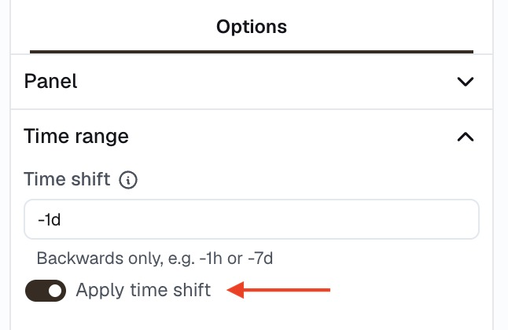
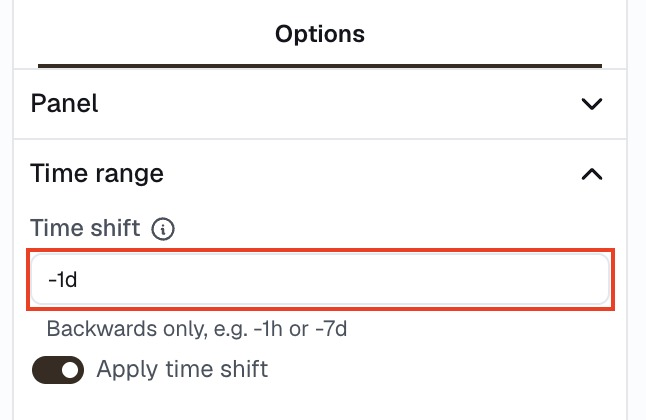

## Time Range Expressions

Time range expressions let you manually configure the time range of dashboards and panels using a simple syntax instead of selecting fixed dates. This is useful when you want dynamic time windows that always stay relative to the current time.

- **Supported Units**
  - `s`: Seconds
  - `m`: Minutes
  - `h`: Hour
  - `d`: Days
  - `w`: Weeks
  - `M`: Months
- **Supported Operators**
  - `/`: Start of (day, month, week, etc.)
  - `\`: End of (day, month, week, etc.)
  - `-`: Subtract time
  - `+`: Add time
- **Keywords**
  - `now`: Current time

**Examples:**

| **Expression** | **From** | **To**   |
| -------------- | -------- | -------- |
| Last 5 minutes | now-5m   | now      |
| Yesterday      | now-1d/d | now-1d\d |
| The day so far | now/d    | now      |
| This week      | now/w    | now\w    |

:::info
You can enter the **From** and **To** expressions in the time picker’s **Start & End time** fields. Click **Apply** to apply the custom range to the panel or dashboard.
:::

## Time Range Settings

Panel-level time settings are in the **Time range** section of the **Options** tab in the panel editor. By default, every panel follows the dashboard's time range.

### Apply a time shift

A time shift moves a panel's start and end time back by a fixed amount, so the panel shows an earlier window than the rest of the dashboard. For example, put a panel with a `-1d` shift next to an unshifted one to compare today's traffic with yesterday's.

1. Enter a **Time shift**, for example `-1d`.
2. Turn on **Apply time shift**.

- **Supported operators:** `-` (subtract time). The shift only goes backwards.
- **Supported units:** Same as dashboard time range expressions

**Examples:**

| **From** | **To** | **Time Shift** | **Applied From** | **Applied To** |
| -------- | -------- | -------------- | ---------------- | -------------- |
| now-1d   | now      | **-5h**        | now-1d-5h        | now-5h         |
| now-1d/d | now-1d\d | **-1d**        | now-1d/d-1d      | now-1d\d-1d    |

