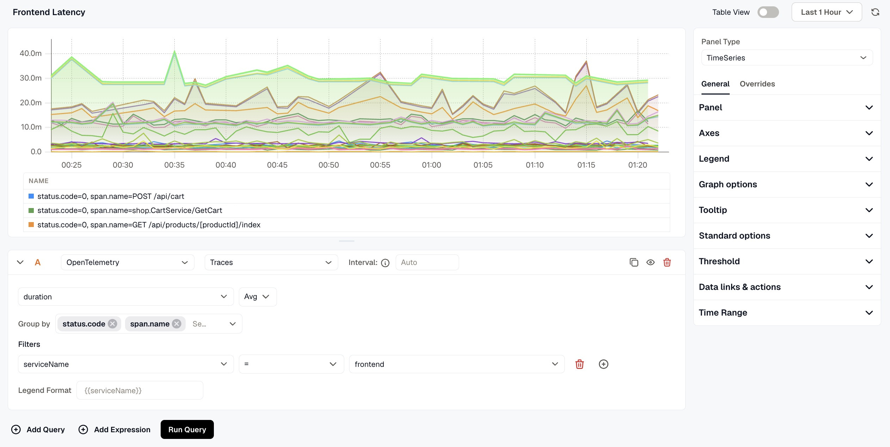
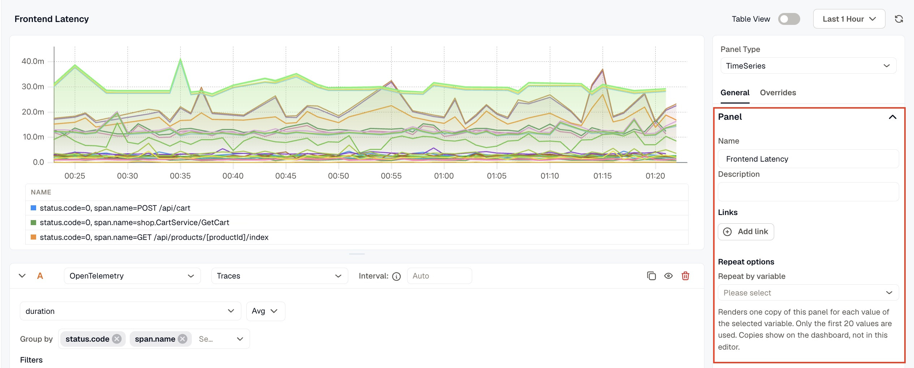
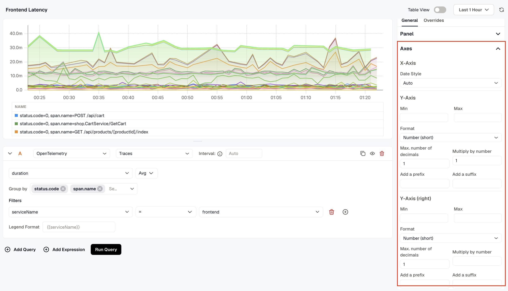
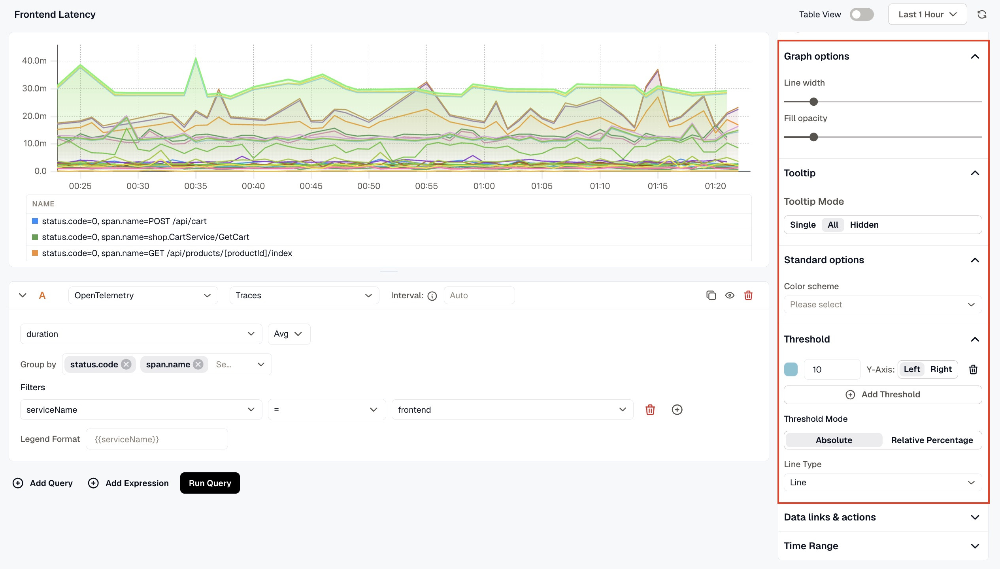
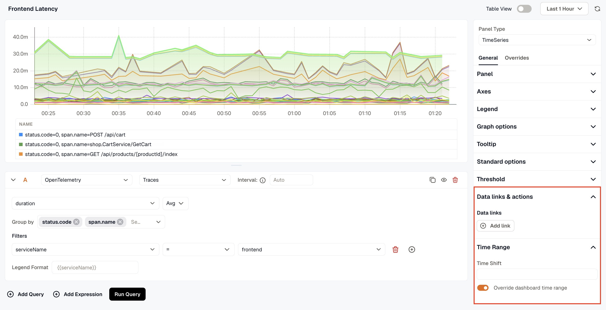

A TimeSeries panel plots values over time, one line per series. Use it to follow a trend, such as request rate or CPU usage, and to compare several series on the same time axis.

## Panel

- **Name** is the title shown on the dashboard.
- **Description** appears behind the info icon in the panel header.
- **Links** connect the panel to related resources, such as a runbook or another dashboard. Click **Add link** to add one.
- **Repeat by variable** draws one copy of the panel for each value of a dashboard variable, up to the first 20 values. Choose a **Direction**, and for horizontal repeats, a **Max per row**. The copies appear on the dashboard, not in the editor.

## Standard options

**Format** sets the unit and how numbers are written. If you leave **Unit** on **Auto**, the panel uses the unit the metric declares. **Color scheme** sets the line colors: a palette gives every series its own color, and **From thresholds** colors each line by the threshold step its last value falls in.

**Display name** renames a series. It's most useful in an override, where it renames only the series the rule matches. See [Format values and units](../../panel-options/format-and-units/) and [Colors and value mappings](../../panel-options/colors-and-value-mappings/).

## Axes

- **X-Axis:** **Date style** sets how times are written along the axis. **Auto** picks a format from the length of the time range.
- **Y-Axis:** **Min** and **Max** pin the ends of the left axis instead of fitting it to the data.
- **Y-Axis (right):** **Min** and **Max** for the right axis. The right axis appears when you place a series on it with [Axis placement](#axis-placement).

Each Y axis writes its labels in the unit of the series drawn on it. For example, with request rate on the left and memory on the right, the right axis reads in bytes.

## Legend

**Mode** shows the legend as a **Table** or a **List**, or turns it **Off**. **Values** adds summary values next to each series: **Min**, **Max**, **Mean**, **Total**, **First**, **Last**, or **Count**.

## Graph options

- **Line width** runs from 0 to 10, with a default of 1.5.
- **Fill opacity** runs from 0 to 100, with a default of 15. At 0, the panel draws lines with no fill.
- **Missing values** sets what a line does where its series has no data point. **Connect** (the default) joins the points on either side, **Leave a gap** breaks the line, and **Show as zero** drops it to zero.

When series report at different times, each one has gaps at the others' timestamps. **Connect** draws through those gaps, so it's usually the right choice when you compare series from different sources.

To change graph options for one series only, such as a thicker line for the series that matters most, set **Graph options** in an override.

## Tooltip

Choose what the tooltip shows when the cursor is over the chart: **Single** shows one series, **All** shows every series at that time, and **Hidden** turns the tooltip off.

### Pin the tooltip and create an alert

Click a point to pin the tooltip in place. The pinned tooltip lists the [data links](../../panel-options/data-links/) of the series you clicked. Click elsewhere, or scroll the page, to unpin it.

On a saved dashboard, the pinned tooltip offers **Create alert at this value**. It opens a new alert rule built from the panel's query, with the clicked value as the threshold. See [Create alerts](../../../../alerts/create-alerts/).

## Axis placement

Choose **Auto**, **Left**, or **Right**. Set here, it applies to every series. To move a single series to the right axis, add an override with **Axis placement** set to **Right**. For example, put latency on the right axis and request count on the left.

## Threshold

Thresholds draw as horizontal lines across the chart. Click **Add Threshold** for each step, pick its color, and use its **Y-Axis** toggle to draw it against the left or right axis. Then choose the line style with **Line Type**: **Off**, **Line**, or **Lines (Dashed)**. With **Color scheme** set to **From thresholds**, the steps also color the lines. See [Thresholds](../../panel-options/thresholds/).

## Data links & actions

Add data links to every series here, or to selected series with an override. See [Data links](../../panel-options/data-links/).

## Value mappings

Value mappings replace values in the tooltip, on the Y axis, and in the legend values. For example, map `1` to `Up` and `0` to `Down` on a health check series. See [Colors and value mappings](../../panel-options/colors-and-value-mappings/).

## Annotations

Mark firing alerts, issues, custom annotations, or the results of your own query on the chart, and choose whether each source draws as a **Band** or a **Point**. See [Annotations](../../annotations/).

## Time range

Turn on **Override dashboard time range** to give this panel its own time range. **Time shift** moves the panel's range back in time, for example `-1d` to show the same window yesterday.

See [Time Range Expressions and Settings](../time-range-expressions-and-settings/) for the supported units and syntax.

## Overrides

Use the **Overrides** tab to change options for some series only. A rule picks series with **Applies to**, for example **Fields with names**, and can set **Display name**, **Format**, **Graph options**, **Color scheme**, **Axis placement**, **Threshold**, **Data links & actions**, and **Value mappings**. For example, set **Color scheme** to **Single color** to give one series a fixed color. See [Overrides](../../panel-options/overrides/).

## Transform

Use the **Transform** tab to reshape the query results before the panel draws them. See [Transformations](../../panel-options/transformations/).

## Related

- [Panel options](../../panel-options/)
- [Queries and data sources](../queries-and-data-sources/)
- [Annotations](../../annotations/)
