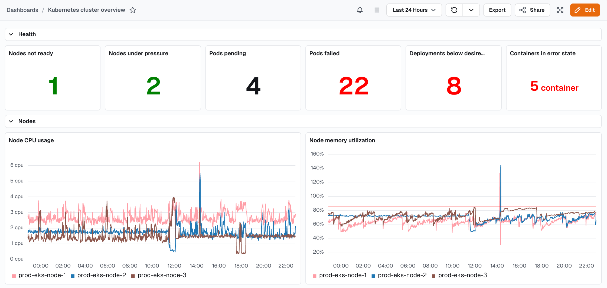
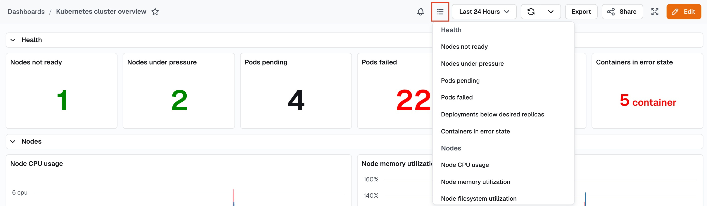
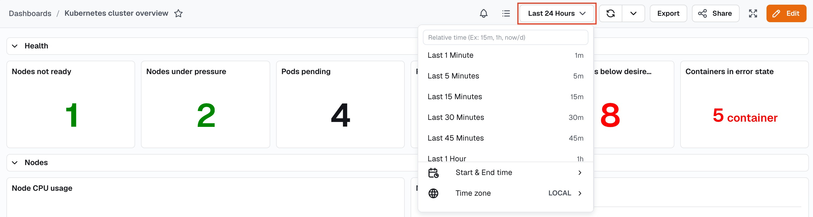
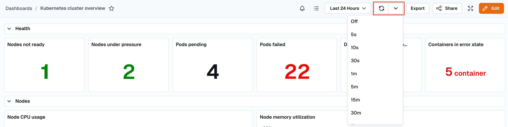
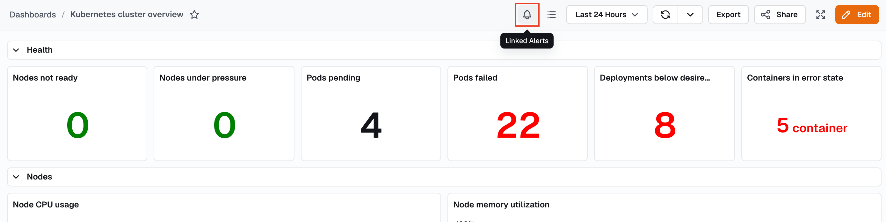
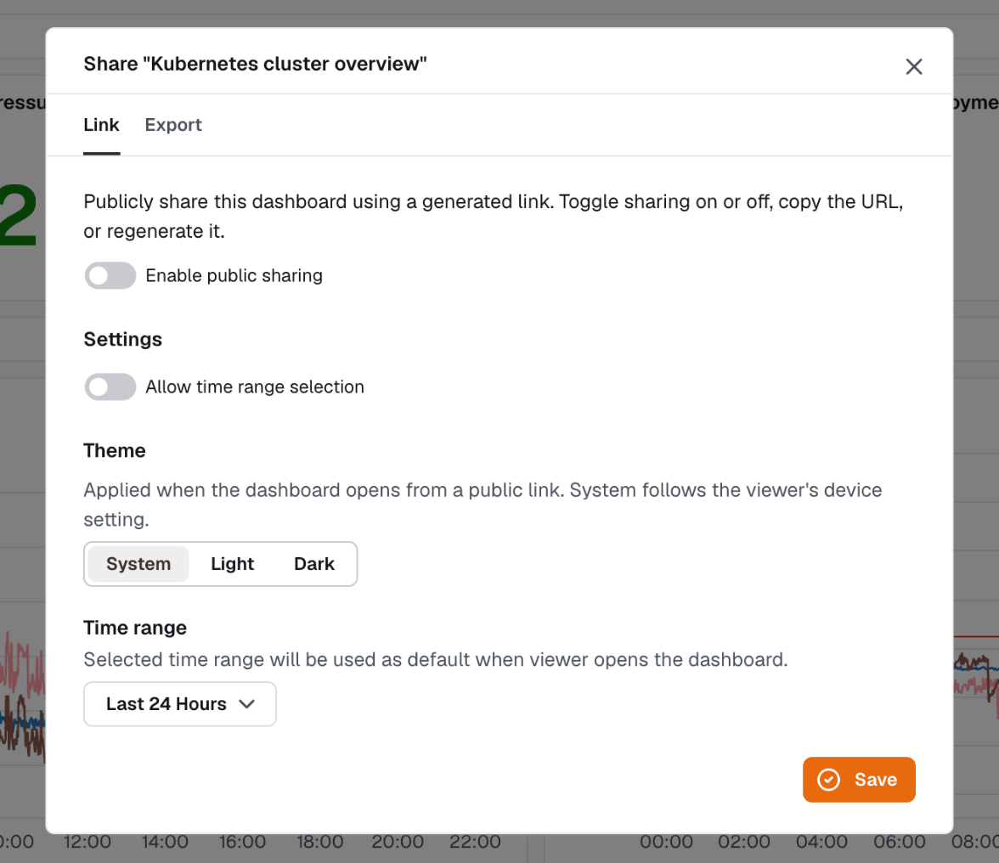

---

title: "Dashboard Details"
description: "Understand the dashboard details view, toolbar controls, and sharing options."
sidebar:
  order: 3
---
Opening a dashboard takes you to the Dashboard Details view where all your panels are displayed together. Every panel updates with the selected time range and refresh setting.

## Toolbar

The toolbar at the top provides the following controls:

- **Panel list:** Opens a dropdown listing all panels on the dashboard, grouped by section. Click a panel to jump to it without scrolling.

- **Time range picker:** Sets the time window applied to all panels. Choose a relative option, type one such as `15m` or `1h` in the **Relative time** field, or use **Start & End time** to set a custom range. You can also set the **Time zone**.

- **Refresh icon:** Manually refreshes all panels to pull the latest data.
- **Refresh interval dropdown:** Sets an automatic refresh interval so the dashboard stays current. 

- **Export:** Exports the dashboard.
- **Share:** Opens the Share Dashboard dialog, with options for a public link or a copy of the dashboard's JSON.
- **Fullscreen:** Expands the dashboard to fullscreen view.
- **Edit:** Enters edit mode to modify the dashboard and its panels.

## Viewing Alerts in Dashboards

KloudMate integrates alerts directly into your dashboard visualizations, providing immediate context on system health alongside your metrics.

- **Linked Alerts:** Click the bell icon in the toolbar to open the Linked Alerts drawer, which lists every alert linked to a panel in the dashboard.
- **Panel Alert Indicators:** If a panel is linked to an alert and the alert is currently **Firing**, a status indicator will appear on the panel header.
- **Alerts Drawer:** Clicking on an alert indicator opens the Alerts Drawer without leaving the dashboard context. This drawer displays information for alerts in the **Firing** state:
  - The current evaluation state of the alert.
  - The conditions that triggered it.

## Sharing a Dashboard

To open the Share Dashboard dialog, click **Share** in the dashboard's toolbar, or in the more options (⋯) menu in the dashboard list.

### Public link

Generates a link that anyone can use to view the dashboard without logging in to KloudMate.

- **Enable public sharing:** Toggle this on to activate the public link.
- **Allow time range selection:** Toggle this on to let viewers change the time range when viewing the shared dashboard.
- **Theme:** Sets the theme the dashboard opens in from a public link: **System**, **Light**, or **Dark**. **System** follows the viewer's device setting.
- **Time range:** Sets the default time range viewers will see when they open the shared link.
- **Variables:** Shown when the dashboard has variables. Picks the value of each variable for the public link. Viewers can't change them. A public link opens on the values picked here, whatever the dashboard's defaults or anyone's own picks. A variable you don't pick here uses its default.

Click **Save** to apply the settings. The shared link can be managed from the **Public Dashboards** page.

A public dashboard draws no annotations, and its panel menu has no **Create alert**.

### Export

Open the **Export** tab to get the dashboard as YAML, then click **Copy** or **Download**. Import the file into another workspace to recreate the dashboard with the same layout and no manual rebuild. See [Importing a Dashboard](../#importing-a-dashboard) and [Config as code](../../../platform/config-as-code/).
