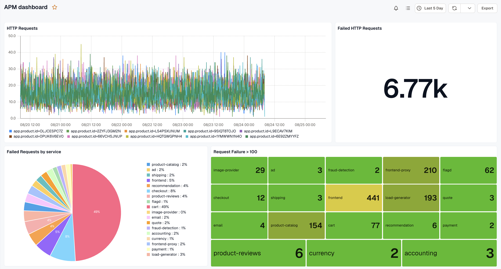
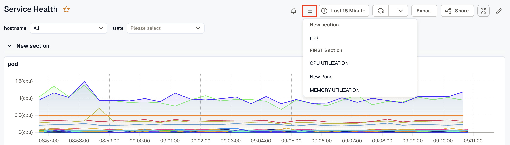
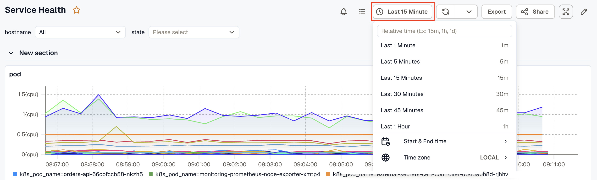
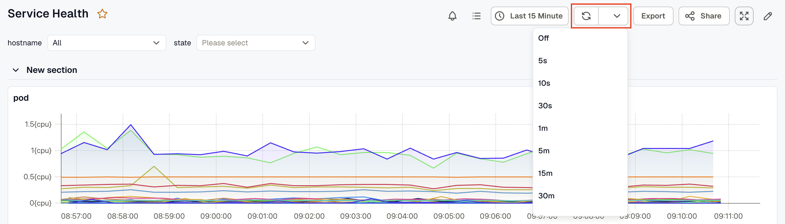
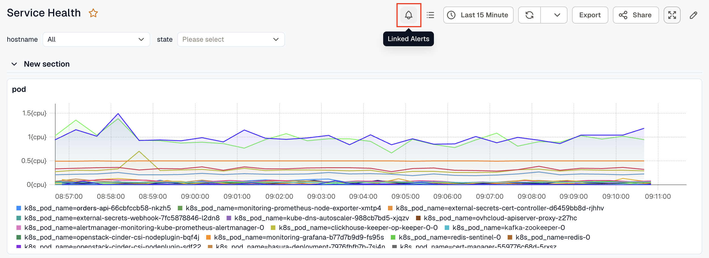
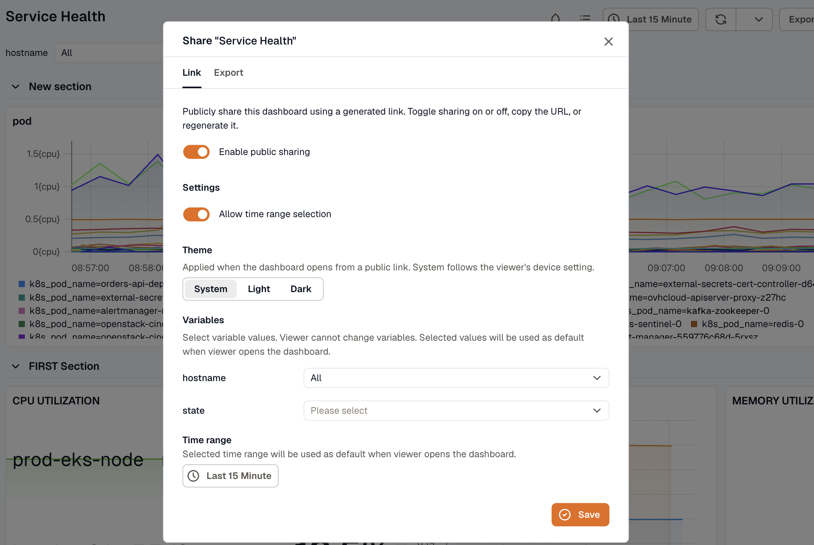
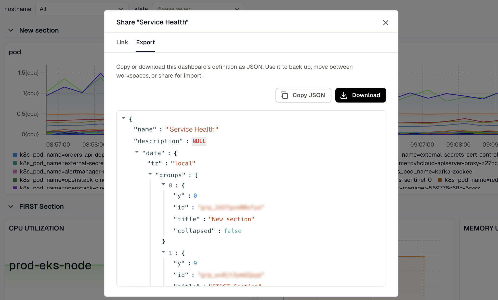

---

title: "Dashboard Details"
description: "Understand the dashboard details view, toolbar controls, and sharing options."
sidebar:
  order: 3
---
Opening a dashboard takes you to the Dashboard Details view where all your panels are displayed together. Every panel updates with the selected time range and refresh setting.

## Toolbar

The toolbar at the top provides the following controls:

- **Panel list:** Opens a dropdown listing all panels on the dashboard, letting you quickly jump to a specific panel without scrolling.

- **Time range picker:** Sets the time window applied to all panels. Choose a relative option or use Start & End time to set a custom range. You can also set the Timezone.

- **Refresh icon:** Manually refreshes all panels to pull the latest data.
- **Refresh interval dropdown:** Sets an automatic refresh interval so the dashboard stays current. 

- **Export:** Exports the dashboard.
- **Share:** Opens the Share Dashboard dialog, with options for a public link or a copy of the dashboard's JSON.
- **Fullscreen:** Expands the dashboard to fullscreen view.
- **Edit:** Enters edit mode to modify the dashboard and its panels.

## Viewing Alerts in Dashboards

KloudMate integrates alerts directly into your dashboard visualizations, providing immediate context on system health alongside your metrics.

- **Linked Alerts:** Click the bell icon in the toolbar to open the Linked Alerts drawer, which lists every alert linked to a panel in the dashboard.
- **Panel Alert Indicators:** If a panel is linked to an alert and the alert is currently **Firing**, a status indicator will appear on the panel header.
- **Alerts Drawer:** Clicking on an alert indicator opens the Alerts Drawer without leaving the dashboard context. This drawer displays information for alerts in the **Firing** state:
  - The current evaluation state of the alert.
  - The conditions that triggered it.

## Sharing a Dashboard

To open the Share Dashboard dialog, click **Share** in the dashboard's toolbar, or in the more options (⋯) menu in the dashboard list.

### Public link

Generates a link that anyone can use to view the dashboard without logging in to KloudMate.

- **Enable public sharing:** Toggle this on to activate the public link.
- **Allow time range selection:** Toggle this on to let viewers change the time range when viewing the shared dashboard.
- **Time range:** Sets the default time range viewers will see when they open the shared link.

Click **Save** to apply the settings. The shared link can be managed from the **Public Dashboards** page.

### Copy JSON

Open the **Export** tab and click **Copy JSON** to copy the dashboard's JSON definition, or **Download** to save it as a file. Use it to recreate the dashboard in another workspace with the same layout and no manual rebuild.

To import the JSON, or to read what it contains, see [Dashboard JSON and API](../dashboard-json-and-api/).
