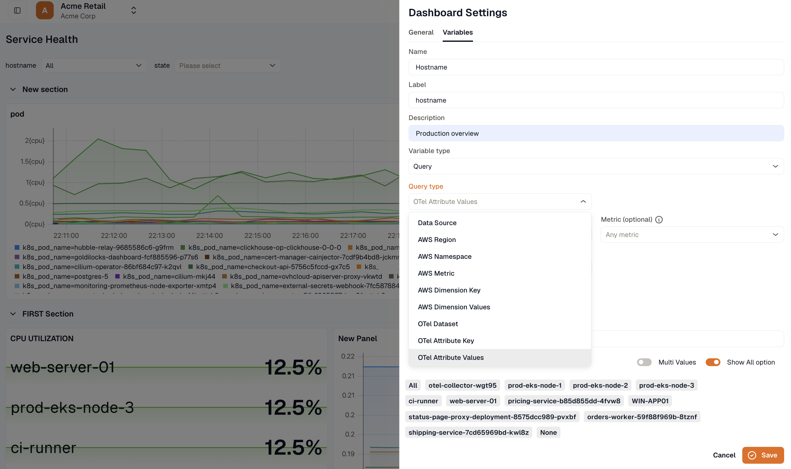

Variables let one dashboard cover many views. For example, a `service` variable puts a dropdown at the top of the dashboard, and every panel that uses it filters to the service a viewer picks. A data source variable switches every CloudWatch panel between your AWS accounts.

## Add a variable

1. Open the dashboard, click **Edit**, then click **Settings** and open the **Variables** tab.
2. Enter a **Name**, a **Label**, and an optional **Description**. The name can contain only letters and numbers, with no spaces. The label is what viewers see on the dashboard.
3. Choose a **Variable type**, and fill in the fields for that type.
4. Check the **Preview of values** to see what viewers will be able to pick.
5. Click **Save**.

To use a variable in a panel, edit the panel's query and select the variable in place of a fixed value. Variables are listed above the other values in each field's picker. A data source variable is listed at the top of the **Data source** picker.

## Variable types

- **Query** takes its values from a data source. Pick the **Data source**, then a **Query type**.
- **Data source** points panels at another account of the same type. The **Data source type** is **CloudWatch**, so a viewer can switch every CloudWatch panel between AWS accounts. A panel bound to the variable stays on that type, because a query written for one type can't run against another.
- **Text box** lets viewers type a value on the dashboard. The **Default value** is used until someone types another.

### Query types for KloudMate

| Query type | Values |
| --- | --- |
| **Data set** | The data sets, such as Metrics, Logs, and Traces. A viewer picks one. |
| **Attribute key** | Attribute keys, such as `service.name` or `host.name`. |
| **Attribute values** | The values of one **Attribute**, such as every `service.name`. Set **Metric (optional)** to read the values from one metric's series only, which is useful when a label exists on a different metric from the ones your panels chart. Leave it on **Any metric** to look across every metric. |

### Query types for CloudWatch

| Query type | Values |
| --- | --- |
| **Region** | AWS regions. |
| **Namespace** | CloudWatch namespaces, such as `AWS/EC2`. |
| **Metric** | The metrics in a namespace. Needs a region and a namespace. |
| **Dimension key** | Dimension keys, such as `InstanceId`. |
| **Dimension values** | The values of a dimension, such as every instance ID. |

## Shape the list of values

Query variables have these settings:

- **Sort:** **None** keeps the order the data source returned, which puts the most common values first. **A to Z** and **Z to A** sort alphabetically.
- **Regex (optional):** Values that don't match are dropped, so `/^prod-/` keeps only the production values. A capture group shows part of each value: `/^prod-(.*)/` turns `prod-eu-1` into `eu-1`.
- **Match on:** Whether the regex is tested against each option's **Label** or its **Value**.
- **Multi value:** Lets viewers select more than one value. It's offered for **Attribute key**, **Attribute values**, **Dimension key**, and **Dimension values**.
- **Show All option:** Adds an **All** choice at the top of the dropdown that matches every value. It's offered only where the data source can match every value at once, which is **Dimension values** on CloudWatch.

Every variable also has **None** at the bottom of its dropdown. Selecting **None** removes that filter from the query entirely, rather than filtering on an empty value. This also applies to a filter inside an OR group and to a filter in an aggregation.

## How a viewer's selection is kept

When someone opens a dashboard, each variable starts on the first of these that applies:

1. The value in the link. A shared link carries the sender's selection, so it opens on the same view.
2. The value last chosen for this dashboard in this browser.
3. The variable's default value.

The value in the link is the `var-<name>` URL parameter, for example `?var-service=checkout`. A multi-value variable takes a comma-separated list, such as `?var-service=checkout,payments`. Picking a value in the variable bar updates the parameter.

The last pick is remembered for each dashboard, in this browser only.

Picking a value never changes the saved dashboard, in view mode or in edit mode, and saving the dashboard doesn't save your picks. Viewers can change variables without edit access, and their picks don't affect anyone else. To change what a **Text box** variable starts on, set its **Default value** in the variable settings.

A [dashboard link](../adding-links-to-dashboards/) with **Add variables** turned on, the **Export** button in the dashboard toolbar, and scheduled reports all use each variable's current value.

A public link opens on the values picked in its own settings. See [Public link](../dashboard-details/#public-link).

**Share** → **Export** copies the saved dashboard definition, so its JSON carries each variable's default and none of your picks.

When you create a dashboard from an AWS template, the **Default Region** you pick becomes the default value of the dashboard's region variable.

***

## Related

- [Managing Dashboards](../managing-dashboards/)
- [Create a Dashboard](../create-a-dashboard/)
- [Dashboard JSON and API](../dashboard-json-and-api/)
