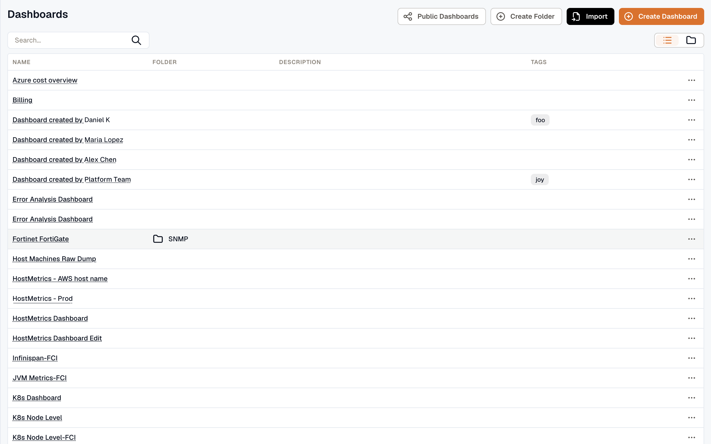
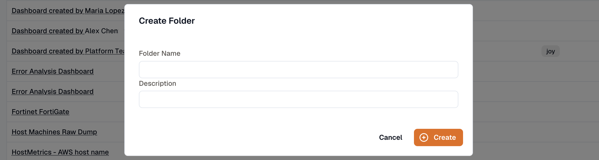
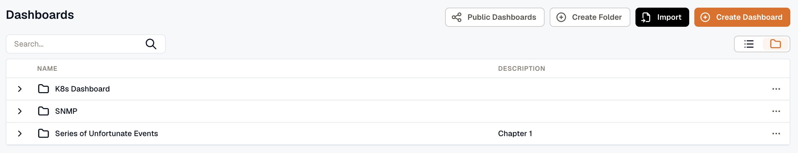
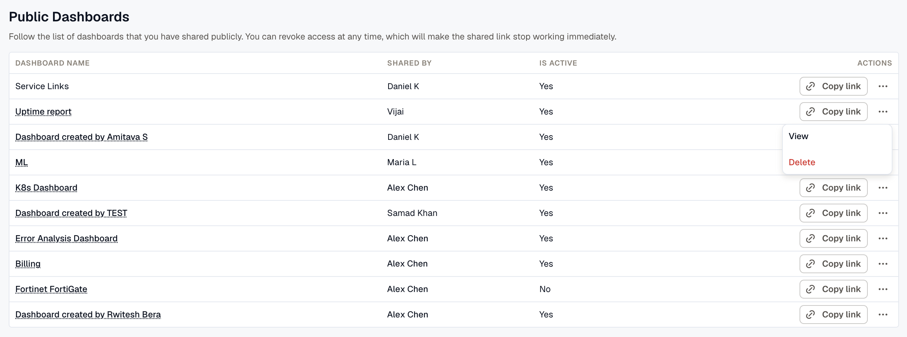
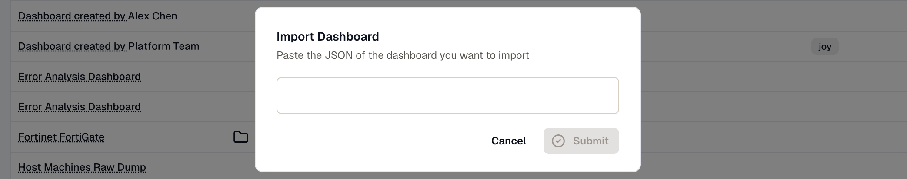

Build dashboards to track the metrics that matter to your application and business. Open **Dashboards** in the left navigation to see all of them. To build one, see [Create a dashboard](./create-a-dashboard/).

## Find a dashboard

Search by dashboard or folder name. Switch to **Folders** to group dashboards by folder, or to **List** to see them all in one list.

To move, share, or delete a dashboard, open its more options (⋯) menu and click **Move to folder**, **Share**, or **Delete**. See [Sharing a Dashboard](./dashboard-details/#sharing-a-dashboard).

### Tag dashboards

Click a dashboard's **Tags** cell to add a tag or create a new one. A tag is saved exactly as you type it. A dashboard can't carry the same tag twice in different cases, so if it already has `Prod`, adding `prod` keeps `Prod`.

To show only dashboards with certain tags, click **Tags** in the toolbar and pick one or more. A dashboard must carry every tag you pick. The filter ignores case and lists each tag once, under the spelling first used in the workspace.

[Dashboard links](./adding-links-to-dashboards/) match a tag's exact spelling, case included, so keep one spelling for each tag.

## Organize dashboards in folders

Group related dashboards in a folder, for example one folder per team or service. Folders are optional.

1. Click the arrow next to **Create Dashboard**, then click **Create folder**.

   

2. Enter a **Name** and an optional **Description**, then click **Create**.

To put a dashboard in a folder, open its more options (⋯) menu, click **Move to folder**, and pick the folder. Pick **Ungrouped** to take it out of a folder.

To rename or remove a folder, use its more options (⋯) menu to **Edit folder** or **Delete folder**. Deleting a folder doesn't delete its dashboards. They move to **Ungrouped**.

## Manage public dashboards

A public link gives read-only access to people outside your workspace, such as stakeholders or external teams, without a KloudMate login. To create one, see [Sharing a Dashboard](./dashboard-details/#sharing-a-dashboard).

To manage your public links, click **Public Dashboards**. From there you can copy a link, open it to see what others see, or click **Delete** to revoke it. A deleted link stops working immediately.

## Importing a Dashboard

Import a dashboard from its JSON to copy it from one workspace to another, or to reuse a dashboard someone shared with you. To get the JSON of an existing dashboard, see [Sharing a Dashboard](./dashboard-details/#sharing-a-dashboard).

1. Copy the dashboard's JSON.
2. On the Dashboards page, click **Import**.
3. Paste the JSON and click **Submit**.

To create, update, or delete dashboards from a script instead, or to read the JSON format, see [Dashboard JSON and API](./dashboard-json-and-api/).

## User Permissions

| **Role**      | **Permissions**                                |
| ------------- | ---------------------------------------------- |
| **Admin**     | Create, edit, or delete dashboards and folders. Turn a public link on or off. |
| **Developer** | Create, edit, or delete dashboards and folders |
| **Viewer**    | View dashboards and folders only |
