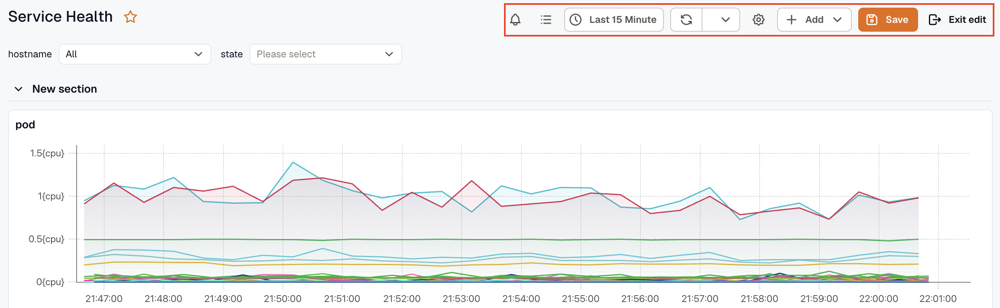
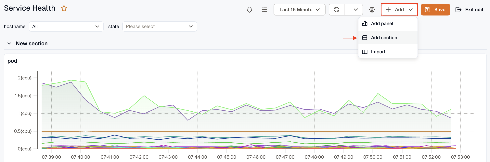
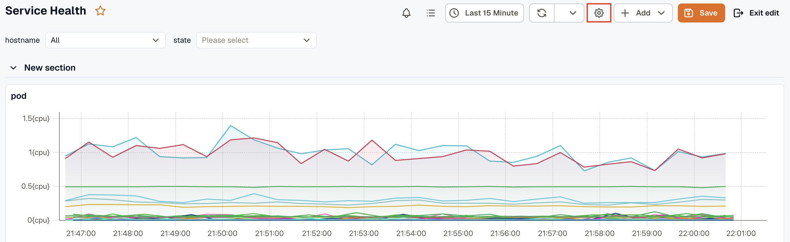
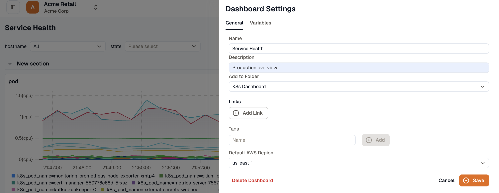

## Entering Edit Mode

To make any changes to a dashboard, including editing panels, updating settings, or reorganizing layout, click the **Edit** icon at the top-right corner of the dashboard. This switches the toolbar to edit mode, showing Settings, Add Panel, Save, and Exit edit.

Click **Exit edit** to return to view mode without saving, or **Save** to save your changes.

## Adding Sections to a Dashboard

Sections group related panels under a collapsible header, so long dashboards stay easy to scan. In edit mode, click **Add**, then select **Add section**.

Click the section header to expand or collapse the panels underneath it, and drag panels into it to organize them.

## Dashboard Settings

Click the **Settings** icon in the toolbar while in edit mode to open the Dashboard Settings panel. From here you can:

### General tab

- **Name:** Update the dashboard name.
- **Description:** Add or edit a description.
- **Add to Folder:** Move the dashboard into a folder to keep it organized with related dashboards.
- **Links:** Add external links that appear as quick-access buttons on the dashboard (for example, a link to a related service’s traces page). Click **Add Link** to add one.
- **Tags:** Add tags to make the dashboard easier to search and categorize.
- **Delete Dashboard:** Permanently delete the dashboard.

Click **Save** to apply changes or **Cancel** to discard them.

### Variables tab

Use the **Variables** tab to add variables, such as a service or an AWS account, that viewers can switch from a dropdown on the dashboard. See [Dashboard Variables](../dashboard-variables/).
